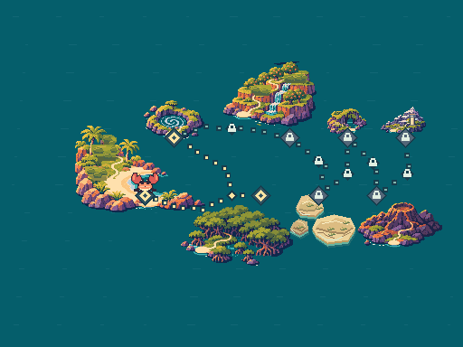
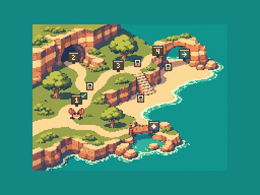
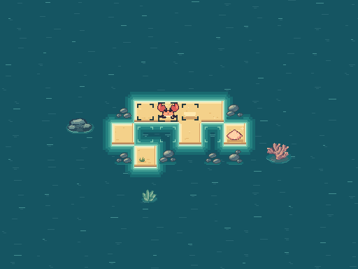
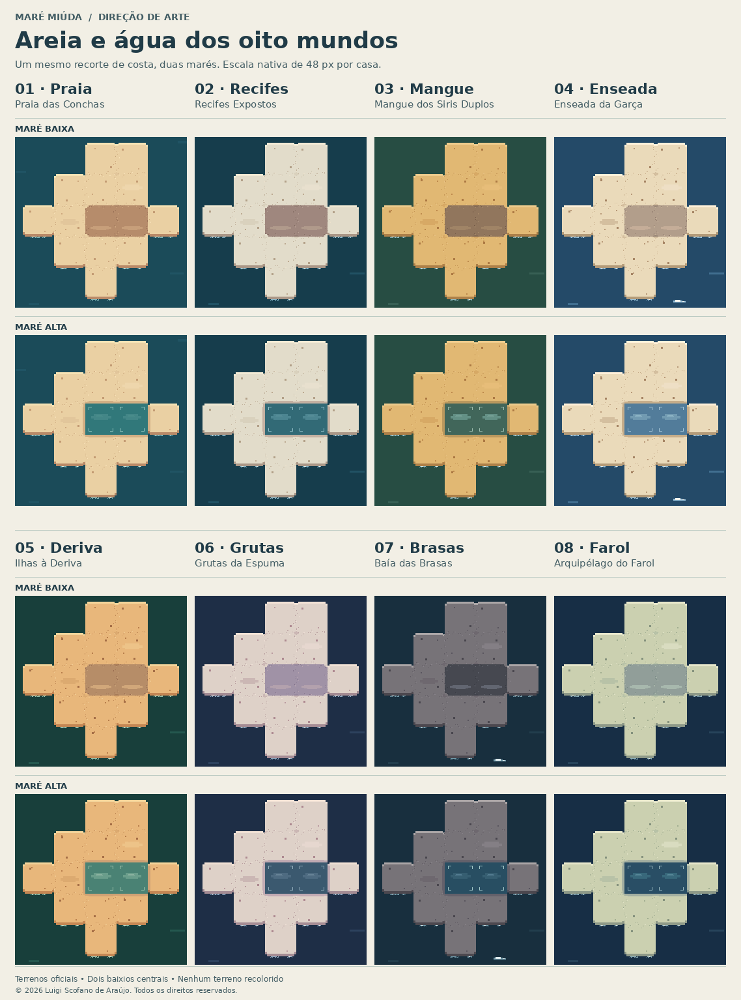

# Maré Miúda: Entre Ilhas

*Tiny Tide: Between Islands*


Um siri cruza um arquipélago em um quebra-cabeça de aventura por turnos. A cada três passos válidos a maré vira: a água cobre atalhos, revela caminhos e muda como você atravessa cada ilha. O jogo é independente do Miudezas: não carrega seu código, seus recursos nem suas partidas salvas.

**Prévia privada, ainda não lançada · 8 mundos · 229 desafios no catálogo da campanha · 8 arranjos da trilha aprovada.**

[Baixar ZIP privado](https://github.com/luigiscofano/mare-miuda-entre-ilhas/actions/runs/44938701024/artifacts/14721380432) · [Como jogar localmente](#como-jogar-localmente) · [Visuais](#visuais-do-jogo) · [Documentação](#documentação) · [Processo de criação](docs/processo-de-criacao/README.md)

O ZIP foi gerado no [PR #77](https://github.com/luigiscofano/mare-miuda-entre-ilhas/pull/77), a partir do commit `7eef68a`. Entre no GitHub para baixar até **5 de dezembro de 2026**. Depois disso, procure um ZIP mais recente nas execuções de **Verificar protótipo** ou gere o jogo localmente. O Safari em iPhone físico e o VoiceOver ainda precisam de validação. [Roteiro manual](tests/qa-manual.md).

**Ilha de Improviso** gera travessias à parte da campanha. Escolha um dos oito temas, um a três siris e uma das cinco dificuldades, de Sossegado a **Maré Feroz**. A garça e o fragmento são opcionais. [Controles, filtros e histórico](docs/processo-de-criacao/39-ilha-de-improviso/README.md).

## Como jogar localmente

A seleção direta tem uma [nota de implementação e compatibilidade](docs/campanha/seletor-direto.md); as pranchas finais são uma etapa à parte.

Com Node.js 24 ou posterior, execute na raiz:

```sh
npm test
npm run build
npm run test:offline
```

Abra `dist/mare-miuda-prototipo.html` no navegador para jogar sem conexão. A outra opção é executar `npm run serve` (requer Python 3) e abrir `http://127.0.0.1:4173`. O protótipo não precisa instalar dependências para compilar ou rodar os testes de motor.

<a id="regras"></a>

A trilha **Siri na Areia — Notas Claras** acompanha os oito mundos. O áudio começa após interação, tem volumes separados de Música e Efeitos e também está incluído no HTML offline. [Como funciona o áudio](src/audio/README.md) · [Partitura e exportação](scripts/trilha/README.md).

## Visuais do jogo

Quadros do renderizador em **512 × 384**, sem cursor, nos estados jogáveis indicados. Não são capturas de aparelho nem pranchas conceituais. O quadro do Cabo Baixo registra o seletor caminhável anterior, preservado no Processo de criação.

| Seleção de mundos · proposta em revisão | Cabo Baixo · mapa caminhável anterior |
| --- | --- |
|  |  |
| **Trilha das pedras · maré baixa** | **Trilha das pedras · maré alta** |
|  |  |

[Guia de arte e fontes](docs/arte/README.md) · [Fauna e sprites](docs/arte/fauna/README.md) · [Pranchas e versões históricas](docs/processo-de-criacao/acervo-visual/README.md)

<details>
<summary>Areia e água dos oito mundos</summary>

A mesma costa, com dois baixios centrais, em maré baixa e alta. A comparação usa as artes dos oito mundos, da Praia das Conchas ao Arquipélago do Farol, incluindo a Baía das Brasas.



[Detalhes da prancha e crédito](docs/arte/areia-e-agua/README.md)

</details>

## Documentação

<details>
<summary>Processo de criação</summary>

1. [Fundação](docs/processo-de-criacao/01-fundacao/README.md): regras, decisões de arquitetura e plano dos mundos.
2. [Protótipo cinza](docs/processo-de-criacao/02-prototipo/README.md): HTML autônomo v0.1.0 preservado, fichas, soluções e alcance dos testes.
3. [Fatia vertical: Praia das Conchas](docs/processo-de-criacao/03-fatia-vertical/README.md): mapa, trilhas, arte provisória, edição de áudio, salvamento e encontro de encerramento.
4. [Primeiro lote: Recifes e Mangue](docs/processo-de-criacao/04-lote-1/README.md): arquipélago, pedra alta, dois fragmentos, dupla, placa e porta.

[Siris duplos em outros mundos](docs/processo-de-criacao/09-siris-duplos/README.md) registra as primeiras provas jogáveis e a ampliação dos desvios da Enseada e da Deriva. [Grutas e Ressaca em dupla](docs/processo-de-criacao/10-duplas-grutas-ressaca/README.md) acompanha as quatro fases regulares. [Farol em dupla](docs/processo-de-criacao/11-farol-dupla/README.md) registra duas fases regulares e o encaixe entre balsas, baixios e patrulha.

[A travessia da Praia](docs/processo-de-criacao/29-travessia-praia/README.md) preserva a prancha V32 aprovada e explica sua aplicação nas fases jogáveis.

[As travessias de Recifes e Mangue](docs/processo-de-criacao/30-travessias-recifes-mangue/README.md) testam duas ambientações com a mesma grade, sem mudar regras ou seletores.

[A Enseada e as Ilhas à Deriva](docs/processo-de-criacao/31-travessias-enseada-deriva/README.md) apresentam duas prévias e os sinais de rasante e balsa em quadros das duas marés.

[Grutas, Baía e Farol](docs/processo-de-criacao/32-travessias-grutas-ressaca-farol/README.md) completam as prévias de travessia dos oito mundos e mostram mecanismos em cada uma das duas marés.

[O seletor de mundos Meia-Lua](docs/processo-de-criacao/33-seletor-arquipelago/README.md) registra a adaptação da arte do estudo aos marcos do jogo, com rotas e bloqueios legíveis. [Os seletores da Praia](docs/processo-de-criacao/34-seletores-praia/README.md) registram as duas telas com desvio e cadeado em escala nativa. [Recifes e Mangue](docs/processo-de-criacao/35-seletores-recifes-mangue/README.md) levam a mesma sinalização a dois mapas próprios. [Enseada e Deriva](docs/processo-de-criacao/36-seletores-enseada-deriva/README.md) mostram os ramais, cadeados e desvios na escala de jogo. [Grutas, Baía e Farol](docs/processo-de-criacao/37-seletores-mundos-finais/README.md) fecham o lote e mostram o acesso às últimas arenas.

[Índice permanente do processo](docs/processo-de-criacao/README.md) · [Acervo visual: 340 arquivos históricos preservados](docs/processo-de-criacao/acervo-visual/README.md). Consulte as cópias locais e os commits exatos de origem. O material histórico não entra no build.

</details>

---

<details>
<summary>Sobre e origem</summary>

O jogo parte da ideia de maré do minigame Maré Miúda. Neste repositório, o estado, as fases e a renderização têm implementação nova, sem dependência do original. Nomes de trabalho: Maré Miúda: Entre Ilhas e Tiny Tide: Between Islands.

</details>

---

<details>
<summary>Regras e controles</summary>

| Ação | Teclado | Toque |
| --- | --- | --- |
| Mover uma casa na travessia / seguir para o próximo marco no mapa | Setas ou WASD | Direcionais |
| Abrir fase ou região | Tab + Enter/Espaço na lista; Enter no marco do Arquipélago | Toque na fase ou visite o marco atual do Arquipélago |
| Alternar siri quando a fase tem dupla ou trio | Espaço | Trocar siri |
| Reiniciar a tentativa | R | Reiniciar |
| Voltar | Esc | Voltar |

 Passos bloqueados, troca de siri e navegação no mapa não mudam a maré. Três passos válidos sobem a maré; mais três descem. Baixio coberto bloqueia. A água e a garça são avaliadas antes da coleta e da vitória. Um erro leva o siri à última casa firme, sem rebobinar o ciclo; a terceira levada encerra a tentativa. Um turno nunca soma dois erros. [Contrato do motor](src/motor/README.md).

</details>

---

<details>
<summary>Game design</summary>

O núcleo combina contagem de passos, leitura espacial e previsão. O jogador não precisa correr: decisões de água e ameaça só andam em passos válidos. A bancada e a praia não têm botão de esperar. No mapa de seleção, cada comando escolhe uma saída e o siri percorre a trilha até o próximo marco, sem consumir passos de maré. A movimentação em grade fica dentro das fases. Volta à casa firme e limite de três levadas são hipóteses a testar com jogadores.

</details>

---

<details>
<summary>Campanha e mapa-múndi</summary>

Escolha a fase pelo nome, sem andar dentro da região. Os botões mostram **Disponível**, **Bloqueada** (com motivo) ou **Concluída**. Bônus, chefes opcionais e viagens ficam em grupos próprios. O **Arquipélago** conserva o mapa caminhável e seus portos. Os [novos trechos](docs/campanha/expansao/README.md) se abrem em sequência depois de marcos já existentes. A rota original e as viagens não exigem essas travessias novas. A Praia das Conchas tem dois seletores, **Cabo Baixo** e **Enseadinha**, com a mesma passagem entre eles. Depois da Praia, Recifes e Mangue podem ser visitados em qualquer ordem. As duas rotas principais abrem a Enseada, e o percurso segue por Deriva, Grutas, Baía e Farol. O desfecho é revisitável: **A luz das duas marés** encerra a campanha sem exigir chefes nem bônus.

| Mundo | Travessias regulares | Mecânica e progressão |
| --- | ---: | --- |
| Praia das Conchas | 25 | Começa com o ciclo de maré, travessias curtas e a primeira ameaça anunciada. Inclui o encontro Ponta da garça. |
| Recifes Expostos | 25 | Introduz pedra alta, rotas de baixa e coletas em mais de uma etapa. |
| Mangue dos Siris Duplos | 25 | Apresenta a troca de siri, o contador compartilhado e os primeiros objetivos em dupla. |
| Enseada da Garça | 25 | Combina previsão do rasante, abrigo e virada da água; a dupla reaparece. |
| Ilhas à Deriva | 25 | Balsas, correntes e desembarques planejados; há travessias solo e em dupla. |
| Grutas da Espuma | 25 | Pérola, encaixe, alavanca e portão. O trio estreia no desvio Três refúgios. |
| Baía da Ressaca | 25 | Ondas em faixas, moedas com limite de passos e coordenação em dupla ou trio. |
| Arquipélago do Farol | 25 | Pontes de luz, lentes e combinações avançadas antes do desfecho. |

**Como contar os 229 desafios:** 200 travessias regulares, 16 arenas opcionais de chefe (duas por mundo) e 13 bônus ou alternativas sem chefe. Nem toda entrada não opcional é necessária na rota mais curta até os créditos. A bancada tem quatro testes, três reaproveitados da campanha e um exclusivo, e não soma quatro ao total.

[Mapa e progressão](docs/campanha/README.md) · [Matriz de game design e level design](docs/campanha/matriz.md) · [Fichas e soluções](src/fases/README.md) · [Critérios de contagem](docs/processo-de-criacao/estado-atual.md)

</details>

---

<details>
<summary>Level design e soluções</summary>

A campanha parte de um tutorial acessível na Praia, passa por lógica leve e combinação de regras, e chega a mapas maiores com escolhas consequentes, fuga e chefes por turnos. A bancada inclui uma prova independente de três moedas com orçamento de passos. Na Baía, a mesma regra volta em duas travessias da campanha. [Curva de dificuldade](docs/producao/escopo-e-leitura.md#curva-de-dificuldade-da-campanha).


Passagem da primeira onda, A sombra da garça e Busca e volta. Essas três fases estão na bancada e também na rota da praia. A praia acrescenta O segredo da ilhota e A ponta da garça. Recifes tem dez travessias regulares e dois desvios. O ramo norte parte do primeiro marco; a saída para a Enseada continua dependendo das três travessias históricas de Recifes e das três do Mangue, sem exigir o ramo novo. [Fichas dos Recifes ampliados](docs/processo-de-criacao/09-recifes-ampliados/README.md). O Mangue acrescenta sete regulares em um ramo após Raízes vizinhas, sem substituir o percurso original. [Fichas do Mangue ampliado](docs/processo-de-criacao/10-mangue-ampliado/README.md). Cada mapa tem objetivo, instrução e solução reproduzível no motor. [Diagramas e soluções](src/fases/README.md).

</details>

---

<details>
<summary>Artes conceituais</summary>

Os estudos PT/EN ficam preservados separadamente. A Placa de Areia (A) foi aprovada para a abertura em português; a Corrente de Espuma (B) continua no acervo como estudo. Estudos e capturas reais têm rótulos distintos no Processo de criação.

</details>

---

<details>
<summary>Artes do jogo e animação</summary>

A concha tem um brilho de pixels chapados e identificação textual. Os cantos de bloqueio marcam apenas vizinhos ortogonais, sem cobrir o cenário inteiro. O [Arquipélago em Meia-Lua](docs/processo-de-criacao/33-seletor-arquipelago/README.md) usa o estudo sem casas com oito ilhas e espuma. A [direção dos mapas de fases](docs/producao/escopo-e-leitura.md#grades-visuais-do-arquipélago-e-dos-seletores) é independente da grade de travessia.


Na bancada, a arte cinza lê terreno, maré e previsão de ameaça. A Praia usa a paleta V32, com espuma costeira, baixios de areia molhada ou cobertos e marcados pelos quatro cantos, rochas em aglomerados e concha rosa. A prévia de Recifes e Mangue usa mar azul com poças e corais ou água oliva com raízes e lama, respectivamente, e uma concha própria para cada região. A Enseada tem areia clara, juncos e concha violeta; a Deriva tem canais de jade e concha dourada em crescente. O X do rasante e as balsas navegáveis continuam distinguíveis. Grutas, Ressaca e Farol usam propostas de ardósia, azul de tempestade e azul-índigo, com conchas e margens distintas. A pérola, a espuma de risco e as pontes de luz mantêm seus sinais. A densidade do cenário e do arquipélago segue em revisão; a Placa de Areia da abertura foi mantida. O siri principal é o recorte nativo da Placa de Areia na Travessia, na bancada e nos seletores, sem trocar a arte dos mapas. Verde e Amarelo são o mesmo recorte em outras paletas: insígnias acima dos sprites identificam cada um também sem cor. A nova garça aparece na previsão, em patrulha ou rasante, sem cobrir o X no tabuleiro. [Fauna e capturas](docs/arte/fauna/README.md). Os fragmentos permanecem em matrizes de pixels editáveis em TypeScript. Nenhum recurso do jogo original é importado. [Guia de arte](docs/arte/README.md).

</details>

---

<details>
<summary>Identidade visual</summary>

Placa de Areia (opção A) na abertura, em grade original de 180 × 94 pixels, com escala inteira sem suavização. A variante inglesa e as versões compactas ficam no acervo dos estudos; o jogo ainda não tem seleção de idioma. A paleta e a grade das demais artes ainda são provisórias.

</details>

---

<details>
<summary>Áudio e trilha</summary>

A Praia conserva a faixa Notas Claras aprovada. As outras sete regiões usam o mesmo tema com timbres e apoios diferentes, em transições contínuas. Os sinais de subida/descida, erro, coleta e vitória são sintetizados separadamente. Música e efeitos têm volumes independentes e persistentes. Forma, padrões e texto ensinam as regras sem depender de áudio. Ver [áudio](src/audio/README.md).

</details>

---

<details>
<summary>Arquitetura e fluxo</summary>

Entrada traduz o comando → motor puro resolve o turno → interface publica o novo estado → Canvas desenha. O índice de fases e o validador usam os mesmos dados e regras. O motor decide a consequência, não a animação nem a trilha. A campanha controla as conexões; o save local versionado guarda progresso e volumes, sem conta ou servidor de jogo. [Contrato do motor](src/motor/README.md).

</details>

---

<details>
<summary>Linguagem e ferramentas</summary>

TypeScript, HTML semântico, CSS e Canvas 2D; Node.js 24 no script de build e nos testes. O protótipo é web estático, sem servidor de jogo ou conta. Python 3 é opcional para o servidor de desenvolvimento e para as verificações de navegador.

</details>

---

<details>
<summary>Código e estrutura de pastas</summary>

- `src/motor/`: estado, regras e eventos.
- `src/fases/`, `src/validacao/`: mapas, soluções e validação por reprodução.
- `src/entrada/`, `src/interface/`, `src/render/`: controles, estado perceptível e arte provisória.
- `tests/`, `scripts/` e `docs/`: testes, build e cadernos de produção.
- `src/campanha/`, `src/persistencia/` e `src/audio/` implementam os oito mundos, o save isolado e a trilha com seus sinais de jogo. Não dependem do Miudezas.

</details>

---

<details>
<summary>Como rodar e publicar</summary>

Veja [Como jogar localmente](#como-jogar-localmente). O build produz uma versão modular em `dist/index.html` e um HTML autônomo para teste. Deploy e merge não são disparados pelo build; a publicação é uma etapa deliberada após aprovação. O GitHub Actions roda verificações e produz capturas como artefatos quando os testes de navegador passam, sem publicar.

</details>

---

<details>
<summary>Testes e acessibilidade</summary>

Os testes cobrem as 229 soluções da campanha, incluindo 16 arenas opcionais de chefes, o relógio compartilhado da dupla, as duas ordens dos mundos e passos limítrofes, rejeição de movimentos, eventos simultâneos, terceiro erro, inventário, reinício, rotas do mapa e persistência. O teste offline carrega o HTML final em DOM/Canvas simulados e verifica tanto a bancada quanto o mapa. Teclado e toque têm caminhos equivalentes; mapa em texto, foco visível, padrões e indicadores não dependem de cor. [Cobertura e limites](tests/README.md). [Roteiro de validação manual](tests/qa-manual.md). Os PRs com QA no Chromium bem-sucedido disponibilizam também um ZIP jogável privado na aba Actions, sem deploy. [Fichas e decisões das Grutas](docs/processo-de-criacao/08-grutas/README.md).

</details>

---

<details>
<summary>Produção e roteiro</summary>

Fundação → protótipo → fatia vertical → campanha em lotes → lançamento. A campanha está implementada em PRs de rascunho, não lançada. O [CI da prévia](https://github.com/luigiscofano/mare-miuda-entre-ilhas/actions/runs/44938701024) passou no build, nos testes de motor, no HTML offline, no Chromium e no WebKit. O próximo marco é a validação no Safari em iPhone físico, incluindo toque, VoiceOver, save e retorno do áudio após sair e voltar. Revisão de lançamento, integração e publicação são etapas separadas. Não há geração procedural ou coop simultânea no escopo inicial. [Critérios de passagem](docs/producao/README.md).

</details>

---

<details>
<summary>Referências</summary>

[Implementação de Maré Miúda no Miudezas](https://github.com/luigiscofano/Miudezas/blob/main/dist/quintal.js), consultada apenas como referência. Pokémon Black and White é referência futura de legibilidade e densidade, sem uso de mapas, sprites, marcas ou paletas originais.

</details>

---

<details>
<summary>Créditos e direitos autorais</summary>

Projeto de Luigi Scofano de Araujo. O protótipo e a fatia vertical não incorporam sprites, código, fontes baixadas ou sons de terceiros. O navegador usa a fonte de sistema. Documentar autoria, origem e licenças ao incorporar recursos.

</details>

---

**© 2026 Luigi Scofano de Araujo. Todos os direitos reservados.**

