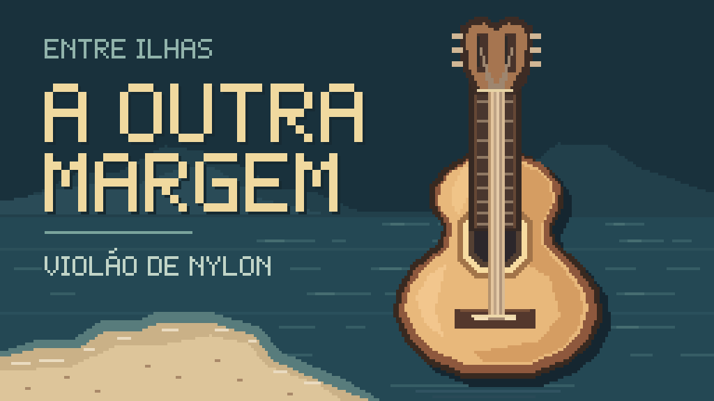

# mare-miuda-entre-ilhas
Quebra-cabeça de aventura por turnos em pixel art. Um siri, um arquipélago e uma maré que vira a cada três passos.

[**Assistir a Maré Miúda: Entre Ilhas: Os oito mundos (MP4)**](docs/arte/animacoes/Mare-Miuda-Os-Oito-Mundos.mp4) · 24 vitórias da campanha, três por mundo, em 4min22,5s. [Ver capítulos](docs/arte/animacoes/README.md#os-oito-mundos).

## Documentação visual

| Guia | Conteúdo |
| --- | --- |
| [Atlas de arte](docs/arte/Mare-Miuda-Atlas-de-Arte.pdf) | Areias, células, estruturas, vegetação e animais dos oito mundos. |
| [Todas as travessias](docs/arte/catalogo-231-travessias/Mare-Miuda-231-Travessias.pdf) | 231 fases em maré baixa e alta, com índice por mundo. |
| [Arquipélago](docs/interface/Mare-Miuda-Arquipelago.pdf) | Os cartões dos oito mundos no computador e no celular. |
| [Progressão e mecânicas](docs/campanha/Mare-Miuda-Progressao-e-Mecanicas.pdf) | Regras da edição oficial e evolução dos desafios. |
| [Trilha sonora](docs/arte/trilha-sonora/README.md) | **A Outra Margem**, para violão de nylon. |
| [Efeitos sonoros](docs/arte/efeitos-sonoros/README.md) | Onze sons de jogo e interface, com amostras e momentos de acionamento. |

Veja o [índice da documentação](docs/README.md) e as notas de verificação em cada seção. Os PDFs documentam a edição offline aprovada e não alteram a versão jogável do repositório.

© 2026 Luigi Scofano de Araújo. Todos os direitos reservados.

- [Vídeo sem som das animações](docs/arte/animacoes/README.md): versão ampliada dos trechos de ação.

## Jogar a edição oficial offline

Com Python 3.10+ e Node, gere o HTML em `dist` e abra-o no navegador:

```sh
python3 edicao-oficial/montar.py dist/mare-miuda-prototipo.html --verificar
node edicao-oficial/testes/campanha.mjs dist/mare-miuda-prototipo.html
```

As fontes removem do motor e dos renderizadores as mecânicas históricas descartadas. Os identificadores antigos ficam apenas para carregar saves sem perder progresso. Consulte [produção e verificação](docs/producao/README.md).

Na campanha, a passada dura 205 ms e a maré visual sobe e desce mais devagar, sem mudar o ritmo das jogadas. A interface também inclui o painel de estado com avisos separados e as ações de derrota ao fim da animação.

Na campanha, as placas de resultado são maiores e continuam centradas no tabuleiro; a derrota ganha espirais laterais. Após um erro recuperável de maré ou garça, o Siri pisca três vezes. Com a maré mais lenta, o tempo entre o reaparecimento e a liberação dos controles continua igual. O título fica sozinho no topo; o objetivo e a orientação estão em **Mapa em texto e ajuda**. Esses ajustes de resultado e retorno são exclusivos da campanha.

Veja [controles e acessibilidade](docs/interface/README.md#resultado-e-retorno-na-campanha) e [a verificação de resultado e retorno](docs/producao/README.md#validação-de-resultado-e-retorno).

## Painéis de apoio

Os painéis **Configurações**, **Som e música**, **Créditos** e **Ilha de Improviso** abrem no centro, com a tela anterior ainda visível sob um escurecimento de 79%. Eles não ocupam a tela inteira e têm brilhos brancos nas quatro quinas da moldura. No Porto, **Som e música** identifica a trilha e mostra os volumes; na seleção de fases e na partida, abra **Configurações** para ajustá-los. Fechar um painel de apoio devolve o foco ao botão de origem sem mudar a fase ou a página de seleção.

[Ver controles e acessibilidade dos painéis](docs/interface/README.md#painéis-de-apoio).

No Porto, abra **Ilha de Improviso** para montar uma travessia avulsa: escolha tema, dificuldade e de um a três Siris, ajuste as opções de garça e pérola ou consulte o histórico. **Gerar travessia** abre a fase fora da campanha; **Editar filtros** retorna ao painel com as escolhas mantidas. Consulte o [guia da Ilha de Improviso](docs/interface/README.md#ilha-de-improviso).

## Trilha sonora

[Ouvir A Outra Margem, em violão](docs/arte/trilha-sonora/a-outra-margem-violao.mp3).

**A Outra Margem** é a trilha da edição offline. A versão de violão de nylon segue em um único ciclo durante a navegação pelos oito mundos, sem reiniciar ao trocar de tela. Música e efeitos continuam com volumes independentes em **Configurações**.

[Ouvir os 11 efeitos](docs/arte/efeitos-sonoros/Mare-Miuda-Efeitos-Mais-Sutis.mp3) ou [ver quando cada um toca](docs/arte/efeitos-sonoros/README.md). Eles sinalizam a maré, a coleta, as fendas, os perigos, os resultados e os cliques sem interromper a trilha.

[](docs/arte/trilha-sonora/README.md)

## Seleção de fases

Nos oito mundos, a seleção de fases preenche a janela no computador, com as quatro quinas de areia encostadas às bordas. No celular, a lista mantém o formato vertical. As duas versões oferecem **Configurações** e **Voltar ao início**, sem apagar o progresso nem a página da seleção durante a sessão. O fundo tem brilhos em três tamanhos e espumas decorativas; a preferência de movimento reduzido deixa o fundo estático.

Veja [seleção de fases e acessibilidade](docs/interface/README.md#seleção-de-fases).
