# Maré Miúda: Entre Ilhas

**Português** · [English](README.en.md)

<a href="docs/arte/galeria/identidade/logo-oficial.png"></a>

**Um quebra-cabeça por turnos em pixel art. A cada três passos válidos, a maré vira.** Planeje onde o Siri vai estar quando a água subir e use os baixios que reaparecem quando ela desce.

**8 mundos · 231 fases de campanha · Edição offline para computador e celular**

[Como jogar](#como-jogar) · [Idioma do jogo](#idioma-do-jogo) · [Galeria](#galeria-do-jogo) · [Filme dos oito mundos](docs/arte/animacoes/Mare-Miuda-Os-Oito-Mundos.mp4) · [Todos os PDFs e vídeos](#pdfs-e-vídeos)

**Sumário:** [Campanha e design](#campanha-e-design) · [Arte e interface](#arte-e-interface) · [Áudio](#áudio) · [Arquitetura e código](#arquitetura-e-código) · [Documentação completa](docs/README.md)

<a id="jogar-a-edição-oficial-offline"></a>

## Como jogar

Na raiz do repositório, com Python 3.10 ou posterior:

```sh
python3 edicao-oficial/montar.py dist/mare-miuda-prototipo.html --verificar
```

Abra `dist/mare-miuda-prototipo.html` no navegador. A edição inclui arte e áudio e roda sem internet. No **Porto de Partida**, **Começar viagem** ou **Continuar viagem** abre diretamente o **Arquipélago**. Escolha um mundo e uma fase. Seu progresso é preservado.

| Ação | Controle |
| --- | --- |
| Mover | Setas ou WASD no teclado; no celular, deslize no próprio tabuleiro na direção desejada. |
| Recomeçar | **R** ou **Reiniciar**. |
| Consultar objetivo e terreno | **Mapa em texto e ajuda**. |
| Regular som ou retornar | **Configurações** e botões de retorno. |

Um movimento bloqueado não gasta passo. Os tracinhos indicam destinos possíveis e só aparecem depois que todos os siris pousam. Ao trocar de cópia offline, guarde o HTML anterior: alguns navegadores associam o progresso ao caminho do arquivo. [Instruções de produção](docs/producao/README.md#executar).

## Idioma do jogo

No Porto de Partida, a troca de idioma fica no canto inferior direito, sem faixa de fundo. No computador, a logo e os controles têm mais espaço, com quatro quinas montadas com as células de areia do tabuleiro.

Com o jogo aberto, clique ou toque em **EN** no canto inferior direito para jogar em inglês. O botão passa a mostrar **PT** para voltar ao português. A única outra opção de troca fica dentro de **Configurações**. As demais telas não têm botão de idioma nem faixa de rodapé. A mudança é imediata e não reinicia a partida nem muda o progresso salvo. Ao abrir ou recarregar o HTML normalmente, o jogo começa em português.

[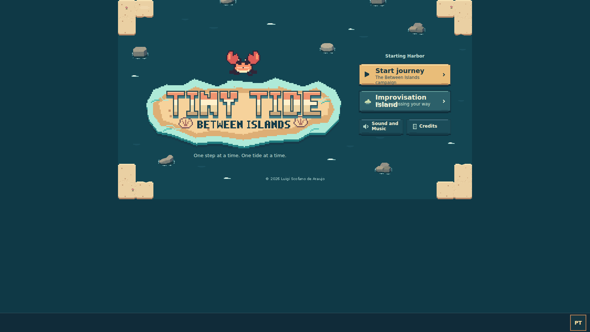](docs/arte/galeria/telas/troca-de-idioma.png)

[Mais sobre a troca de idioma](docs/interface/README.md#idioma-do-jogo).

## Galeria do jogo

A campanha da **Praia das Conchas** tem painel compacto, previsão da virada em três passos e cenas de fim de fase mais curtas. No computador, o estado acompanha a travessia à direita; no celular, cabe acima do tabuleiro. O mesmo painel aparece em **Sombra na restinga** e **Turno dos guardiões**. As outras travessias mantêm a disposição anterior. [Veja computador e celular na galeria](docs/arte/galeria/README.md#telas).

Os quadros de travessia vêm do motor e da câmera oficiais. As telas de navegação foram capturadas no HTML offline com a tipografia atual, sem cursor, em navegador de computador e em janela móvel emulada. O enquadramento retira as sobras da janela quando necessário, sem cortar o conteúdo da interface mostrado. [Origem e resolução das imagens](docs/arte/galeria/README.md).

<details open>
<summary><strong>Porto de Partida, Arquipélago e janelas de apoio</strong></summary>

| Porto de Partida | Ilha de Improviso |
| --- | --- |
| <a href="docs/arte/galeria/telas/porto.png"></a> | <a href="docs/arte/galeria/telas/ilha-de-improviso.png"></a> |

| Som e música | Créditos |
| --- | --- |
| <a href="docs/arte/galeria/telas/som-e-musica.png"></a> | <a href="docs/arte/galeria/telas/creditos.png"></a> |

| Arquipélago · 1 e 2 | Arquipélago · 3 e 4 |
| --- | --- |
| <a href="docs/arte/galeria/telas/arquipelago-1.png">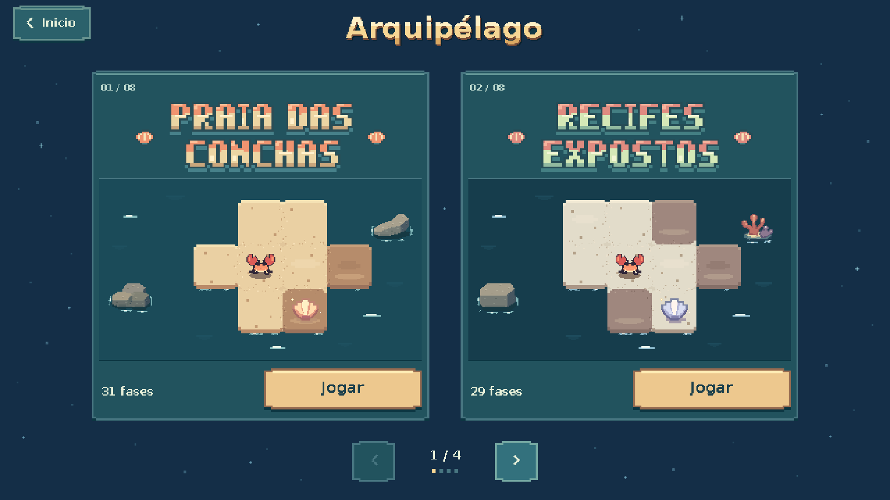</a> | <a href="docs/arte/galeria/telas/arquipelago-2.png">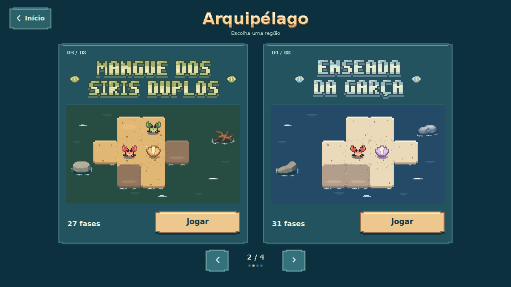</a> |

| Arquipélago · 5 e 6 | Arquipélago · 7 e 8 |
| --- | --- |
| <a href="docs/arte/galeria/telas/arquipelago-3.png">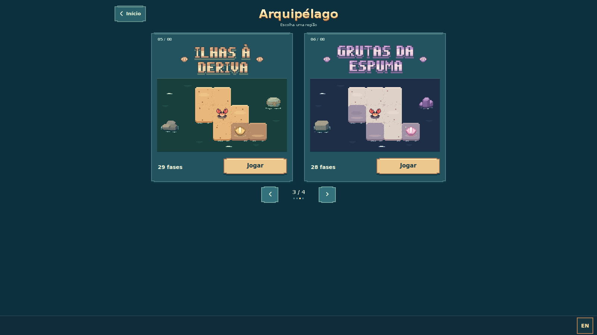</a> | <a href="docs/arte/galeria/telas/arquipelago-4.png"></a> |

| Porto no celular | Arquipélago no celular |
| --- | --- |
| <a href="docs/arte/galeria/telas/porto-celular.png">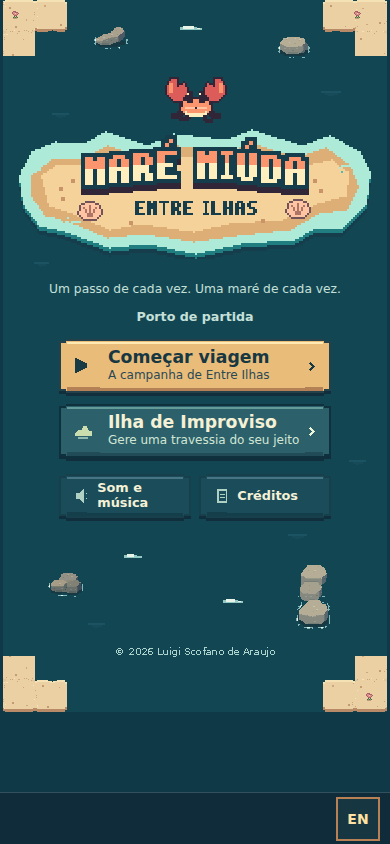</a> | <a href="docs/arte/galeria/telas/arquipelago-celular.png"></a> |

</details>

<details>
<summary><strong>Seletores de fases dos oito mundos</strong></summary>

| Praia das Conchas | Recifes Expostos |
| --- | --- |
| <a href="docs/arte/galeria/telas/seletor-01.png">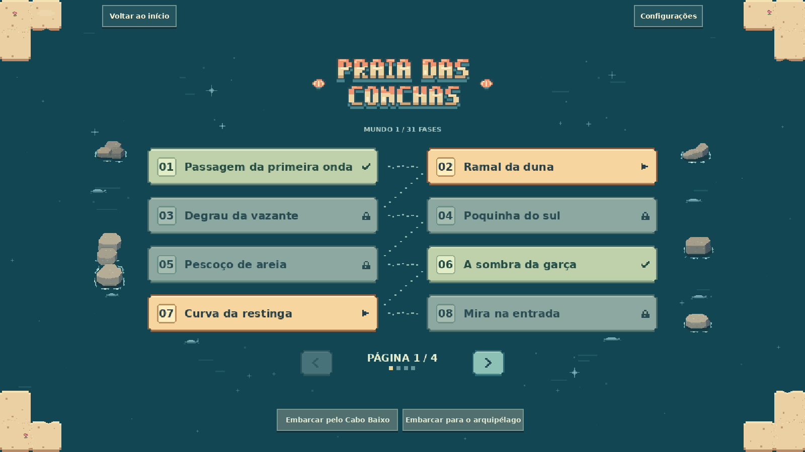</a> | <a href="docs/arte/galeria/telas/seletor-02.png"></a> |

| Mangue dos Siris Duplos | Enseada da Garça |
| --- | --- |
| <a href="docs/arte/galeria/telas/seletor-03.png"></a> | <a href="docs/arte/galeria/telas/seletor-04.png"></a> |

| Ilhas à Deriva | Grutas da Espuma |
| --- | --- |
| <a href="docs/arte/galeria/telas/seletor-05.png">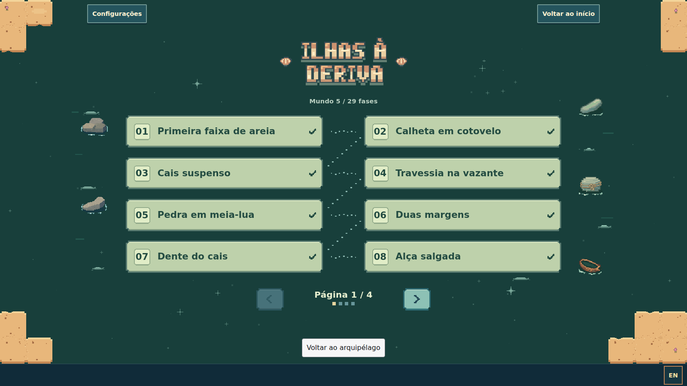</a> | <a href="docs/arte/galeria/telas/seletor-06.png"></a> |

| Baía das Brasas | Arquipélago do Farol |
| --- | --- |
| <a href="docs/arte/galeria/telas/seletor-07.png">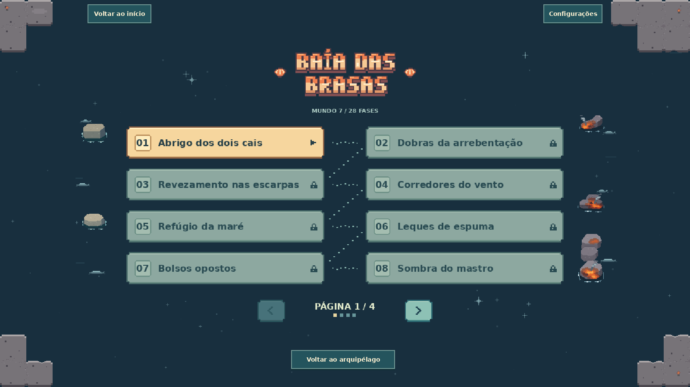</a> | <a href="docs/arte/galeria/telas/seletor-08.png">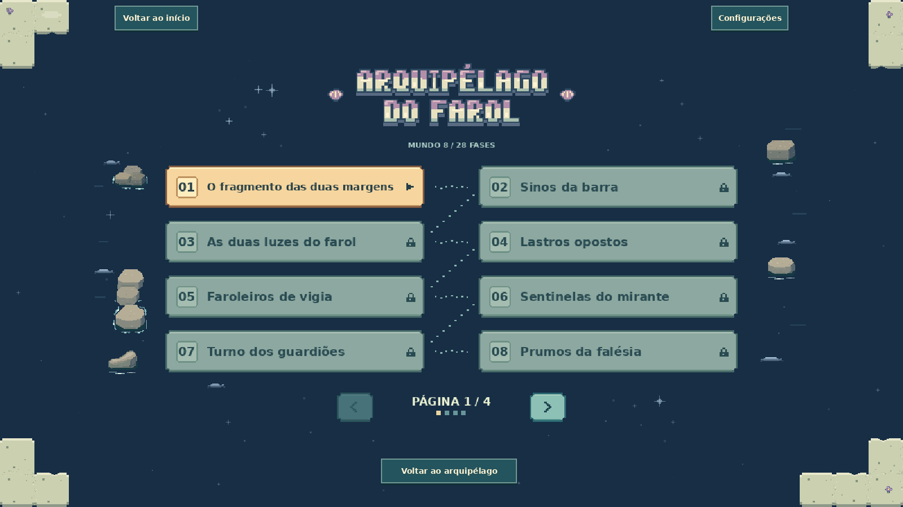</a> |

</details>

<details>
<summary><strong>Oito travessias, cada uma nas duas marés</strong></summary>

Maré baixa no início; maré alta após três movimentos válidos. A posição do Siri pode mudar entre os quadros.

**1. Praia das Conchas · Passagem da primeira onda**

| Maré baixa | Maré alta |
| --- | --- |
| <a href="docs/arte/galeria/travessias/mundo-01-baixa.png">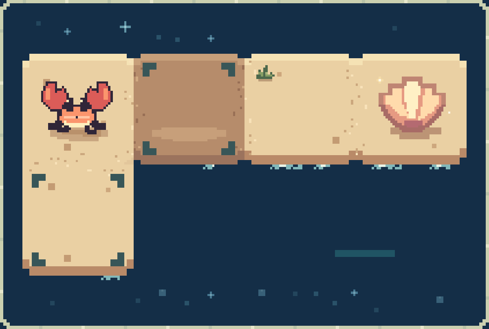</a> | <a href="docs/arte/galeria/travessias/mundo-01-alta.png"></a> |

**2. Recifes Expostos · Acima da espuma**

| Maré baixa | Maré alta |
| --- | --- |
| <a href="docs/arte/galeria/travessias/mundo-02-baixa.png"></a> | <a href="docs/arte/galeria/travessias/mundo-02-alta.png">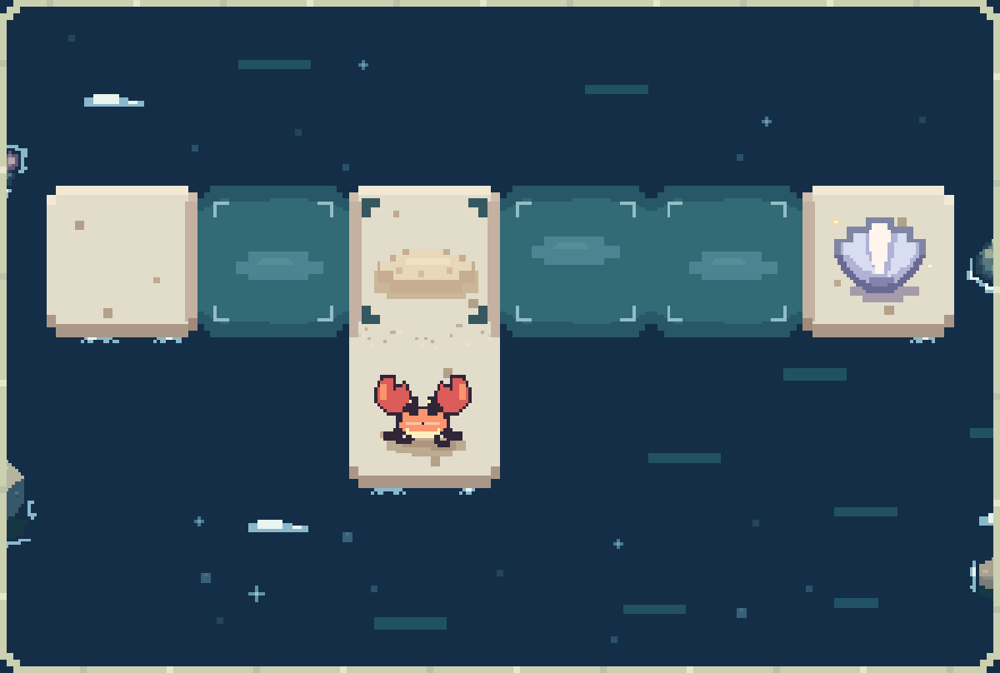</a> |

**3. Mangue dos Siris Duplos · Raízes vizinhas**

| Maré baixa | Maré alta |
| --- | --- |
| <a href="docs/arte/galeria/travessias/mundo-03-baixa.png"></a> | <a href="docs/arte/galeria/travessias/mundo-03-alta.png">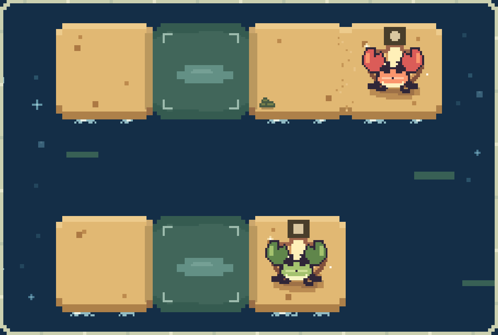</a> |

**4. Enseada da Garça · Sombra na restinga**

| Maré baixa | Maré alta |
| --- | --- |
| <a href="docs/arte/galeria/travessias/mundo-04-baixa.png">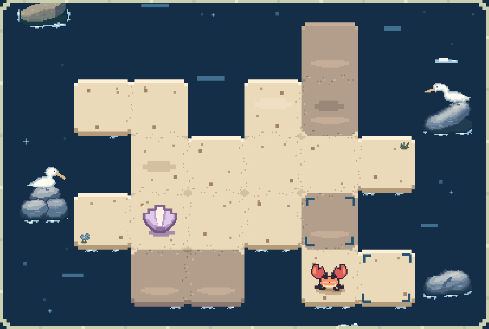</a> | <a href="docs/arte/galeria/travessias/mundo-04-alta.png">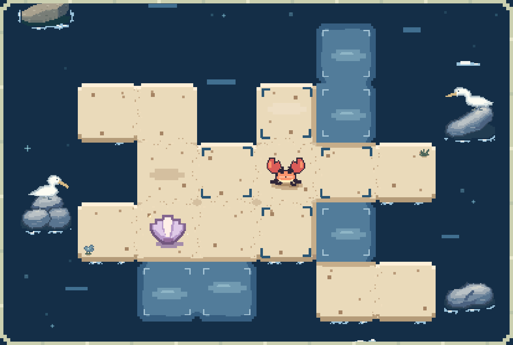</a> |

**5. Ilhas à Deriva · Primeira faixa de areia**

| Maré baixa | Maré alta |
| --- | --- |
| <a href="docs/arte/galeria/travessias/mundo-05-baixa.png"></a> | <a href="docs/arte/galeria/travessias/mundo-05-alta.png"></a> |

**6. Grutas da Espuma · Corredor da vazante**

| Maré baixa | Maré alta |
| --- | --- |
| <a href="docs/arte/galeria/travessias/mundo-06-baixa.png"></a> | <a href="docs/arte/galeria/travessias/mundo-06-alta.png">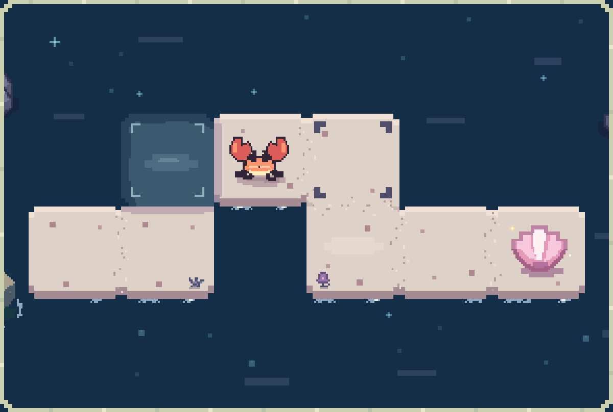</a> |

**7. Baía das Brasas · Abrigo dos dois cais**

| Maré baixa | Maré alta |
| --- | --- |
| <a href="docs/arte/galeria/travessias/mundo-07-baixa.png"></a> | <a href="docs/arte/galeria/travessias/mundo-07-alta.png">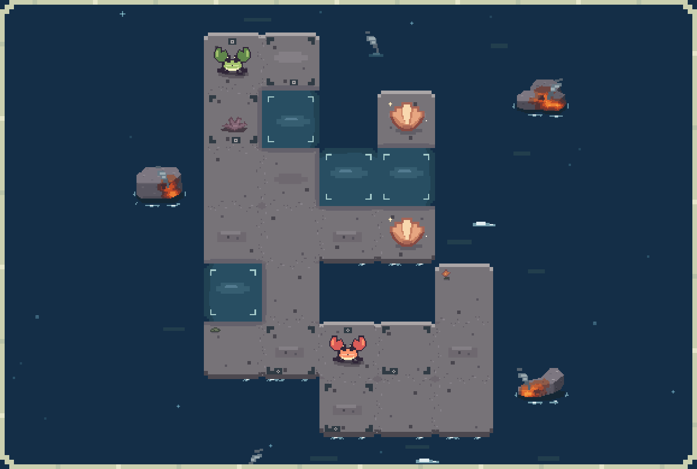</a> |

**8. Arquipélago do Farol · O fragmento das duas margens**

| Maré baixa | Maré alta |
| --- | --- |
| <a href="docs/arte/galeria/travessias/mundo-08-baixa.png">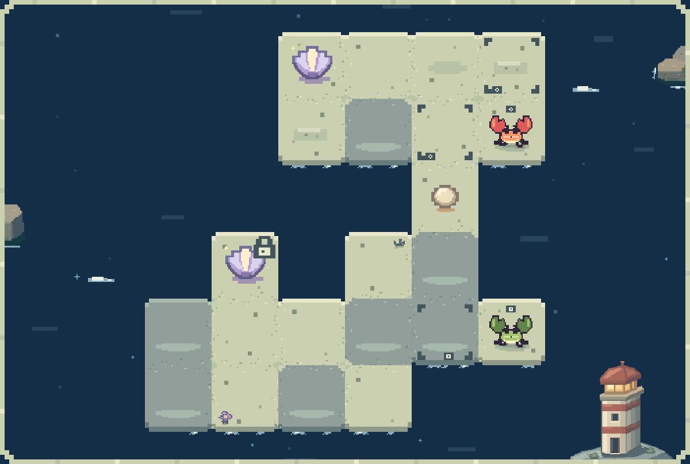</a> | <a href="docs/arte/galeria/travessias/mundo-08-alta.png">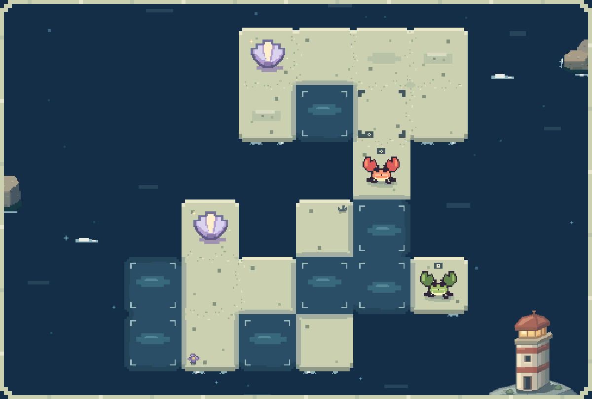</a> |

[Ver todas as 231 travessias](docs/arte/catalogo-231-travessias/README.md).

</details>


## Campanha e design

<details open>
<summary><strong>Game design · regras e objetivos</strong></summary>

- **Maré:** vira a cada três movimentos válidos. Baixios praticáveis na baixa ficam submersos na alta; a areia firme serve de apoio.
- **Conchas e pérolas:** conchas marcam a chegada. Nas fases de coleta, a ostra rosa só abre com a última pérola.
- **Garça e fendas:** a mira sinaliza o risco do rasante. Fendas ligam posições do tabuleiro.
- **Dois ou três Siris:** respondem ao mesmo comando. Casas ocupadas no início do turno bloqueiam a passagem; os Siris não se atravessam.
- **Recuperação:** após um erro recuperável da campanha, o Siri volta ao último apoio. O terceiro erro encerra a tentativa. A pausa não consome passos nem enfileira movimentos.
- **Cenário:** espuma, reflexos e formações oceânicas são decorativos. Balsas, âncoras, portas, botões e ataque de onda não fazem parte das regras atuais.

[Regras da edição jogável](docs/campanha/validacao-da-edicao.md) · [Guia da campanha](docs/campanha/README.md).

</details>

<details>
<summary><strong>Level design · mapas, mundos e progressão</strong></summary>

A dificuldade parte do **timing da maré** e cresce com o espaço, o posicionamento, as rotas de volta e a combinação com outros objetivos. O número de passos de uma solução não equivale à dificuldade percebida. As fichas registram mapa, objetivo e solução de referência.

| Mundo | Regulares | Chefes opcionais | Bônus | Total | Identidade |
| --- | ---: | ---: | ---: | ---: | --- |
| 1. Praia das Conchas | 25 | 2 | 4 | 31 | Areia dourada e conchas |
| 2. Recifes Expostos | 25 | 2 | 2 | 29 | Recifes e coral |
| 3. Mangue dos Siris Duplos | 25 | 2 | 0 | 27 | Raízes, lodo e tons quentes |
| 4. Enseada da Garça | 25 | 2 | 4 | 31 | Juncos e garças brancas |
| 5. Ilhas à Deriva | 25 | 2 | 2 | 29 | Madeira e fragmentos náuticos |
| 6. Grutas da Espuma | 25 | 2 | 1 | 28 | Ametista e rocha em tons frios |
| 7. Baía das Brasas | 25 | 2 | 1 | 28 | Areia vulcânica, magma e vapor |
| 8. Arquipélago do Farol | 25 | 2 | 1 | 28 | Farol e rochedos |
| **Total** | **200** | **16** | **15** | **231** | |

[PDF de progressão e mecânicas](docs/campanha/Mare-Miuda-Progressao-e-Mecanicas.pdf) · [Índice fase a fase](docs/arte/catalogo-231-travessias/README.md).

</details>

<details>
<summary><strong>Dificuldades e Ilha de Improviso</strong></summary>

A campanha progride pela ordem das travessias. A **Ilha de Improviso** tem cinco dificuldades próprias: **Sossegado**, **Animado**, **Puxado**, **Mar Bravo** e **Maré Feroz**. Escolha tema, um a três Siris, garça e pérola obrigatória. A fase avulsa tem histórico próprio, não avança a campanha e permite voltar em **Editar filtros** sem perder as escolhas. [Guia da Ilha](docs/interface/README.md#ilha-de-improviso).

</details>


<a id="seleção-de-fases"></a>
<a id="painéis-de-apoio"></a>

## Arte e interface

<details open>
<summary><strong>Identidade visual, logo e sprites em PNG</strong></summary>

A marca **Placa de Areia** e os três Siris vêm dos recursos da edição oficial. As imagens abaixo foram ampliadas **4× por vizinho mais próximo**. Clique em um Siri para abrir o PNG nativo.

| Siri Coral | Siri Verde | Siri Amarelo |
| --- | --- | --- |
| <a href="docs/arte/galeria/identidade/siri-coral.png"></a> | <a href="docs/arte/galeria/identidade/siri-verde.png"></a> | <a href="docs/arte/galeria/identidade/siri-amarelo.png">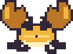</a> |

A pixel art usa **48 × 48 pixels lógicos por célula**, tons chapados, arestas em degraus e sombras curtas. Plantas e flores baixas são decorativas. Rochas, solo firme e baixios se distinguem pela forma e textura, não só pela cor.

[Logo em PNG](docs/arte/galeria/identidade/logo-oficial.png) · [Atlas de arte](docs/arte/Mare-Miuda-Atlas-de-Arte.pdf) · [Guia de arte](docs/arte/README.md).

</details>

<details>
<summary><strong>Paleta · cores da arte e da interface</strong></summary>

A base do oceano das travessias é **`#142E47`**. Estas são amostras de areia dos renderizadores atuais, não a paleta completa.

| Mundo | Areia seca | Areia molhada |
| --- | --- | --- |
| Praia das Conchas | `#EAD0A3` | `#B68C6B` |
| Recifes Expostos | `#E2DCCA` | `#9F877E` |
| Mangue dos Siris Duplos | `#E1B873` | `#91765D` |
| Enseada da Garça | `#EADABA` | `#B29E8B` |
| Ilhas à Deriva | `#E8B77B` | `#B68D68` |
| Grutas da Espuma | `#DED1C8` | `#A092A6` |
| Baía das Brasas | `#777378` | `#464850` |
| Arquipélago do Farol | `#CBD0B0` | `#919E99` |

Nos painéis: base `#112D38`, texto claro `#FDF0CB`, areia da moldura `#DFAC6F` e dourado de destaque `#FFE2A3`. Nas travessias, areia, baixio e oceano também se distinguem por textura, contorno e reflexo.

</details>

<details>
<summary><strong>Telas, câmera e acessibilidade</strong></summary>

- **Porto:** campanha, Ilha de Improviso, Som e música e Créditos.
- **Arquipélago:** seleção de mundos em cartões. Cada seletor de fases tem quatro páginas, duas colunas no computador e uma fase por linha no celular. Ícones e textos distinguem disponibilidade, conclusão, bônus e chefes.
- **Travessia:** a câmera centraliza toda a área jogável, inclusive baixios submersos. Cenário e tabuleiro escalam juntos; título, painel e botões ficam fora do zoom. A moldura pode recortar o cenário, não a rota.
- **Janelas auxiliares:** Configurações, Som e música, Créditos e Ilha de Improviso abrem no centro, com o fundo escurecido em 79%. Ao fechar, o foco volta ao botão de origem.
- **Acessibilidade:** teclado, toque, mapa em texto, avisos para leitores de tela e preferência de movimento reduzido. Elementos decorativos não capturam foco. Verificação automatizada não substitui teste em aparelho físico.

[Guia da interface](docs/interface/README.md) · [Câmera, moldura e oceano](docs/arte/camera/README.md) · [PDF do Arquipélago](docs/interface/Mare-Miuda-Arquipelago.pdf).

</details>

<details>
<summary><strong>Animações · maré, Siris, garça, resultados e cenário</strong></summary>

- A passada da campanha dura **205 ms**, sem mudar a lógica do turno.
- A água avança ou recua conforme a vizinhança do baixio. A maré cobre o Siri na direção da inundação. Fendas têm entrada e saída animadas; o rasante usa a garça oficial.
- Depois de um erro recuperável, o Siri afetado pisca três vezes. Os quadros de vitória e derrota são centralizados, com conchas na vitória e espirais na derrota.
- Espuma e vapor são decorativos. Com movimento reduzido, a apresentação muda, não as regras.
- O registro sem som inclui estudos de maré anteriores. Ele não documenta as revisões mais recentes de resultado e retorno.

[Guia e capítulos de animação](docs/arte/animacoes/README.md) · [Vídeo ampliado sem som](docs/arte/animacoes/Mare-Miuda-Animacoes-Sem-Som-Ampliadas.mp4).

</details>


<a id="trilha-sonora"></a>

## Áudio

<details open>
<summary><strong>Trilha sonora · construção de A Outra Margem</strong></summary>

[Ouvir a faixa oficial para violão de nylon (MP3)](docs/arte/trilha-sonora/a-outra-margem-violao.mp3).

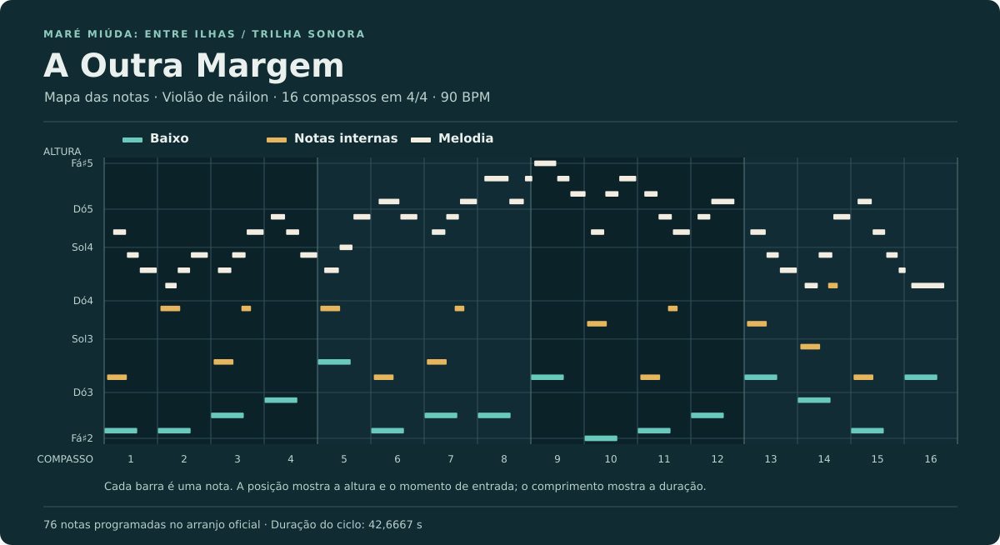

O gráfico usa os **76 eventos da composição oficial**, separados em baixo, notas internas e melodia: 16 compassos em 4/4 a 90 BPM. O jogo toca um ciclo estéreo de 42,6667 segundos, sem o fade do MP3 de escuta. A música segue entre as telas e tem volume separado dos efeitos.

[Construção da faixa e detalhes do loop](docs/arte/trilha-sonora/README.md#como-a-faixa-foi-construída) · [Dados das notas (CSV)](docs/arte/trilha-sonora/eventos-a-outra-margem.csv).

</details>

<details>
<summary><strong>Efeitos sonoros · jogo e interface</strong></summary>

Os efeitos sinalizam eventos como maré, fendas, coleta, erro, retorno, vitória e derrota. O clique de botão é separado dos dez efeitos da travessia e não toca com a simples passagem do cursor. A ação continua compreensível sem som.

A Praia das Conchas acrescenta uma passada suave na areia, distinta dos sons da maré e do resultado.

[Ouvir os 11 efeitos originais (MP3)](docs/arte/efeitos-sonoros/Mare-Miuda-Efeitos-Mais-Sutis.mp3) · [Catálogo dos efeitos e seus eventos](docs/arte/efeitos-sonoros/README.md).

</details>


## Arquitetura e código

<details open>
<summary><strong>Linguagens, estrutura e fluxo da edição jogável</strong></summary>

**JavaScript (módulos ES)** implementa o jogo; **HTML e CSS** compõem telas e painéis; **Canvas 2D** desenha o tabuleiro. O montador é **Python** e os testes rodam em **Node.js**. A interface e a documentação estão disponíveis em português do Brasil e em inglês. *Tiny Tide: Between Islands* é o título da edição em inglês.

| Local | Responsabilidade |
| --- | --- |
| [index.html](edicao-oficial/index.html) | Estrutura das telas, diálogos e controles. |
| [src/app.mjs](edicao-oficial/src/app.mjs) | Ponto de entrada: comandos, tela, áudio, save e renderização. |
| [src/campanha/fichas/](edicao-oficial/src/campanha/fichas/) | Mapas, objetivos, soluções e ordem das travessias. |
| [src/render/](edicao-oficial/src/render/) e [src/interface/](edicao-oficial/src/interface/) | Renderização, efeitos, painéis e letreiros. |
| [estilos/](edicao-oficial/estilos/) e [assets.zip](edicao-oficial/assets.zip) | Apresentação, sprites, fontes, trilha e efeitos. |
| [montar.py](edicao-oficial/montar.py) e [verificacao.json](edicao-oficial/verificacao.json) | Build offline e verificação de integridade. |
| [testes/](edicao-oficial/testes/) | Campanha, animações, áudio e painéis. |

**Fluxo:** comando → validação → estado e maré → quadro da travessia e efeitos. O navegador guarda progresso e preferências localmente. IDs legados ajudam a preservar saves e não reativam regras antigas. O montador reúne mídias e módulos num HTML sem usar a rede. [Guia de produção](docs/producao/README.md).

</details>

<details>
<summary><strong>Testes da edição oficial</strong></summary>

Depois de gerar o HTML:

```sh
for teste in campanha passada resultados-e-retorno trilha efeitos paineis idiomas; do
  node "edicao-oficial/testes/${teste}.mjs" dist/mare-miuda-prototipo.html || exit 1
done
```

O teste da campanha reproduz **231 soluções e 4.007 passos válidos**, sem levadas. As outras suítes verificam passada, resultados, áudio e janelas no HTML gerado. [Ver também as checagens manuais](docs/producao/README.md).

</details>


<a id="documentação-visual"></a>

## PDFs e vídeos

<details open>
<summary><strong>Quatro PDFs · acervo completo</strong></summary>

| PDF | Conteúdo |
| --- | --- |
| [Atlas de arte](docs/arte/Mare-Miuda-Atlas-de-Arte.pdf) | Areias, células, estruturas, plantas e animais. |
| [Catálogo das 231 travessias](docs/arte/catalogo-231-travessias/Mare-Miuda-231-Travessias.pdf) | 462 quadros, com maré baixa e alta e índice por mundo. |
| [Arquipélago](docs/interface/Mare-Miuda-Arquipelago.pdf) | Cartões dos mundos no computador e no celular. |
| [Progressão e mecânicas](docs/campanha/Mare-Miuda-Progressao-e-Mecanicas.pdf) | Regras, exemplos e evolução dos desafios. |

[Índice da documentação](docs/README.md).

</details>

<details open>
<summary><strong>Dois vídeos · campanha e animações</strong></summary>

| Vídeo | Formato e conteúdo |
| --- | --- |
| [Os oito mundos (MP4)](docs/arte/animacoes/Mare-Miuda-Os-Oito-Mundos.mp4) | 4 min 22,5 s · 1600 × 900 · 60 fps. 24 vitórias da campanha, uma na Ilha de Improviso, Som e música e Créditos. Trilha e efeitos do jogo na montagem. |
| [Animações sem som, ampliadas (MP4)](docs/arte/animacoes/Mare-Miuda-Animacoes-Sem-Som-Ampliadas.mp4) | 2 min 15 s · 1440 × 810 · 60 fps. Movimentos, resultados e estudos das variações de maré. |

[Capítulos do filme](docs/arte/animacoes/README.md#os-oito-mundos) · [Detalhes do vídeo sem som](docs/arte/animacoes/README.md#registro-de-animações-sem-som).

</details>


© 2026 Luigi Scofano de Araújo. Todos os direitos reservados.
