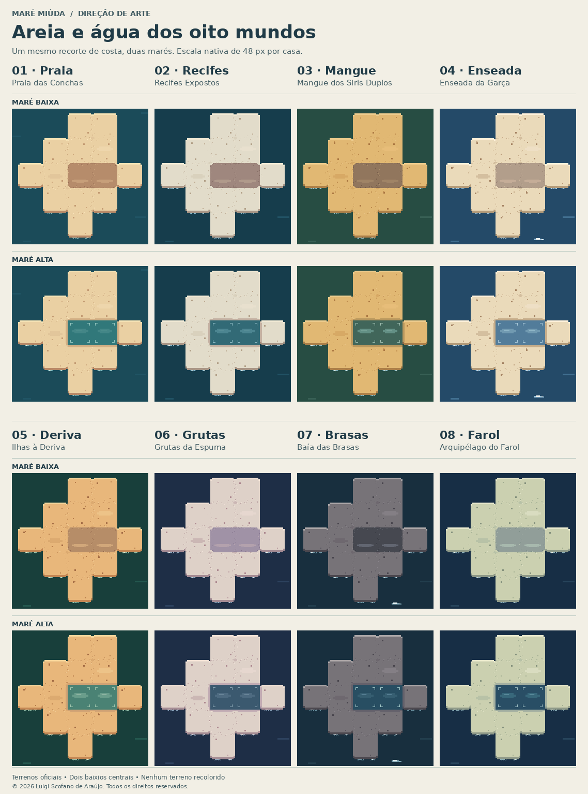

# Areia e água dos oito mundos

[Voltar ao guia de arte](../README.md) · [Abrir PNG em tamanho original](Mare-Miuda-Areia-e-Agua-dos-Oito-Mundos.png)

## Como ler a prancha

Os dezesseis quadros usam uma mesma grade de cinco por cinco, com dois baixios centrais. Assim, dá para comparar as cores e os detalhes sem confundir mudanças de terreno com diferenças de caminho. Na maré baixa, os baixios aparecem expostos; na alta, as duas casas centrais ficam cobertas. A areia seca das margens continua visível.

1. Praia das Conchas
2. Recifes Expostos
3. Mangue dos Siris Duplos
4. Enseada da Garça
5. Ilhas à Deriva
6. Grutas da Espuma
7. Baía das Brasas
8. Arquipélago do Farol

A prancha foi montada a partir das paletas e do desenho de piso, juntas e água da campanha offline, em escala nativa de 48 pixels por casa. Não há personagens, objetos interativos ou obstáculos. É uma referência comparativa de arte, não um conjunto de mapas jogáveis.

## Arquivo e créditos

- Formato: PNG, 1138 × 1534 pixels.
- SHA-256: `9c415800f4737df177852ba2877e0c8d5276efbb98e1e233b3fb896d53456378`.
- © 2026 Luigi Scofano de Araújo. Todos os direitos reservados.
