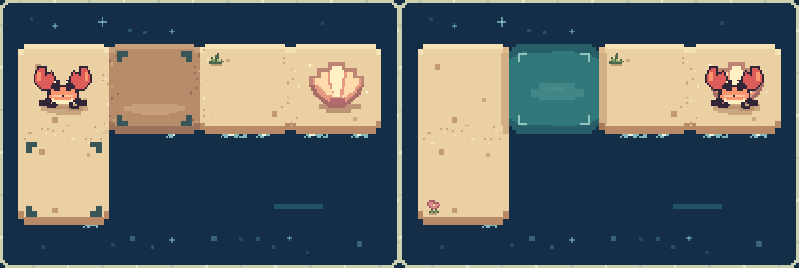

# Visual catalog of the 231 crossings

[Português](README.md) · **English**

For a selection in motion, [The eight worlds film](../animacoes/README.en.md#the-eight-worlds) follows 24 campaign victories, three per world.

The **Maré Miúda: Entre Ilhas** (**Tiny Tide: Between Islands**) campaign in 462 images: one at low tide and one at high tide for each level, in the order of the game's selector.

- **[PDF catalog](Mare-Miuda-231-Travessias.pdf)**: cover with shortcuts to the eight worlds, one page per level, and both tides side by side.
- **[Technical index (TSV)](indice.tsv)**: name, stable identifier, category, PDF page, reference filenames, and SHA-256 of each PNG. It can be opened as a tab-separated spreadsheet.

## Campaign by world

| World | Regular | Optional bosses | Bonus | Total | Starting page |
| --- | ---: | ---: | ---: | ---: | ---: |
| 01. Praia das Conchas | 25 | 2 | 4 | 31 | 2 |
| 02. Recifes Expostos | 25 | 2 | 2 | 29 | 33 |
| 03. Mangue dos Siris Duplos | 25 | 2 | 0 | 27 | 62 |
| 04. Enseada da Garça | 25 | 2 | 4 | 31 | 89 |
| 05. Ilhas à Deriva | 25 | 2 | 2 | 29 | 120 |
| 06. Grutas da Espuma | 25 | 2 | 1 | 28 | 149 |
| 07. Baía das Brasas | 25 | 2 | 1 | 28 | 177 |
| 08. Arquipélago do Farol | 25 | 2 | 1 | 28 | 205 |
| **Total** | **200** | **16** | **15** | **231** | |

The catalog covers the campaign. It does not include Laboratório or the challenges generated in Ilha de Improviso.

## Example: Passagem da primeira onda

On the left, low tide at the start. On the right, high tide after three steps.

## How the frames were captured

The images show only the **crossing camera**, without menus or controls. They were produced by the game's renderer in the 1,600 × 900 px desktop profile, with a 1,200 × 808 px camera. Low tide was captured at step zero. For high tide, the engine received three valid commands and applied the tide change; no crab was swept away in these sequences. Because the crab moves between captures, each pair shows two moments in a run, not the same position recolored.

The automation ran the real engine and renderer in a controlled environment, with reduced motion to capture stable states. The 462 frames embedded in the PDF were checked pixel by pixel against the original PNGs. The PDF is an exact copy of the delivered catalog.

| Artifact | SHA-256 |
| --- | --- |
| Playable HTML used to produce the images | `d9d4952eab0d0e9a1b60e9bb700a4e5a2cdec933b8d358fdc71e6a4a75fe93e7` |
| Mare-Miuda-231-Travessias.pdf | `921163c3fe8c8b506ec3c4f65a5dd4d2b05831a38904f1ca3a4097e553a742ce` |

© 2026 Luigi Scofano de Araújo. All rights reserved.
