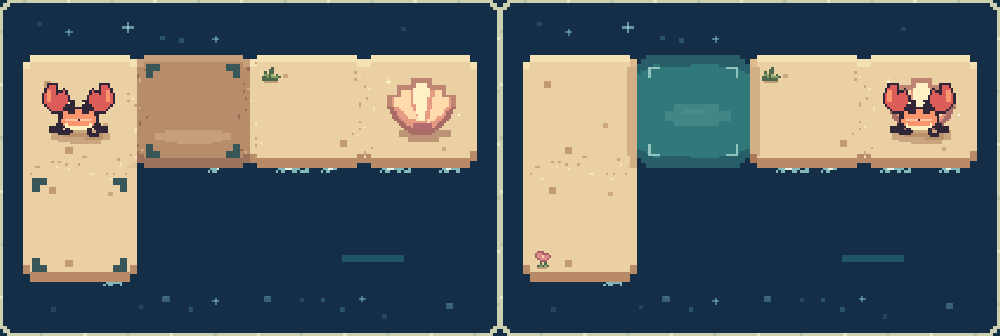

# Catálogo visual das 231 travessias

A campanha de **Maré Miúda: Entre Ilhas** em 462 imagens: uma de maré baixa e outra de maré alta para cada fase, na ordem do seletor do jogo.

- **[Catálogo em PDF](Mare-Miuda-231-Travessias.pdf)**: capa com atalhos para os oito mundos, uma página por fase e as duas marés lado a lado.
- **[Índice técnico (TSV)](indice.tsv)**: nome, identificador estável, categoria, página no PDF, nomes dos arquivos de referência e SHA-256 de cada PNG. Pode ser aberto como planilha separada por tabulação.

## Campanha por mundo

| Mundo | Regulares | Chefes opcionais | Bônus | Total | Página inicial |
| --- | ---: | ---: | ---: | ---: | ---: |
| 01. Praia das Conchas | 25 | 2 | 4 | 31 | 2 |
| 02. Recifes Expostos | 25 | 2 | 2 | 29 | 33 |
| 03. Mangue dos Siris Duplos | 25 | 2 | 0 | 27 | 62 |
| 04. Enseada da Garça | 25 | 2 | 4 | 31 | 89 |
| 05. Ilhas à Deriva | 25 | 2 | 2 | 29 | 120 |
| 06. Grutas da Espuma | 25 | 2 | 1 | 28 | 149 |
| 07. Baía das Brasas | 25 | 2 | 1 | 28 | 177 |
| 08. Arquipélago do Farol | 25 | 2 | 1 | 28 | 205 |
| **Total** | **200** | **16** | **15** | **231** | |

O catálogo cobre a campanha. Não inclui o Laboratório nem os desafios gerados na Ilha de Improviso.

## Exemplo: Passagem da primeira onda

À esquerda, maré baixa no início. À direita, maré alta após três passos.

## Como os quadros foram obtidos

As imagens mostram apenas a **câmera da travessia**, sem menus nem controles. Elas foram produzidas pelo renderizador do jogo no perfil de computador de 1.600 × 900 px, com câmera de 1.200 × 808 px. A maré baixa foi capturada no passo zero. Para a alta, o motor recebeu três comandos válidos e aplicou a virada de maré; nenhum Siri foi levado nessas sequências. Como o Siri se move entre as capturas, os pares mostram dois momentos da partida, não a mesma posição recolorida.

A automação executou o motor e o renderizador reais em ambiente controlado, com movimento reduzido para capturar estados estáveis. Os 462 quadros embutidos no PDF foram conferidos pixel a pixel com os PNGs originais. O PDF é uma cópia exata da entrega do catálogo.

| Artefato | SHA-256 |
| --- | --- |
| HTML jogável que originou as imagens | `d9d4952eab0d0e9a1b60e9bb700a4e5a2cdec933b8d358fdc71e6a4a75fe93e7` |
| Mare-Miuda-231-Travessias.pdf | `921163c3fe8c8b506ec3c4f65a5dd4d2b05831a38904f1ca3a4097e553a742ce` |

© 2026 Luigi Scofano de Araújo. Todos os direitos reservados.
