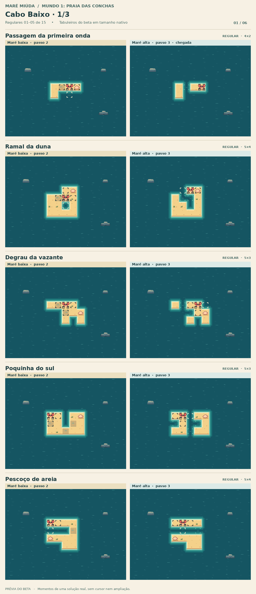
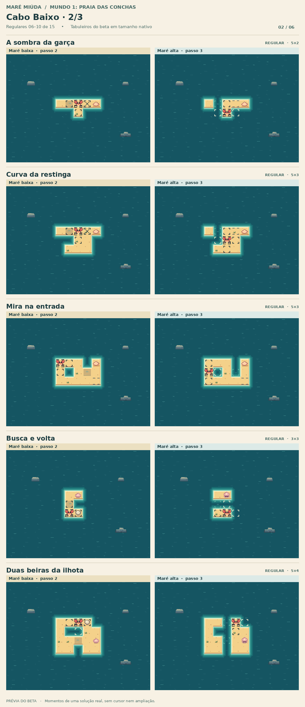
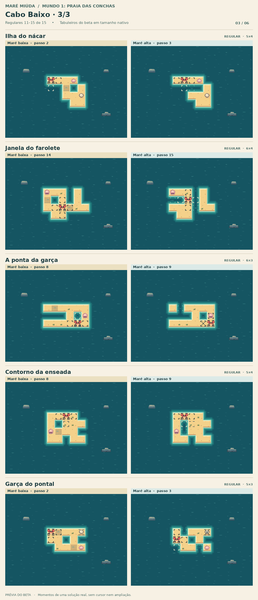
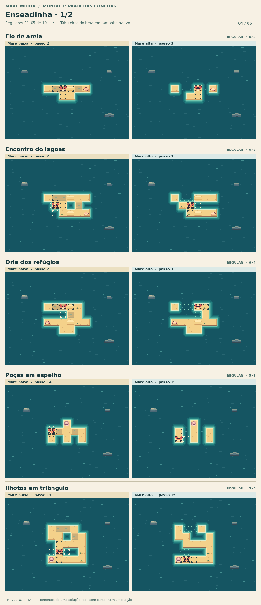
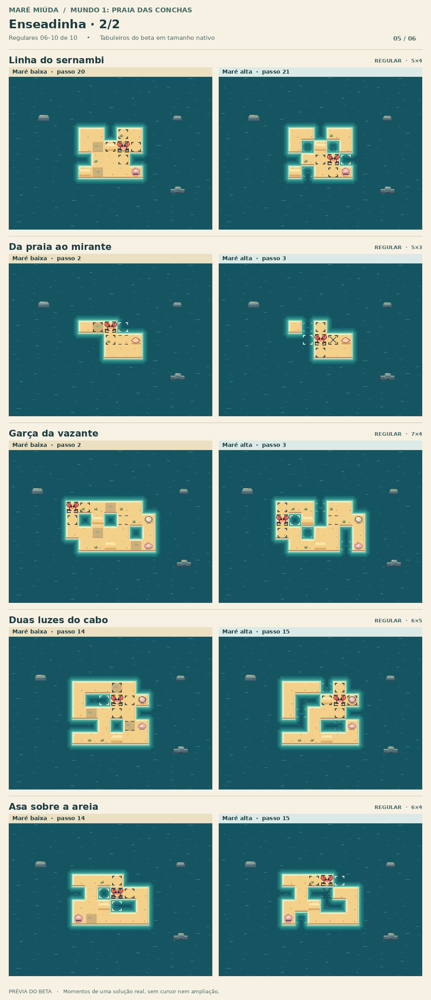
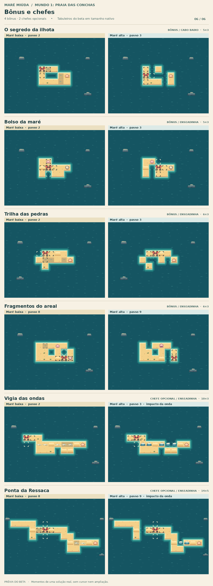

# Fase beta: Maré Miúda, Entre Ilhas

Este caderno preserva a edição privada anterior à retirada das ondas dos chefes. É um **registro histórico**, não uma descrição da versão corrente. A Praia das Conchas reúne **25 travessias regulares, quatro bônus e dois chefes opcionais**. O catálogo desta revisão tinha oito mundos e 231 desafios de campanha; a Ilha de Improviso e a bancada não entram nesse total.

## Praia das Conchas: 31 fases, duas marés

| Folha | Conteúdo | Abrir PNG |
| --- | --- | --- |
| 1 | Cabo Baixo, regulares 1–5 | [Cabo Baixo 1/3](pranchas/praia-das-conchas-01-cabo-baixo-1.png) |
| 2 | Cabo Baixo, regulares 6–10 | [Cabo Baixo 2/3](pranchas/praia-das-conchas-02-cabo-baixo-2.png) |
| 3 | Cabo Baixo, regulares 11–15 | [Cabo Baixo 3/3](pranchas/praia-das-conchas-03-cabo-baixo-3.png) |
| 4 | Enseadinha, regulares 1–5 | [Enseadinha 1/2](pranchas/praia-das-conchas-04-enseadinha-1.png) |
| 5 | Enseadinha, regulares 6–10 | [Enseadinha 2/2](pranchas/praia-das-conchas-05-enseadinha-2.png) |
| 6 | Quatro bônus, Vigia das Ondas e Ponta da Ressaca | [Bônus e chefes](pranchas/praia-das-conchas-06-bonus-e-chefes.png) |

Os 62 quadros saem do renderizador do beta, em 512 × 384 pixels nativos, sem cursor nem suavização. Cada par acompanha ações válidas de uma solução do catálogo. Na primeira fase, a maré alta coincide com a chegada. Nos chefes, o quadro de alta registra o instante do impacto. Não são layouts conceituais nem capturas de aparelho. Os ensaios com pedras avulsas adicionais eram propostas visuais; esta galeria registra as três estruturas do renderizador.

Ver as seis pranchas no GitHub

## Arte, telas e materiais de origem

| Registros desta revisão | O que mostram |
| --- | --- |
| [Busca e volta: ostra fechada e aberta](capturas/busca-e-volta-ostra.png) | Recortes nativos antes e depois da coleta da pérola. |
| [Vigia das ondas: aviso, crista e reação](capturas/vigia-impacto.png) | Recortes do aviso inicial, aviso forte, virada protegida e virada com levada. |
| [Pranchas do Mundo 1](#praia-das-conchas-31-fases-duas-marés) | Terreno, marés, refúgios, grãos, pérolas, ostras e estruturas oceânicas efetivamente exibidos. |

As referências abaixo já ficam versionadas em seus próprios cadernos; são **material de origem, não capturas novas desta revisão**:

- [Abertura no desktop](../../processo-de-criacao/03-fatia-vertical/capturas/abertura-placa-desktop.png) e [em celular emulado](../../processo-de-criacao/03-fatia-vertical/capturas/abertura-placa-mobile-emulado.png). A [Placa de Areia](../../../assets/logo-placa-de-areia-pt.png) é a arte usada na abertura.
- [Arquipélago Meia-Lua](../../processo-de-criacao/33-seletor-arquipelago/README.md), com capturas, fundo e marcos. Os [estudos dos seletores da Praia](../../processo-de-criacao/34-seletores-praia/README.md) documentam o mapa caminhável anterior, não a lista direta do beta.
- [Fauna, originais e fontes](../fauna/README.md): [folha de sprites](../../../assets/fauna/spritesheet.png), siri recortado da marca, variantes do trio e poses da garça.
- [Ilha de Improviso](../../processo-de-criacao/39-ilha-de-improviso/README.md) e [seletor direto](../../campanha/seletor-direto.md): contratos das duas interfaces.

### Índice de travessias por mundo

A fonte de todas as fases está no [catálogo Git fixado do beta](https://github.com/luigiscofano/mare-miuda-entre-ilhas/tree/8529b77221b8717cffeaa6db0ed4211359deb23d/src/fases). Os cadernos abaixo reúnem amostras e decisões visuais; os de outros mundos **não** são pranchas completas da revisão beta.

| Mundo | Registro visual | Seletores históricos |
| --- | --- | --- |
| Praia das Conchas | [31 fases no beta](#praia-das-conchas-31-fases-duas-marés) e [origem da arte](../../processo-de-criacao/29-travessia-praia/README.md) | [Cabo Baixo e Enseadinha](../../processo-de-criacao/34-seletores-praia/README.md) |
| Recifes Expostos | [Duas marés](../../processo-de-criacao/30-travessias-recifes-mangue/README.md#recifes-expostos) | [Recifes e Mangue](../../processo-de-criacao/35-seletores-recifes-mangue/README.md) |
| Mangue dos Siris Duplos | [Duas marés](../../processo-de-criacao/30-travessias-recifes-mangue/README.md#mangue-dos-siris-duplos) | [Recifes e Mangue](../../processo-de-criacao/35-seletores-recifes-mangue/README.md) |
| Enseada da Garça | [Duas marés](../../processo-de-criacao/31-travessias-enseada-deriva/README.md#enseada-da-garça) | [Enseada e Deriva](../../processo-de-criacao/36-seletores-enseada-deriva/README.md) |
| Ilhas à Deriva | [Duas marés](../../processo-de-criacao/31-travessias-enseada-deriva/README.md#ilhas-à-deriva) | [Enseada e Deriva](../../processo-de-criacao/36-seletores-enseada-deriva/README.md) |
| Grutas da Espuma | [Duas marés](../../processo-de-criacao/32-travessias-grutas-ressaca-farol/README.md#quadros-do-tabuleiro) | [Grutas, Baía e Farol](../../processo-de-criacao/37-seletores-mundos-finais/README.md) |
| Baía da Ressaca | [Duas marés](../../processo-de-criacao/32-travessias-grutas-ressaca-farol/README.md#quadros-do-tabuleiro) | [Grutas, Baía e Farol](../../processo-de-criacao/37-seletores-mundos-finais/README.md) |
| Arquipélago do Farol | [Duas marés](../../processo-de-criacao/32-travessias-grutas-ressaca-farol/README.md#quadros-do-tabuleiro) | [Grutas, Baía e Farol](../../processo-de-criacao/37-seletores-mundos-finais/README.md) |

**Limites da galeria:** há 62 quadros do Mundo 1, não de todas as 231 fases, dos demais estados de cada fase ou das possibilidades do Improviso. Não há laudo de aparelho físico. Telas e movimentos não ilustrados podem ser reabertos no snapshot abaixo.

## Regras e escolhas do beta

- **Maré por passos:** a água sobe após três movimentos válidos e baixa após mais três. Movimento bloqueado e troca de siri não consomem passos. Baixio coberto impede passagem; pedras nunca são piso. Refúgio de areia firme é transitável. Água e garça são avaliadas antes de coleta e vitória. A terceira levada encerra a tentativa.
- **Campanha:** oito mundos, arquipélago caminhável e listas clicáveis dentro das regiões. A Praia divide-se em Cabo Baixo e Enseadinha. As travessias novas abrem nos pontos de ensino existentes. Bônus e chefes são opcionais.
- **Camada visual:** cada casa tem 16 × 16 pixels lógicos e 32 × 32 no render nativo. Grãos quadrados ficam na areia seca. Três estruturas ficam fora da grade ativa. Pérolas mantêm sua cor pela ordem original; a ostra abre após a coleta completa.
- **Ondas históricas:** as faixas marcavam as casas atingidas em nove fases: **Vigia das Ondas**, **Ponta da Ressaca**, **Vento Sul**, **Ressaca Alta** e cinco travessias da expansão da Baía da Ressaca (**A primeira faixa**, **Argolas da vazante**, **Portinhola dos flutuantes**, **Lâminas da marola** e **Cais da última rebentação**). A espuma avisava na baixa; na alta, a crista frontal da onda aparecia por 360 ms na faixa atingida. A crista era estática e não alterava o motor. A faixa era distinta da maré normal.
- **Depois do beta:** a revisão seguinte retira a regra da faixa, o aviso e a crista das ondas dessas nove fases. Permanecem o ciclo normal de marés, os baixios, os refúgios, a garça, a Fenda de Recife, as pérolas, as ostras e a água decorativa. Este caderno preserva a experiência anterior sem ativá-la na linha corrente.

Para consultar a implementação histórica, veja [a arte da onda](https://github.com/luigiscofano/mare-miuda-entre-ilhas/blob/8529b77221b8717cffeaa6db0ed4211359deb23d/src/render/onda-frontal.ts), [seus testes](https://github.com/luigiscofano/mare-miuda-entre-ilhas/blob/8529b77221b8717cffeaa6db0ed4211359deb23d/tests/onda-frontal.test.ts) e [os cinco mapas de expansão](https://github.com/luigiscofano/mare-miuda-entre-ilhas/blob/8529b77221b8717cffeaa6db0ed4211359deb23d/src/fases/expansao/ressaca.ts).

## Abrir a edição jogável arquivada

A [árvore Git privada do beta](https://github.com/luigiscofano/mare-miuda-entre-ilhas/tree/8529b77221b8717cffeaa6db0ed4211359deb23d) fixa o conteúdo, mesmo se o código corrente mudar ou os artefatos de CI expirarem. É necessário ter acesso ao repositório. Não há deploy público.

~~~sh
git clone https://github.com/luigiscofano/mare-miuda-entre-ilhas.git mare-miuda-fase-beta
cd mare-miuda-fase-beta
git switch --detach 8529b77221b8717cffeaa6db0ed4211359deb23d
npm test
npm run build
npm run test:offline
~~~

Com Node.js 24 ou posterior, o build gera **dist/mare-miuda-prototipo.html**, que abre diretamente no navegador, sem conexão. Para jogar servido localmente, use **npm run serve** com Python 3 e abra **http://127.0.0.1:4173**. Use um perfil separado do navegador (ou uma porta diferente) para isolar o progresso da versão corrente. Nenhum ZIP ou HTML gerado faz parte desta pasta: o histórico Git preserva as fontes para reconstruí-los.

© 2026 Luigi Scofano de Araújo. Todos os direitos reservados.
