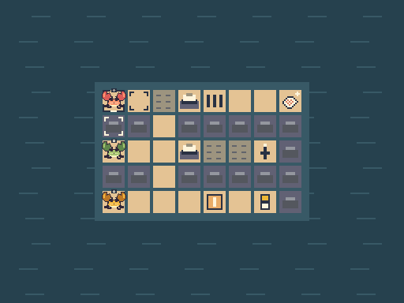
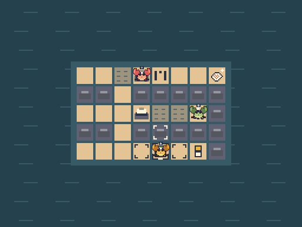
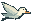
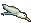

# Fauna · sprites e leitura da fase

O Coral é o recorte original da Placa de Areia. Verde e Amarelo mantêm exatamente os 31 × 23 pixels, a silhueta e os espaços transparentes do Coral. Só quatro cores da carapaça mudam. As insígnias são desenhadas **acima** dos sprites, sem alterar sua arte. A barra sob o personagem identifica o ativo; a descrição do mapa informa os nomes, as coordenadas e quem se move com o próximo comando.

| Coral · círculo | Verde · quadrado | Amarelo · triângulo |
| --- | --- | --- |
|  |  |  |




*Quadros do renderizador de jogo, sem cursor. Terreno em grade lógica de 16 px por casa e superfície nativa de 512 × 384; sprites de 31 × 23 na superfície. O cenário permanece provisório.*

| Garça em patrulha | Garça em rasante |
| --- | --- |
|  |  |

A garça aparece ao lado da previsão, sem cobrir nenhuma casa. Patrulha é a postura padrão da ameaça; o rasante aparece quando o próximo passo está marcado. O X e o texto de destino continuam sendo os avisos de risco no tabuleiro. A pose não é uma regra ou um relógio novo.

## Fontes e exportação

As fontes estão em [fontes/](fontes/). As dimensões e os bytes da arte são verificados em `tests/fauna.test.ts`. Para reconstruir os quadros, use Python com Pillow, na raiz do repositório:

```sh
mkdir -p /tmp/fauna-mare
cp docs/arte/fauna/fontes/desenhar_garca.py /tmp/fauna-mare/
python /tmp/fauna-mare/desenhar_garca.py
python docs/arte/fauna/fontes/recolorir_siris.py assets/logo-placa-de-areia-pt.png /tmp/fauna-mare
python docs/arte/fauna/fontes/montar_folha.py /tmp/fauna-mare
```

O build copia a folha e as duas poses sem reamostrar e usa os mesmos arquivos no HTML offline. Para ampliar, use fator inteiro por vizinho mais próximo. Os arquivos individuais e a folha têm apenas pixels opacos ou totalmente transparentes.
