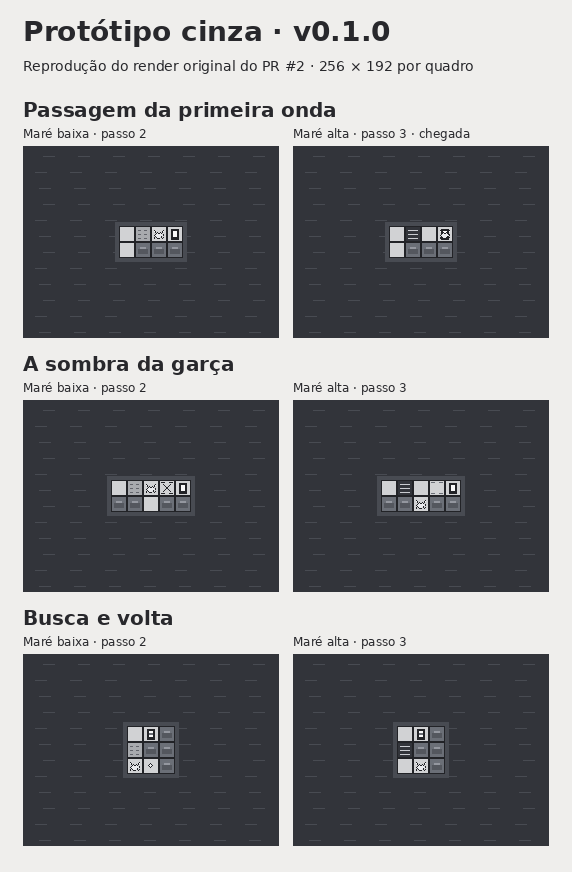

# Protótipo inicial em preto e branco · v0.1.0

A primeira edição jogável é o **protótipo cinza**: tipografia simples, tabuleiro em tons de cinza e três fases curtas. É anterior ao mapa de campanha, à marca de abertura e à arte colorida da Praia. Não deve ser confundida com a [fase beta posterior](../fase-beta/README.md).

## Jogar a cópia original

Abra o [HTML autônomo preservado](../../processo-de-criacao/02-prototipo/prototipo-cinza-v0.1.0.html) no GitHub, baixe-o e abra o arquivo no navegador. Ele já contém CSS e JavaScript; não precisa de rede. O arquivo permanece onde foi arquivado, **sem sobrescrita ou cópia redundante**.

| Origem | O que o registro guarda |
| --- | --- |
| [#1 · Fundação](../../processo-de-criacao/01-fundacao/README.md) | Regra de maré por turnos, desenho do motor e mapas de teste. É o registro estrutural, não a edição jogável. |
| [#2 · Protótipo cinza](https://github.com/luigiscofano/mare-miuda-entre-ilhas/pull/2) | Primeira edição jogável. [Árvore exata das fontes](https://github.com/luigiscofano/mare-miuda-entre-ilhas/tree/ca4deb941dbcc32cc1c3b9770ed30f46e8fe7ae4). A entrega inicial foi registrada em 19/11/2026, às 20h45 (Brasília). |
| [#3 · Estudos de marca](https://github.com/luigiscofano/mare-miuda-entre-ilhas/pull/3) | Placa de Areia e Corrente de Espuma, em português e inglês. [Estudos preservados](https://github.com/luigiscofano/mare-miuda-entre-ilhas/blob/d6695646fc0898666b843929468e8132d3d7b58c/docs/processo-de-criacao/identidade-visual/01-placa-e-corrente/README.md); não faziam parte do protótipo cinza. |
| [#4 · Cópia histórica](https://github.com/luigiscofano/mare-miuda-entre-ilhas/pull/4) | Conservou o [HTML original byte a byte](https://github.com/luigiscofano/mare-miuda-entre-ilhas/blob/74295bd88f34d4c4b8a395a3d74cd24edfd3a467/docs/processo-de-criacao/02-prototipo/prototipo-cinza-v0.1.0.html) e registrou a transição para a [fatia colorida da Praia](../../processo-de-criacao/03-fatia-vertical/README.md). |

O HTML arquivado tem **43.977 bytes** e SHA-256 **ed1dd8448590a78789c6959844060dd46f17731e41fdfee548853830043e4811**. A recompilação da árvore do #2 produziu os mesmos bytes. A [execução histórica](https://github.com/luigiscofano/mare-miuda-entre-ilhas/actions/runs/44640476232) registrou 14 testes do motor e uma checagem offline simulada; não confirmou Safari nem aparelho físico.

## As três fases e seus sprites

| Fase | O que ensinava |
| --- | --- |
| Passagem da primeira onda | Completar o terceiro passo em solo firme quando a maré sobe. |
| A sombra da garça | Ler o aviso e contornar o alvo antes do ataque da garça. |
| Busca e volta | Recolher o fragmento e voltar à saída em outra janela de maré. |

As [fichas da época](../../processo-de-criacao/02-prototipo/fichas-das-tres-fases.md) conservam mapas, objetivos e soluções. A grade era de 256 × 192, com casas de 16 × 16. A concha era um retângulo claro, os traços do baixio mudavam com a maré e o X anunciava a casa da garça.

**Reproduções novas, não capturas da época.** Os seis quadros foram produzidos pelo motor e renderizador exatos do #2, sem recriar cores ou casas. As duas exportações abaixo copiam os pixels das matrizes da [fonte original](https://github.com/luigiscofano/mare-miuda-entre-ilhas/blob/ca4deb941dbcc32cc1c3b9770ed30f46e8fe7ae4/src/render/index.ts), sem redesenho nem suavização:

- [Siri original, 12 × 11](reproducoes/siri-original.png).
- [Fragmento original, 5 × 5](reproducoes/fragmento-original.png).

**Lacunas:** a árvore do #2 não contém PNGs independentes nem capturas contemporâneas. Os desenhos de piso, concha, garça e personagem viviam no código. Não há captura confirmada de aparelho ou vídeo dessa edição no material recuperado; a cópia jogável e as matrizes originais preservam o que pode ser reproduzido.

## Reconstruir pelas fontes

Com Node.js 24 ou posterior, use uma cópia separada do repositório privado:

~~~sh
git clone https://github.com/luigiscofano/mare-miuda-entre-ilhas.git mare-miuda-prototipo-cinza
cd mare-miuda-prototipo-cinza
git switch --detach ca4deb941dbcc32cc1c3b9770ed30f46e8fe7ae4
npm test
npm run build
npm run test:offline
~~~

Abra **dist/mare-miuda-prototipo.html**. O jogo inicial não reativa sua arte nem suas regras na versão corrente.

© 2026 Luigi Scofano de Araújo. Todos os direitos reservados.
