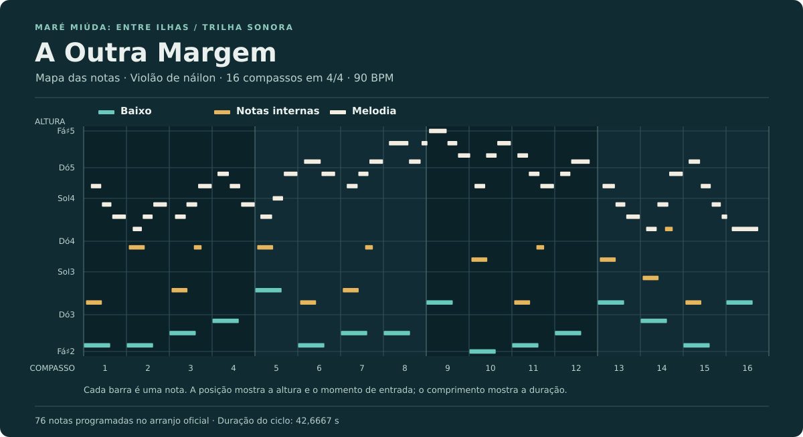

# A Outra Margem

[Português](README.md) · **English**

[Back to the art guide](../README.en.md) · [Build and verification](../../producao/README.en.md#music-checks)

**A Outra Margem** accompanies the offline edition of *Maré Miúda: Entre Ilhas* (*Tiny Tide: Between Islands*). The **nylon-string guitar** arrangement uses quiet bass, sparse accompaniment, and space between melodic phrases. The same track plays across all eight worlds. There is no separate track for each world and no piano version in the game.

[Listen to the official guitar arrangement (MP3)](a-outra-margem-violao.mp3). This listening copy fades out; the game uses the WAV without that fade so it can loop without a pause.

## How the track was built

The chart comes from the note events in the composition used by the game. The horizontal axis shows **16 bars in 4/4 at 90 BPM**; the vertical axis shows pitch. Each bar in the chart shows the onset and duration of a programmed note. This is not an ear transcription or guitar tablature.

| Part | Notes | Role |
| --- | ---: | --- |
| Bass | 16 | One entrance per measure supports the fingerpicking from below. |
| Inner notes | 15 | Spaced accompaniment without doubling the melody with full chords. |
| Melody | 45 | Opens with A4–F♯4–E4, reaches F♯5 in measure 9, and closes on D4 in measure 16. |

All three parts use the **nylon-string guitar** timbre (zero-indexed MIDI program 24). Small variations in onset, up to 7 ms, and velocity give the attacks some variety. The renderer plays three cycles and keeps the middle one so the sound carries naturally across the seam. The final loop lasts 42.6667 seconds and does not include the listening MP3's fade.

[Download the 76 note events as CSV](eventos-a-outra-margem.csv).

## How it plays in the game

Sound starts after a gesture. The track keeps playing across screen and world changes, including opening and leaving a level. Music and effects have independent controls. Turning the music down to zero mutes it without rewinding. Hiding the tab pauses the track, which resumes from its previous position when the browser allows playback again.

Game effects remain separate from the music. Visual and text cues let players continue without sound.

[Listen to the 11 original effects and see what triggers them](../efeitos-sonoros/README.en.md). The guitar track was not changed when the effects were revised.

[Adjust volumes in **Som e música** (Sound and Music) or **Configurações** (Settings)](../../interface/README.en.md#support-panels).

Hear the track together with the game's effects in [The Eight Worlds film](../animacoes/README.en.md#the-eight-worlds).

## Audio file

| Parameter | Value |
| --- | --- |
| Packaging | [`edicao-oficial/assets.zip`](../../../edicao-oficial/assets.zip), entry `assets/audio/a-outra-margem-violao.wav` |
| Audio | WAV, 16-bit PCM, stereo, 48 kHz |
| Loop | 2,048,000 sample frames, 42.6667 s |
| WAV SHA-256 | `d74670604f0f39e99d0390e76772c865486f898358800d71f4d28173dea36bf6` |

© 2026 Luigi Scofano de Araújo. All rights reserved.
