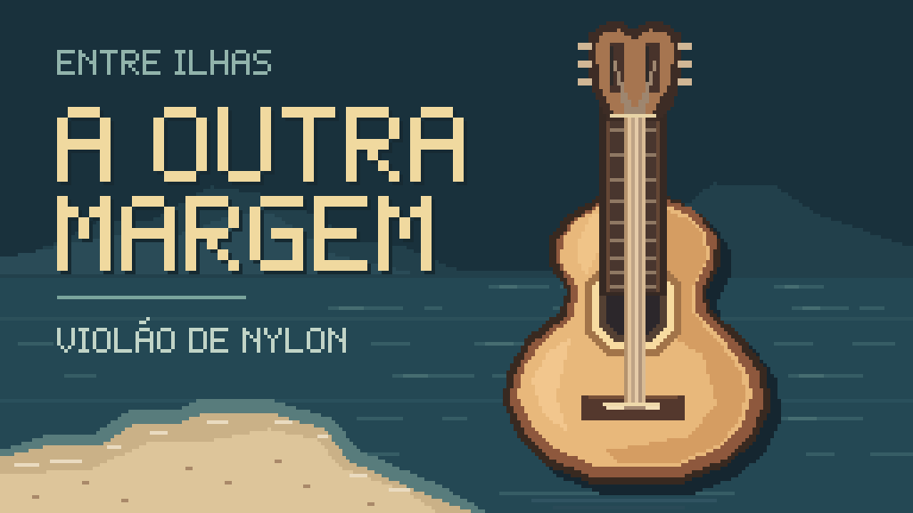

# A Outra Margem

[Voltar ao guia de arte](../README.md) · [Produção e verificação](../../producao/README.md#validação-da-trilha-sonora)

**A Outra Margem** acompanha a edição offline de *Maré Miúda: Entre Ilhas*. A versão escolhida é para **violão de nylon**: baixo discreto, poucas notas de acompanhamento e espaço entre as frases da melodia. O tema atravessa os oito mundos como uma faixa única. Não há uma faixa separada por mundo, nem versão de piano no jogo.

[Ouvir a versão aprovada em violão (MP3)](a-outra-margem-violao.mp3). O arquivo de escuta termina com uma saída suave; o jogo usa o WAV sem esse efeito para repetir sem pausa.

## Como funciona no jogo

O som começa após um gesto. A mesma faixa segue durante as trocas de tela e de mundo, incluindo a passagem do seletor para a fase e a volta. Música e efeitos têm controles independentes. Zerar o volume da música silencia sem voltar ao início da faixa; ocultar a aba pausa a reprodução, que retoma do último ponto quando o navegador volta a permitir áudio.

Os efeitos de jogo permanecem separados da música. As indicações visuais e textuais continuam permitindo jogar sem som.

[Ouça os 11 efeitos e veja quando são usados](../efeitos-sonoros/README.md). A faixa em violão não foi alterada pelo ajuste dos efeitos.

## Arquivo usado

| Parâmetro | Valor |
| --- | --- |
| Empacotamento | [`edicao-oficial/assets.zip`](../../../edicao-oficial/assets.zip), entrada `assets/audio/a-outra-margem-violao.wav` |
| Áudio | WAV, PCM de 16 bits, estéreo, 48 kHz |
| Loop | 2.048.000 quadros de amostra, 42,6667 s |
| SHA-256 do WAV | `d74670604f0f39e99d0390e76772c865486f898358800d71f4d28173dea36bf6` |

Capa em pixel art de 256 × 144 pixels, ampliada 4× sem suavização. © 2026 Luigi Scofano de Araújo. Todos os direitos reservados.
