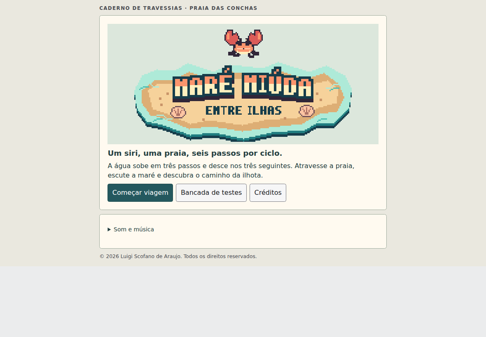

# 03 · Fatia vertical: Praia das Conchas

A praia junta tutorial, navegação a pé, trilha principal, um ramo opcional com recompensa e atalho, o encontro na ponta da praia e o retorno à tela de créditos. São cinco desafios: três já preservados na bancada e dois novos.

- [Mapa, travas e rota opcional](../../campanha/README.md)
- [Níveis, soluções e rota alternativa](../../../src/fases/README.md)
- [Guia de arte provisória](../../arte/README.md)
- [Tema e sinais da maré](../../../src/audio/README.md)
- [Estado de jogo e persistência](../../../src/persistencia/README.md)
- [Testes e reprodução do navegador](../../../tests/README.md)

Não confundir o primeiro mundo de teste com campanha completa. Antes de avançar, testar com pessoas novas a leitura da virada e do sinal da garça, a chegada ao ramo opcional e a compreensão do objetivo. O som é provisório. Na revisão visual desta etapa, foi aplicada somente a Placa de Areia PT; a variante EN segue no acervo e não há seletor de idioma.

Uma pequena surpresa visual foi adicionada ao cenário na revisão da abertura: o bem-te-vi, em pixels sólidos. Sua presença é restrita ao render do mapa e não afeta o que o jogador pode fazer.

## Versão de teste e capturas reais

- [Praia das Conchas v0.2.0 (HTML autônomo)](praia-das-conchas-v0.2.0.html): baixe o arquivo na página do GitHub e abra em um navegador. Não depende de rede nem foi publicado em Pages. SHA-256: `3785c18a1a4615a8a5217366d293f1398a6cb68450f11dd58ea1166e90831efe`.
- [Captura do mapa antes da revisão de identidade](capturas/praia-mapa-primeira-versao-desktop.png), produzida pela [verificação do #4](https://github.com/luigiscofano/mare-miuda-entre-ilhas/actions/runs/44643807475).

### Abertura com a marca escolhida

[Abertura com toque emulado, largura lógica de 390 px](capturas/abertura-placa-mobile-emulado.png) · [Mapa atual de desktop](capturas/praia-mapa-desktop.png).

O [teste da revisão visual](https://github.com/luigiscofano/mare-miuda-entre-ilhas/actions/runs/44644025952) aplicou teclado em desktop 1180 × 820 e toque emulado a 320 e 390 px, abriu o HTML sem rede e percorreu a bancada, o mapa, o reload e o encontro final. As imagens são do jogo rodando em Chromium sem cursor, não de um mockup. Os arquivos da CI preservam as demais capturas enquanto o artefato estiver disponível. Isso não conta como Safari, aparelho físico nem sessão com jogadores novos.
