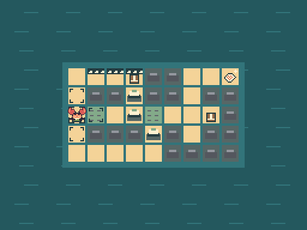

# Vento Sul

Primeiro chefe da Baía da Ressaca. Depois de vencer **Cofre da vazante**, siga à esquerda. A arena é facultativa: não integra as dez fases regulares nem muda o embarque para o Farol. Vencer grava a conclusão do marco, não o estado da tentativa.

*Renderização do tabuleiro do jogo a 2×, sem cursor. Arte provisória.*

## Leitura do combate

A cada subida, a onda percorre uma faixa inteira. O tabuleiro avisa durante a baixa com listras de espuma nas casas atingidas e reforça a marca quando falta um passo. A previsão informa a linha e o intervalo de colunas em texto. Pedras altas protegem mesmo dentro da faixa; rochas sólidas e oceano não são alvos. No padrão desta arena, a onda alterna o braço oeste, a faixa central e o braço leste. Depois recomeça. Não há vida de chefe, cronômetro ou aleatoriedade: a onda, a mudança da água e o movimento compartilham o mesmo turno.

Pise em cada ancoradouro durante uma chegada **segura** que termine na maré baixa. A entrada na alta, mesmo sem onda, não firma uma âncora. O contador sobe de 0/3 a 3/3, o ícone muda de forma e o mapa em texto troca `N` por `n`. Uma levada volta o siri à última casa firme sem apagar âncoras firmadas; reiniciar apaga toda a tentativa. Chegar à concha sem os três ancoradouros não vence.

## Ficha de level design

- **Tabuleiro:** 9 × 5, começa na baixa. Três ancoradouros em extremidades. Faixas, em coordenadas mostradas no jogo: linha 1, colunas 2 a 4; linha 3, colunas 1 a 8; linha 1, colunas 7 a 9.
- **Ensino:** seguir reto para leste logo no início termina na primeira faixa. O braço oeste oferece um primeiro ancoradouro fora da faixa; volte ao braço norte depois de a onda passar. Use o abrigo e o relógio para a travessia central e para buscar o último ancoradouro.
- **Solução de referência:** `DDUURRRLRLRDDRRRRLRLUURR`, 24 passos, zero levadas. `U/D/L/R` equivalem a cima, baixo, esquerda e direita. Há outras rotas seguras.
- **Aceite:** ver faixa antes da subida; uma única levada se onda e água acertam no mesmo passo; ameaças resolvidas antes de ancoragem e vitória; rejeitar saída prematura; reiniciar tentativa; salvar a conclusão da arena sem alterar os saves anteriores.
