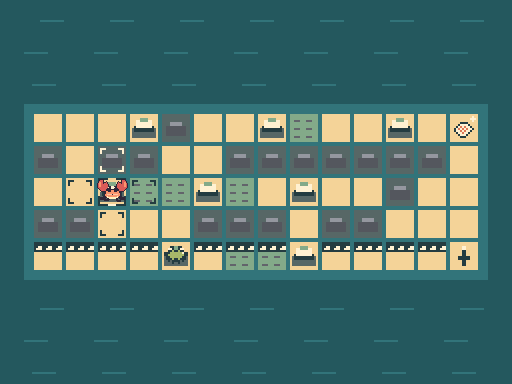

# Ressaca Alta

Segundo chefe opcional da Baía da Ressaca. Depois de vencer **Vento Sul**, siga mais uma vez à esquerda. A arena não entra nas dez fases regulares, nem precisa ser concluída para abrir a viagem ao Farol.

*Renderização do tabuleiro do jogo a 2×, sem cursor. Arte provisória.*

## Como vencer

As ondas varrem as faixas **norte → sul → meio** na subida e repetem o padrão. Veja a faixa marcada com espuma e a previsão em texto. A pedra alta protege; outra forma de se salvar é sair da faixa. Os dois siris compartilham o relógio e os dois são avaliados, mesmo quando um deles está parado. Trocar de siri não gasta passo.

O objetivo não envolve ancoradouros. Atravesse **três ondas seguidas sem levada** e ocupe as duas saídas diferentes, a concha e o marco. Qualquer levada reinicia a sequência, mas não volta o relógio. A concha e o marco ficam fora das faixas; um siri pode esperar ali enquanto o outro termina a travessia.

## Ficha de level design

- **Tabuleiro:** 14 × 5. As ondas passam pelas linhas 1, 5 e 3, entre as colunas 1 e 13. Os dois destinos ficam na coluna 14.
- **Ensino:** é seguro levar o primeiro siri à pedra alta no passo 3, mas deixá-lo lá e não mexer no parceiro leva o siri inativo na onda sul do passo 9. Alterne o controle antes desse aviso e use o corredor do meio para alcançar as duas saídas do lado leste.
- **Solução de referência:** `RDXRRRRXDRDRRXRRRRRXDRRRRXRRRRUUUUXRRRRR`. São 34 passos, seis trocas e zero levadas. U/D/L/R representam cima, baixo, esquerda e direita; X troca o siri ativo.
- **Verificação:** a busca no motor confirma 34 passos no mínimo sem levadas. A melhor travessia sobe para 36 se as pedras altas perderem a proteção. Ignorar a onda reduz o caminho para 30 passos, mas essa rota falha no primeiro ataque com a onda real. Não há vitória sem trocar de siri. Teste no navegador cobre teclado e toque emulado; aparelho físico fica para a revisão de lançamento.
