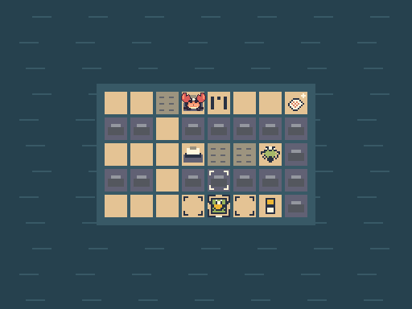

# Três refúgios · estreia do trio

Conclua **A pérola e a placa**, nas Grutas da Espuma, e siga para baixo no mapa. **Três refúgios** é um desvio opcional: as dez travessias regulares e o trajeto para a Baía da Ressaca permanecem como antes.

*Renderização do tabuleiro do jogo, sem cursor. Terreno provisório a 2× e recorte canônico do Coral em seus pixels nativos.*

## Como funciona

**Espaço** ou **Trocar siri** percorre Coral, Verde e Amarelo. Trocar seleciona o próximo siri sem mover ninguém nem avançar a maré. Um passo válido usa o mesmo relógio para os três. Se algum ficar no baixio quando a água sobe, o grupo retorna junto ao último conjunto de casas firmes e perde uma única tentativa. Balsas seguem o mesmo princípio: transportam todo ocupante na virada, esteja ele selecionado ou não.

As pinças erguidas do Coral, baixas do Verde e laterais do Amarelo diferenciam as silhuetas, além da cor. A marca embaixo do ativo e o texto indicam quem responde aos comandos. O mapa em texto descreve as três posições; a troca nomeia o novo siri.

## Ficha da travessia

- **Objetivo:** termine com os três alvos ocupados: a concha, o marco `T` e o marco `Y`. Cada siri pode ocupar qualquer um.
- **Leitura:** o Amarelo pode manter a placa enquanto o Coral cruza o portão. O Verde precisa cruzar os dois baixios a partir da pedra alta assim que a maré baixar. Depois da travessia do Coral, o Amarelo deixa a placa e alcança o seu marco.
- **Solução de referência:** `RRRXRRRRRRXRRRRXRRXXRRXRR`. R move à direita; X troca de siri. São 19 passos, seis trocas e zero levadas.
- **Validação:** as buscas no motor confirmam 19 como mínimo e nenhuma solução segura desligando o portão ou deixando qualquer um dos três siris imóvel. A rota não entra no contador regular. Testes de teclado e toque emulado ficam na CI; não substituem aparelho físico ou verificação com leitor de tela.
