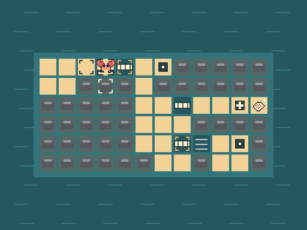

# Guardião do Farol · primeira arena do Farol

Conclua **A luz das duas marés** e siga para baixo. O Guardião é opcional: as dez travessias regulares, a volta ao arquipélago e o desvio em trio permanecem independentes.

*Renderização do tabuleiro rodando as regras do jogo, sem cursor. Terreno provisório a 2× e recorte canônico do Coral em seus pixels nativos.*

## Como funciona

O Guardião gira o feixe de **oeste → leste → sul** a cada três passos válidos, enquanto a maré continua seu ciclo de subida e descida. Os espelhos de cada orientação abrem pontes diferentes. A barra sólida é uma ponte aberta; os cantos de aviso indicam que ela apaga no próximo passo. Os pontos na água são uma ponte fechada, mesmo quando ela está prestes a abrir. A previsão descreve a orientação, a lente e as pontes atuais e informa quando o próximo feixe muda.

Entrar depende da orientação **antes** do passo. Se a ponte apagar no final desse passo, a queda volta à última casa firme e consome uma levada. Caminhe pela margem para ajustar o relógio sem arriscar a ponte. Não há cronômetro nem ataque de onda.

Chegue com segurança a cada lente precisamente enquanto ela recebe luz. Uma lente acesa permanece acesa mesmo depois de uma levada; reiniciar limpa a tentativa. A concha só encerra o desafio quando as três acenderem.

## Ficha de level design

- **Tabuleiro:** 12 × 6. A primeira ponte exige ler o aviso; o caminho norte leva à lente oeste e ao entroncamento. A ponte inferior e o baixio levam à lente sul; a última ponte dá acesso à lente leste e à concha.
- **Primeiro erro demonstrável:** `DURRRR` termina sobre a primeira ponte no passo 6, quando ela apaga. A volta não rebobina o feixe.
- **Solução de referência:** `RRRRRDUDDDDRRRRRDULLLUULLUURLDUDDRRRRLRRR`. São 41 passos e zero levadas. R/D/L/U equivalem a direita, baixo, esquerda e cima.
- **Validação:** o menor percurso sem levadas tem 41 passos. Mantendo as três pontes iluminadas o tempo todo, mas ainda exigindo as janelas das lentes, o mínimo cai a 33. Remover qualquer uma das três pontes impede a rota segura. A busca também verifica que todos os mais de 11 mil estados alcançáveis sem derrota ainda admitem uma vitória sem reiniciar.
- **Compatibilidade:** save registra apenas a conclusão como nos chefes anteriores. O roteiro CI testa teclado e toque emulado, não aparelho físico.
