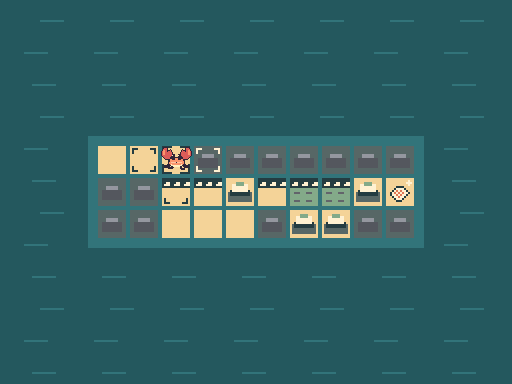

# Vigia das ondas · primeira arena da Praia

Na Enseadinha, conclua **Fio de areia** e siga para cima. O Vigia das ondas é um chefe opcional: não substitui **Ponta da garça**, não entra no contador de fases regulares e não é requisito para a travessia das poças nem para o embarque.

*Renderização do tabuleiro real sem cursor. Terreno provisório a 2× e Coral em seus pixels nativos.*

## Leia o aviso

A espuma anuncia a única faixa em que a onda avança na subida: **linha 2, colunas 3 a 9**. Diferente de um baixio que inunda, a onda também alcança a areia firme da faixa. As pedras altas protegem, mesmo dentro da faixa. A margem de baixo oferece casas para preparar a travessia ou recuar. O aviso fica mais forte quando resta um passo para a subida.

O objetivo é simplesmente alcançar a concha, sem ancoradouros, coleta ou troca de siri. Após uma levada, o relógio não volta: espere outra janela andando pela margem ou usando os refúgios laterais. A terceira levada encerra a tentativa.

## Ficha de level design

- **Tabuleiro:** 10 × 3. A arena ensina o aviso antes de introduzir a alternância de várias faixas na Baía.
- **Primeiro erro:** `RRD` pisa em chão firme dentro da faixa no passo 3. Olhe o aviso: a onda chega mesmo ali.
- **Solução de referência:** `RLRRDRRDURLRRRRR`. R/D/L/U significam direita, baixo, esquerda e cima. São 16 passos, zero levadas e dois abrigos em pedra alta exatamente durante a subida.
- **Verificação:** 16 passos é o mínimo sem levadas; se a onda for retirada, 10 bastam. Sem a proteção das pedras, não há rota segura. Todos os estados alcançáveis antes da derrota mantêm caminho para vencer. O roteiro de navegador verifica teclado e toque emulado; aparelho físico segue pendente.
