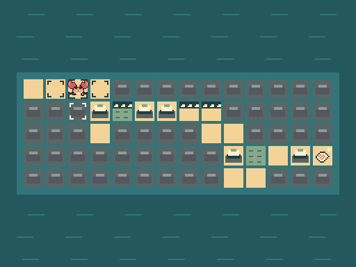
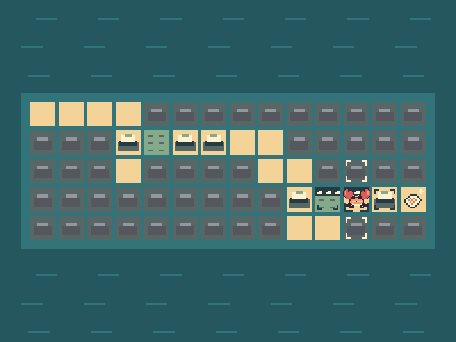

# Ponta da Ressaca · segundo chefe da Praia das Conchas

Na Enseadinha, conclua **Vigia das ondas** e suba de novo para visitar **Ponta da Ressaca**. Desça para voltar ao Vigia e depois ao Fio de areia. As duas arenas são opcionais. A saída ao arquipélago, os dez desafios autorais anteriores e o encontro histórico da Ponta da Garça não mudaram.

| Passo 2: a faixa norte é a próxima | Passo 20: a faixa sul é a próxima |
| --- | --- |
|  |  |

*Quadros do renderizador do jogo, sem cursor e com cenário provisório. A espuma anuncia a faixa; os baixios continuam identificáveis separadamente.*

## Ficha da arena

- **Objetivo:** atravesse os dois baixios e alcance a concha. Não há contador de ondas nem ancoradouros.
- **Grade:** 14 × 5. No terceiro passo sobe a faixa norte; no nono, a sul; depois se alternam a cada subida. As duas faixas integram o mesmo relógio da maré.
- **Leitura:** na primeira baixa, saia do refúgio pelo baixio do norte. Entre as faixas, use a margem firme para sair do alcance da próxima onda. Na segunda baixa, atravesse o baixio sul e termine o turno da subida na pedra alta.
- **Solução de referência:** `RRRDDURRRRLRRDRDDURRRR`, 22 passos válidos, sem levadas. `R/L/U/D`: direita, esquerda, cima e baixo. A rota cruza os baixios nos passos 7 e 19 e usa a pedra alta sul no 21. O bolsão inferior permite ajustar a fase antes da segunda janela; também dá para fazer esse ajuste na margem central.
- **Verificação:** a busca encontra 22 passos como mínimo sem levadas e 28 sem as pedras altas. Bloquear qualquer um dos baixios torna a concha inacessível. Os 470 estados alcançáveis sem derrota ainda permitem chegar à concha, considerando as posições de retorno, as duas faixas e até duas levadas. A recuperação pode exigir um caminho diferente. A abertura, volta, contagem e leitura de save são testadas; a CI exercita as duas ondas usando teclado e toque emulado.
