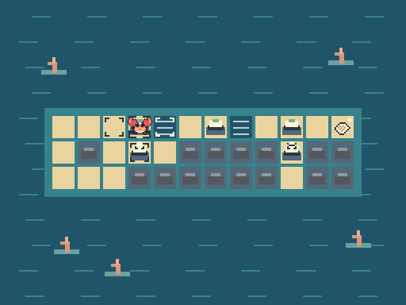
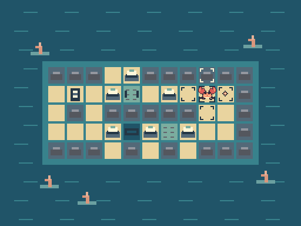
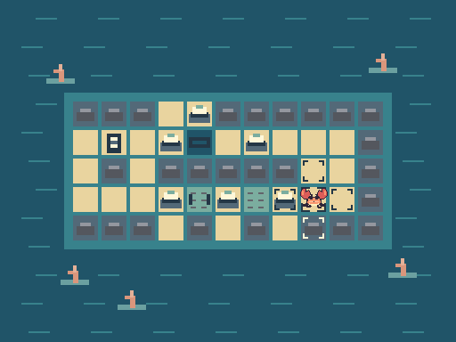

# Chefes de Recifes Expostos

Os dois chefes são desvios. Conclua **A volta do recife** e siga à direita para o **Guardião das Poças**. Ao vencê-lo, desça para o **Vigia do Recife**. Cima e esquerda voltam aos marcos anteriores. Não é necessário vencer as arenas para embarcar de volta ou abrir a Enseada; a contagem permanece em dez fases regulares e dois desvios comuns.

## Guardião das Poças

A baixa abre os bancos de areia, mas só uma chegada na alta valida cada refúgio marcado. O losango vazado indica refúgio a visitar; o preenchido indica refúgio registrado. Os caminhos secos permitem ajustar o relógio antes de atravessar. A concha não encerra a arena se faltar um refúgio.

**Solução:** `RRDRUDURRRLRRRRDURR`, 19 passos sem levadas. As duas marcas entram nos passos 4 e 16.

## Vigia do Recife

Na ida, a comporta norte está disponível na baixa. Ao retirar o fragmento do encaixe, ele deixa de operar como contrapeso: a passagem norte fecha e a sul abre. Essa volta ainda exige ler a maré. Grades transversais indicam a comporta fechada; a disponível tem apenas os batentes.

| Ida pela margem norte | Volta pela margem sul |
| --- | --- |
|  |  |

**Solução:** `DUDURRRRRRLRRRRDDLLLLDUDULLLUUL`, 31 passos sem levadas. O fragmento muda as comportas no passo 15. Desativar a troca de ida e volta reduz a melhor rota a 23 passos.

## Verificação

As imagens vêm do renderizador do jogo, sem cursor. `U/D/L/R` significa cima, baixo, esquerda e direita. A busca que reproduz o motor garante as duas soluções mínimas; também verifica que os 710 estados não derrotados do Guardião e os 162 do Vigia permitem chegar à vitória. Nas duas arenas, reiniciar devolve apenas a tentativa às condições iniciais. Trocar a rota ou registrar um refúgio não altera a cadência de três passos. O roteiro de navegador cobre teclado e toque emulado, desbloqueios, vitória e recarga.
