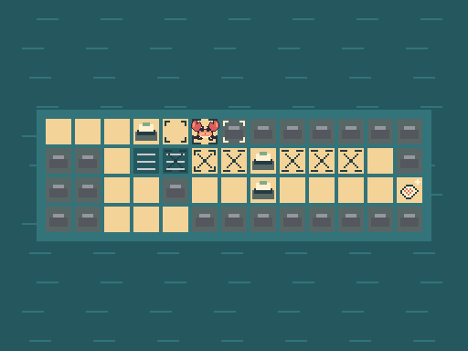
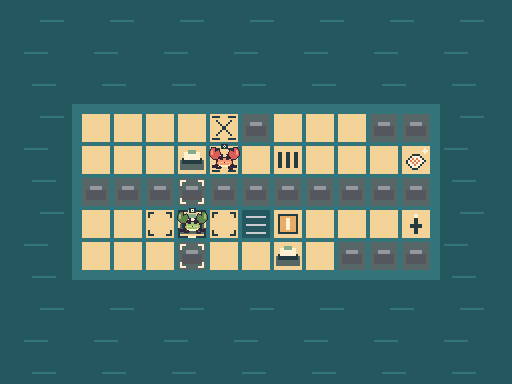

# 26 · Chefes da Enseada da Garça

Depois de concluir **Corrida ao farol baixo**, siga à direita para a Garça da Restinga. Vencer a primeira arena abre o desvio abaixo para o Vigia das Falésias. As duas arenas são opcionais e a passagem às Ilhas à Deriva continua independente.

| Arena | O desafio | Solução sem levadas |
| --- | --- | --- |
| Garça da Restinga | A faixa horizontal muda de posição. Cruze os canais e deixe o rasante passar por cima da pedra alta. | `RLRLRRRRRDRRDRRRRR` (18 passos) |
| Vigia das Falésias | Faixas verticais alternam as margens. Verde abre a porta de Coral e os dois precisam alcançar destinos distintos. | `UDRXRRRRRRXRRRRRRRRRXRRRR` (22 passos; `X` troca sem gastar turno) |

A marca em X indica as casas que o próximo rasante cobre; pedras altas, pedras sólidas e oceano não recebem marca. A garça resolve o ataque após a mudança da água, inclusive sobre o siri inativo. Ataques simultâneos contam uma levada; ambos voltam à última posição firme. O terreno e a fauna usam a arte existente.

## Capturas do jogo

Quadros do renderizador do jogo, sem cursor. A primeira figura mostra o rasante horizontal interrompido pela pedra alta e a segunda mostra a previsão sobre a margem norte enquanto Verde mantém a placa.

## Verificação

A busca usa o motor real e reproduz 18 e 22 passos sem levadas. Sem os rasantes, as distâncias caem a 14 e 20. Nas Falésias, a dupla não vence sem a abertura da porta ou sem trocar de siri. Todo estado alcançável antes da derrota preserva uma rota de recuperação. O teste de navegador percorre os avisos, a perda, o reinício, as duas soluções e o progresso após recarregar, com teclado e toque emulado.
