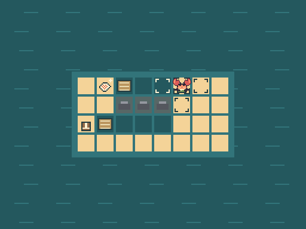
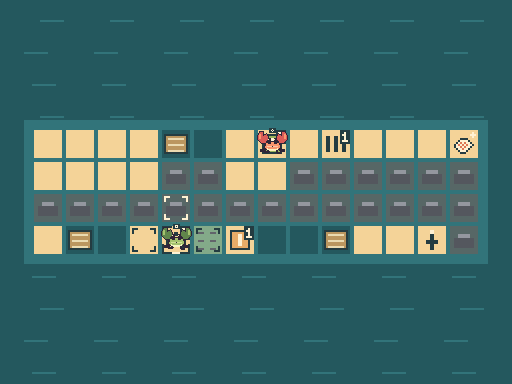

# Chefes das Ilhas à Deriva

De **Corrente cruzada**, siga à direita para **Mestre das Correntes**. Após vencê-lo, desça para **Passagem das Balsas**. A saída original para as Grutas não exige essas arenas. São 10 travessias regulares, dois desvios em dupla e duas arenas opcionais nas Ilhas à Deriva.

## Mestre das Correntes

O Siri deve firmar os dois ancoradouros e voltar à saída. **Só conta desembarcar diretamente da balsa no passo da virada.** O cais leste recebe na descida; o oeste, na subida. Visitar o cais por terra não firma a âncora. A restinga ao sul é um retorno seguro para recompor o tempo se você perder uma janela. Observe a previsão da balsa e o passo que falta para a virada.



```text
SC~~~N..
..###...
N~~~~...
........
```

- Primeira atracação no passo 12 (maré baixa); segunda no passo 21 (maré alta). A primeira travessia de barco é feita no terceiro passo.
- Solução mínima sem levadas: `DDRDUDRUUULRDDDLLLLULUUR` (24 passos). As duas balsas são necessárias, mesmo com a restinga conectando as margens.
- O mapa em texto troca `N` por `n` quando a âncora firma. O total visível começa em 0/2.

## Passagem das Balsas

Uma placa ao norte abre o portão ao sul; a placa ao sul abre o portão ao norte. O Coral deve se adiantar e esperar a bordo. Um passo do Verde leva os dois na mesma virada. Depois, guarde cada placa até que o outro Siri atravesse seu portão. O baixio ao sul só pode ser cruzado a tempo se a placa for alcançada antes da subida.



```text
S...~~.P.D...C
....##..######
##############
A~~.D=P~~~..T#
```

- As primeiras duas balsas levam ambos no passo 9, mesmo com o Coral inativo. O Coral abre o primeiro caminho no 12, o Verde segura o portão do Coral a partir do 15 e parte para a terceira balsa no 18.
- Solução mínima sem levadas: `DUDURRRRXRRXRRXRRRXRRXRRRRXRRRR` (25 passos; `X` troca e não gasta passos).
- Retirar qualquer balsa, bloquear permanentemente qualquer portão ou proibir a carona do Siri inativo torna a arena insolúvel. Não dependa das cores: use as insígnias da equipe, a lista do próximo movimento de cada balsa e as coordenadas dos portões na previsão.

`U/D/L/R` correspondem a cima/baixo/esquerda/direita. Balsas usam `~`, âncoras usam `N`, uma placa usa `P`, um portão usa `D`. As imagens vêm do tabuleiro, sem cursor. As duas arenas têm rota de vitória a partir de todos os estados alcançáveis que não encerraram a tentativa. A busca considera maré, posição dos dois Siris, posição firme de retorno, levadas e âncoras firmadas. Os sprites existentes são reutilizados sem alterações.
