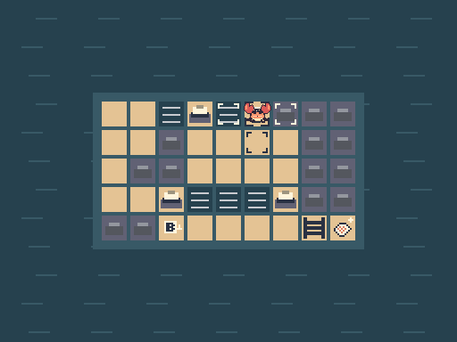
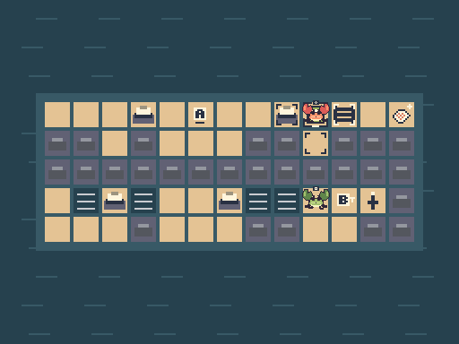

# Chefes das Grutas da Espuma

De **Revezamento nas câmaras**, vá à direita para a **Sentinela da Gruta**. Vença-a para descer até o **Cofre das Espumas**. As duas arenas são opcionais: continuam existindo dez travessias regulares, o desvio de trio e o acesso original à Baía.

## Sentinela da Gruta

O encaixe recebe a pérola **na maré alta**. A alavanca abre a saída **na maré baixa**. Use a prateleira firme junto ao encaixe e a volta pela câmara sul para acertar o relógio. A pressão da água não aciona a peça sozinha: é preciso entrar nela quando a janela estiver aberta.



```text
SK=H=E###
..#....##
.##....##
..H===H##
##F....OC
```

- Pérola no passo 1, encaixe no 11 e alavanca no 18. Solução mínima sem levadas: `RRRDUDUDRRUDDDDLLLRRRRRR` (24 passos; seriam 22 sem as janelas).

## Cofre das Espumas

O Coral leva a pérola ao encaixe norte **no passo exato da descida**. O Verde cruza os baixios ao sul e aciona a alavanca **na maré alta**, enquanto o Coral sustenta a placa ao norte. Depois, cada um vai ao seu destino. A troca não consome passos; o movimento de qualquer um altera a mesma maré.



```text
SK.H.E..HPO.C
##.#...##.###
#############
A=H=..H==.FT#
...#...##..##
```

- Pérola no passo 1, encaixe no 18 e alavanca no 23. Solução mínima sem levadas: `RRXDRRURRDURRRRRXRRRRRRRXRRXRRR` (27 passos; seriam 23 sem as janelas). Nenhum siri pode ficar imóvel até o fim.
- O inventário indica se a peça aceitará o próximo passo e se a placa está ocupada. O tabuleiro destaca a janela junto à peça, com um ponto para a descida exata. Se a placa estiver livre, voltar e tentar na hora certa ainda é possível.
- A busca no motor não encontrou estados alcançáveis sem rota de vitória enquanto a tentativa estiver aberta, mesmo após uma ou duas levadas.

`U/D/L/R` correspondem a cima/baixo/esquerda/direita; `X` troca de siri. `K/E/F` são pérola, encaixe e alavanca; `O` é o portão, `P` a placa, `C/T` os destinos. As imagens mostram os tabuleiros renderizados pelo jogo, sem cursor. Os sprites existentes não foram alterados.
