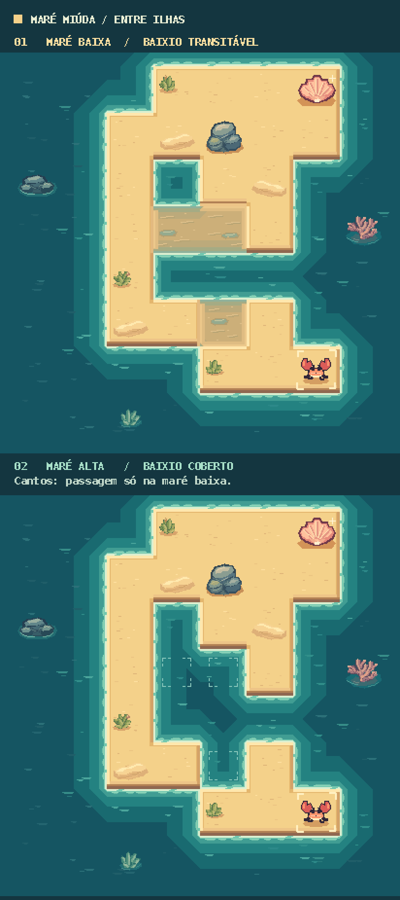
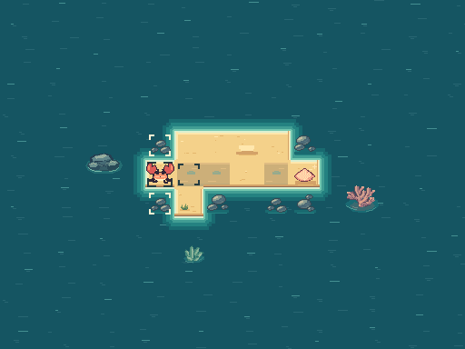
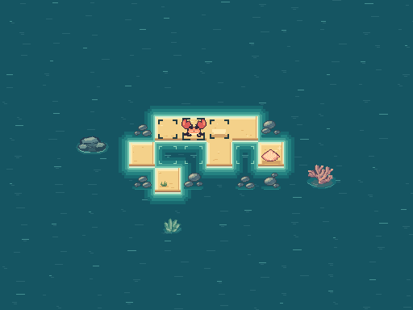

# Travessia da Praia das Conchas

Este caderno preserva a prancha V32 aprovada e documenta sua passagem para as fases jogáveis. O desenho de demonstração não foi transformado em fase: o render acompanha os tabuleiros, os limites e as soluções já existentes.

## Referência aprovada

Prancha conceitual, não captura do jogo. O PNG original está preservado byte a byte: 824 × 1850, com dois quadros de arte nativa de 412 × 412 ampliados 2× sem suavização. SHA-256: `912d72724e9b2505a02afbe9c077b68beae285ff59ebb42c45035d4f39d2dee0`.

## Aplicação

- Praia das Conchas (Cabo Baixo e Enseadinha): mar calmo, faixa de espuma, areia seca, poças na areia molhada, rochas angulares agrupadas, folhagens pequenas e concha rosa.
- Cada casa existente mede 16 × 16 na grade lógica e 32 × 32 na superfície nativa de 512 × 384. O contorno acompanha a grade, não a imagem de referência.
- Na maré alta, os quatro cantos de um pixel mostram todo baixio coberto. Na baixa, areia molhada e película de água indicam a faixa transitável. As marcas de movimento válido continuam decididas pelo motor.
- Os três enfeites do oceano vêm dos quadros nativos da prancha. Não são obstáculos nem se sobrepõem à grade. As folhagens de areia também são decoração; não mudam o piso.
- O siri principal continua recortado diretamente da Placa de Areia, com 31 × 23 pixels nativos. A costa não altera mapa de seleção, bancada, outros mundos, regras ou salvamento.

## Quadros da fase jogável

Trilha das pedras, em dois turnos reais do motor, desenhada diretamente pelo renderizador em 512 × 384. São quadros do tabuleiro na escala nativa, sem cursor, não capturas do navegador.

| Maré baixa | Maré alta |
| --- | --- |
|  |  |

[Guia de arte e fontes editáveis](../../arte/README.md) · [Roteiro de verificação](../../../tests/README.md)

© 2026 Luigi Scofano de Araujo. Todos os direitos reservados.
