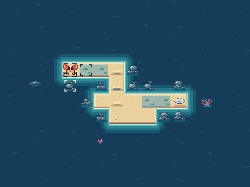
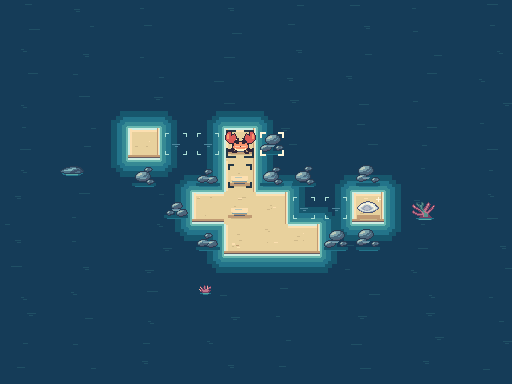
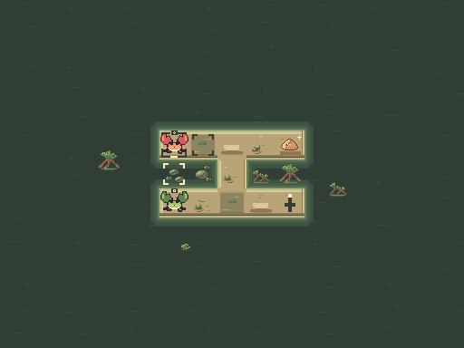
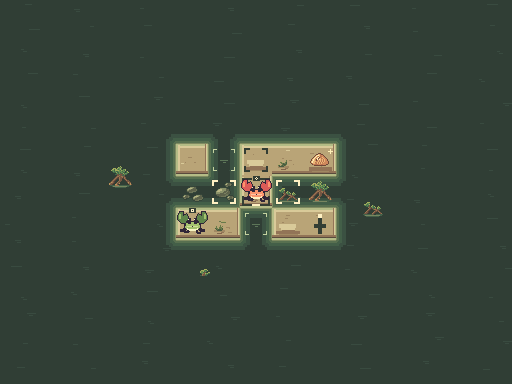

# Travessias de Recifes Expostos e Mangue dos Siris Duplos

**Prévia jogável para revisão visual**, não arte oficial dos dois mundos. A grade, a lógica do motor, as fases e as soluções não foram alteradas. Os seletores, o Arquipélago e a arte já aplicada na Praia não fazem parte deste lote.

## Recifes Expostos

O mar azul tem uma faixa rasa mais larga, poças frias na vazante e um contorno claro junto às placas de areia. Corais e anêmonas aparecem fora das rotas. Afloramentos de pedra azulada recebem veios na face; o refúgio transitável é baixo e tem topo claro. A concha de nácar é oval e estriada, com brilho próprio.

## Mangue dos Siris Duplos

A água oliva cerca margens de lama ocre. As raízes inclinadas e copas pequenas formam silhuetas diferentes no oceano e nos bloqueios que já existiam. Folhas rasteiras e gravetos no piso firme são decoração, não obstáculos. A concha tem como forma uma espiral âmbar. O Coral e o Verde, suas insígnias e a marca de quem está ativo são os mesmos do jogo.

## Quadros do jogo

Estados de início e do terceiro passo em **Janelas do coral** e **Janela partilhada**, gerados pelo renderizador em 512 × 384. São quadros nativos do tabuleiro, sem cursor, e não capturas de navegador.

| Mundo | Maré baixa | Maré alta |
| --- | --- | --- |
| Recifes Expostos |  |  |
| Mangue dos Siris Duplos |  |  |

## Leitura e fontes

Cada casa segue com 16 × 16 na grade lógica e 32 × 32 na superfície de 512 × 384. O piso não perde a forma ortogonal. A baixa tem areia molhada com poças; na alta, os quatro cantos finos marcam as células submersas. Os enfeites fora da trilha nunca ocupam uma célula navegável. Placas, portões, comportas, fragmentos e avisos continuam desenhados por cima do terreno e não foram redesenhados.

[Paletas e matrizes editáveis](../../../src/render/costas-recifes-mangue.ts) · [Renderizador de costa compartilhado](../../../src/render/travessia-praia.ts) · [Verificações](../../../tests/README.md)

© 2026 Luigi Scofano de Araujo. Todos os direitos reservados.
