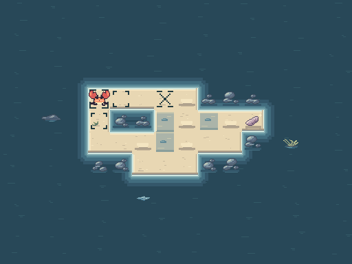
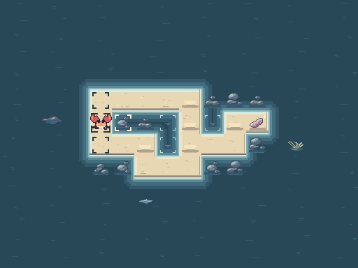
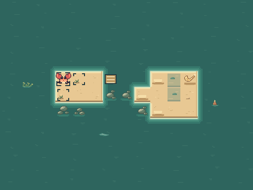
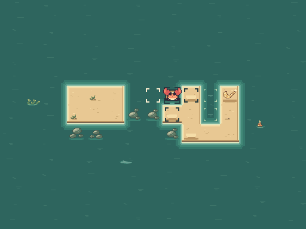

# Travessias da Enseada da Garça e das Ilhas à Deriva

**Prévia jogável para revisão visual.** Este lote não substitui o desenho aprovado da Praia, não muda fases ou regras e não altera os seletores de mundos e níveis.

## Enseada da Garça

Azul de amanhecer, areia clara, lajes frias e juncos de restinga inclinados pelo vento. O X do próximo rasante continua acima do terreno, com o mesmo aviso textual e a mesma posição. Nenhuma ave decorativa concorre com essa indicação. A concha deste mundo é alongada, em tons de violeta.

## Ilhas à Deriva

Canais de jade, bancos baixos de areia morna e vegetação discreta na margem. A boia, a espuma e o ramo distante aparecem apenas fora do retângulo do tabuleiro; gravetos no piso firme não bloqueiam o caminho. As balsas navegáveis conservam as laterais retas e a madeira em faixas claras, sobre a casa em que realmente se encontram. A concha dourada em crescente é o objetivo, não uma embarcação.

## Quadros do jogo

**Escolha de margem**, no segundo e no terceiro passos, e **Duas rampas**, no início e no terceiro passo. O quadro de maré alta da Deriva mostra a balsa já deslocada, com o siri a bordo. São quadros do renderizador em 512 × 384, sem cursor, não capturas do navegador.

| Mundo | Maré baixa | Maré alta |
| --- | --- | --- |
| Enseada da Garça |  |  |
| Ilhas à Deriva |  |  |

## Arte e grade

A grade lógica continua em 16 × 16 por casa; a arte ocupa 32 × 32 pixels nativos por casa. As conchas e os objetos de fundo vêm de matrizes de pixels opacos, sem interpolação. A costa muda de cor e forma na virada; as marcações de jogo, o siri da logo e as demais regras não são recriados pela nova pintura.

[Paletas e matrizes editáveis](../../../src/render/costas-enseada-deriva.ts) · [Renderizador de costa](../../../src/render/travessia-praia.ts) · [Testes](../../../tests/README.md)

© 2026 Luigi Scofano de Araujo. Todos os direitos reservados.
