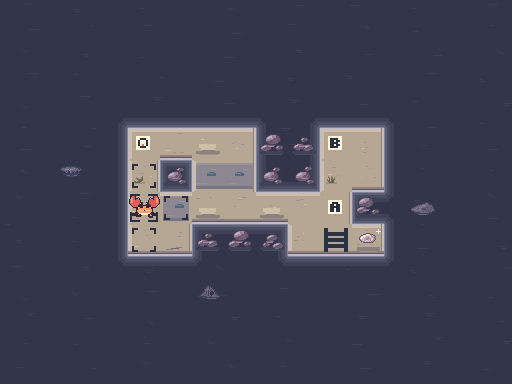
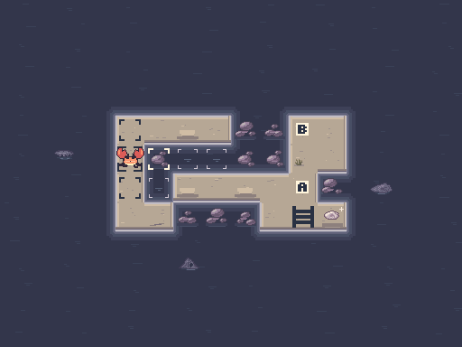
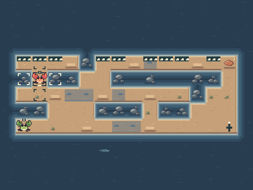
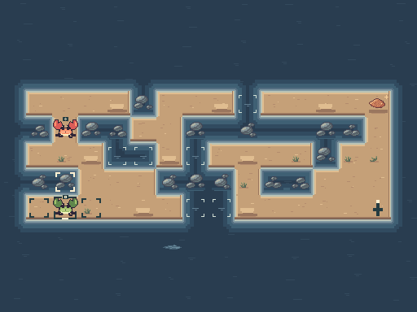
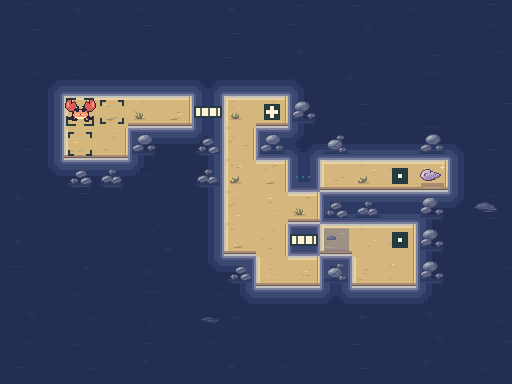
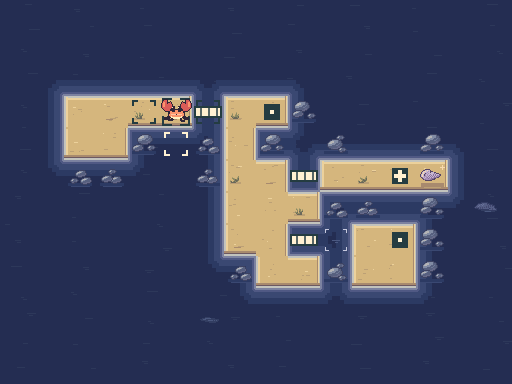

# Travessias das Grutas, da Baía e do Farol

**Prévia jogável para revisão visual**, sem mudar a campanha. Este lote se limita ao tabuleiro de três mundos: não redesenha o Arquipélago nem os seletores. Praia, Recifes, Mangue, Enseada e Deriva permanecem como estavam.

- **Grutas da Espuma:** água cor de ardósia, areia mineral, pedras violeta e pequenas estalactites ao largo. A concha é curta e perolada. As pedras e os veios têm silhuetas irregulares, bem diferentes da pérola com fundo quadrado e dos sinais do encaixe e da alavanca.
- **Baía da Ressaca:** azul de tempestade, areia cobre e concha ferrugem. A espuma decorativa é discreta e fica ao largo. A faixa anunciada conserva a moldura escura e as três cristas claras separadas no topo da casa.
- **Arquipélago do Farol:** azul-índigo cercando margem dourada, penedos sem luz própria e concha em forma de trombeta. A ponte acesa conserva a barra clara segmentada; na água escura, a ponte apagada deixa só pontos. Lentes, placas e brilhos da lógica continuam acima da pintura.

## Quadros do tabuleiro

**Dobra da câmara** e **Guardião do Farol** no início e no terceiro passo, e **Ressaca Alta** no segundo e terceiro passos. São quadros nativos 512 × 384 obtidos do renderizador e do motor, sem cursor e sem suavização, não capturas do navegador.

| Mundo | Maré baixa | Maré alta |
| --- | --- | --- |
| Grutas da Espuma |  |  |
| Baía da Ressaca |  |  |
| Arquipélago do Farol |  |  |

## Arte e grade

A grade permanece 16 × 16 por casa no tabuleiro lógico e 32 × 32 no Canvas nativo. As novas matrizes desenham água, texturas, pedras e conchas; a lógica segue no motor. Os desenhos são opacos e de bordas nítidas, os enfeites de água ficam fora do tabuleiro e o siri usa o recorte canônico da logo.

[Paletas e matrizes editáveis](../../../src/render/costas-grutas-ressaca-farol.ts) · [Renderizador de costa](../../../src/render/travessia-praia.ts) · [Testes](../../../tests/README.md)

© 2026 Luigi Scofano de Araujo. Todos os direitos reservados.
