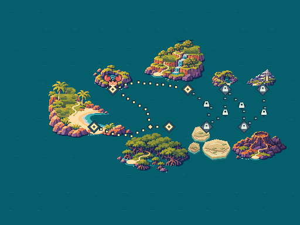
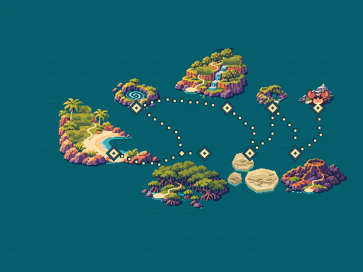

# Meia-Lua · seletor do Arquipélago

**Prévia jogável do mapa de mundos.** A composição usa o estudo Meia-Lua sem casas, com espuma branca e navegação clara, adaptado aos pontos de embarque que já existem no jogo. Os oito mundos mantêm suas posições e nomes, e as ligações, os bloqueios e o save vêm da mesma campanha. Os seletores de fases dentro dos mundos e os tabuleiros de travessia não fazem parte deste lote.

A Praia preserva sua enseada larga, Recifes mantém o redemoinho, Mangue mantém as copas e raízes, e a Enseada mantém as cascatas. Grutas usa a abertura de pedra, Deriva tem pequenos bancos em canais de jade, a Baía fica junto ao relevo vulcânico e o Farol ganha uma torre estreita na antiga silhueta fria. Não há casas, aves nem caminhos fixos pintados no fundo. Os pontos dourados e os losangos vazados indicam acesso liberado; traços mais curtos e cadeados distinguem os bloqueios por forma, não só por cor.

## Quadros do seletor

Renders do Canvas em 512 × 384, sem cursor. São quadros do renderizador em estados reais da campanha, não capturas do navegador.

| Estado | Quadro |
| --- | --- |
| Chegada da Praia; Recifes e Mangue são os primeiros destinos |  |
| Só Recifes concluído; Enseada ainda bloqueada |  |
| Recifes e Mangue concluídos; passagem para a Enseada aberta |  |
| Farol alcançado depois de liberar o percurso completo |  |

## Fontes e exportação

- A [composição Meia-Lua de navegação mais clara](https://github.com/luigiscofano/mare-miuda-entre-ilhas/blob/af40cdeee4fffe2bd5cb69c638e26016162e1bf7/docs/processo-de-criacao/identidade-visual/14-arquipelago-meia-lua/legibilidade/meia-lua-clean-288.png) continua no acervo original (#41).
- As camadas originais [cenário](https://github.com/luigiscofano/mare-miuda-entre-ilhas/blob/af40cdeee4fffe2bd5cb69c638e26016162e1bf7/docs/processo-de-criacao/identidade-visual/14-arquipelago-meia-lua/fontes/arquipelago-base.png), [restauração sem casas](https://github.com/luigiscofano/mare-miuda-entre-ilhas/blob/af40cdeee4fffe2bd5cb69c638e26016162e1bf7/docs/processo-de-criacao/identidade-visual/14-arquipelago-meia-lua/sem-casas/fontes/restauracao.png) e [espuma](https://github.com/luigiscofano/mare-miuda-entre-ilhas/blob/af40cdeee4fffe2bd5cb69c638e26016162e1bf7/docs/processo-de-criacao/identidade-visual/14-arquipelago-meia-lua/espuma/fontes/espuma.png) são recuperáveis do mesmo commit para regenerar os recortes. As antigas rotas não são usadas.
- A [camada editável de ilhas](fontes/ilhas.png) registra o posicionamento, a espuma e os novos detalhes com alfa binário. Os recortes ficam a 1×, exceto gruta e silhueta fria que usam redução inteira 2:1. Nenhum pixel é suavizado.
- Use Python 3 com Pillow e execute a partir da raiz:

```sh
python3 docs/processo-de-criacao/33-seletor-arquipelago/exportar.py \
  assets/arquipelago-meia-lua.png \
  --ilhas docs/processo-de-criacao/33-seletor-arquipelago/fontes/ilhas.png
```

Para regenerar as ilhas a partir do acervo, use `--originais BASE RESTAURACAO ESPUMA --guardar-ilhas CAMADA` no lugar de `--ilhas CAMADA`. O exportador valida os três blobs de origem. A versão servida e o HTML autônomo recebem os mesmos bytes; se o fundo falhar, o mapa anterior permanece funcional.

[A navegação em TypeScript](../../../src/render/seletor-arquipelago.ts) desenha rotas, marcas e cadeados sobre o fundo. O siri da Placa de Areia é desenhado por último no mesmo ponto de ancoragem da versão anterior.

© 2026 Luigi Scofano de Araujo. Todos os direitos reservados.
