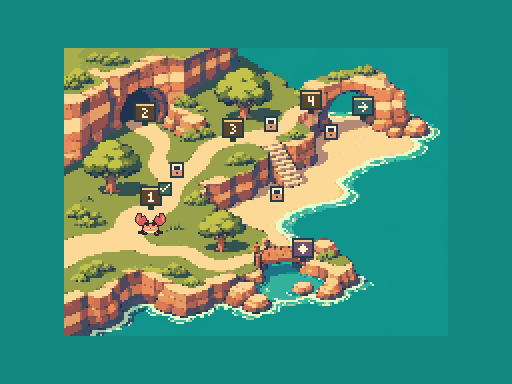
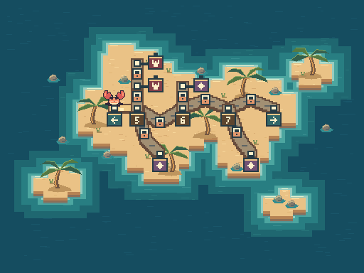
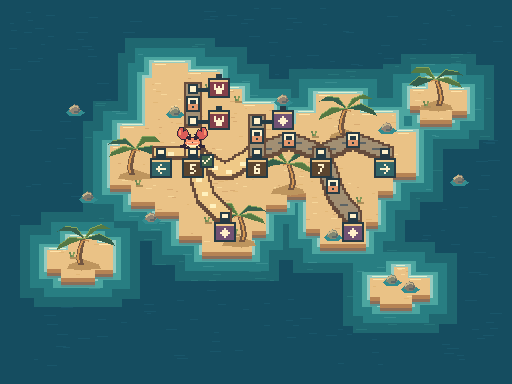
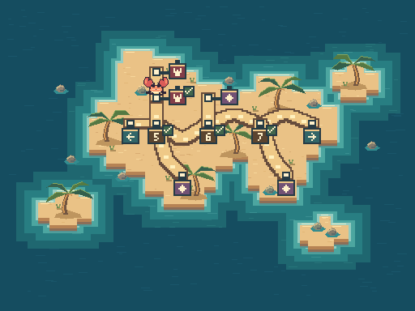

# 34 · Seletores da Praia das Conchas

**Proposta em revisão.** Duas telas do mesmo mundo, com funções e estilos diferentes: o Cabo Baixo mantém o fundo aprovado e ganha placas mais claras; a Enseadinha recebe um fundo novo com a mesma linguagem de cais, areia e recortes retos dos estudos de Caminho das Conchas. A arte da travessia continua separada.

---

<details open>
<summary>Quadros do jogo</summary>

Quadros nativos de 512 × 384 produzidos pelo renderizador Canvas com o estado da campanha, sem cursor. Não são capturas de aparelho nem imagens dos estudos.

| Cabo Baixo, desvio disponível | Enseadinha, entrada com cadeados |
| --- | --- |
|  |  |
| **Enseadinha após Fio de areia, desvio aberto** | **Enseadinha, ramo dos dois chefes** |
|  |  |

</details>

---

<details>
<summary>Leitura das placas e da rota</summary>

- Números **1 a 4** no Cabo Baixo e **5 a 7** na Enseadinha orientam a rota principal. A ordem exibida não altera as fases.
- **Losango** marca desvio; **coroa**, chefe opcional; **seta**, viagem; **marca de visto**, fase concluída. A cor acompanha a forma, não a substitui. O texto da interface mantém o nome da fase e indica o requisito da saída bloqueada.
- **Cadeado** indica passagem bloqueada. Na Enseadinha, areia iluminada com pontos indica rota transitável; areia apagada com traços distingue a rota fechada. As placas do ramal norte ficam ao lado da trilha para não sumirem atrás do Siri.
- A rota continua por vértices com setas, WASD ou botões de toque: um comando percorre a ligação até o próximo vértice. Concluir Fio de areia abre tanto o avanço quanto o desvio e o caminho até Vigia das ondas; o próximo chefe só abre depois da primeira arena.

</details>

---

<details>
<summary>Fontes, escala e autoria</summary>

O arquivo [cabo-baixo-192.png](../../../assets/cabo-baixo-192.png) segue byte por byte como aprovado. O [estudo Caminho das Conchas do histórico](https://github.com/luigiscofano/mare-miuda-entre-ilhas/tree/af40cdeee4fffe2bd5cb69c638e26016162e1bf7/docs/processo-de-criacao/identidade-visual) orientou as camadas de água, cais, espuma, luz da areia e palmeiras. A Enseadinha foi redesenhada; os vértices, os números e os elementos dos estudos não foram copiados.

[exportar.py](exportar.py) é a fonte editável do fundo: máscaras de ilhas ortogonais, camadas opacas de cor, brilhos de espuma e pequenos grupos de pixels. Sombras e luz são desenhadas na grade, sem transparência parcial, filtro suave ou antialiasing. Para reproduzir o PNG com Python e Pillow a partir da raiz:

```sh
python3 docs/processo-de-criacao/34-seletores-praia/exportar.py assets/enseadinha-512.png
```

As rotas e placas da Enseadinha são pintadas sobre o fundo a partir de [seletores-praia.ts](../../../src/render/seletores-praia.ts). O Siri canônico continua como camada final no mesmo recorte e coordenadas. As trilhas, os saves, os pontos de partida, os sete demais seletores internos, o Arquipélago e os tabuleiros não foram modificados.

</details>

© 2026 Luigi Scofano de Araujo. Todos os direitos reservados.
