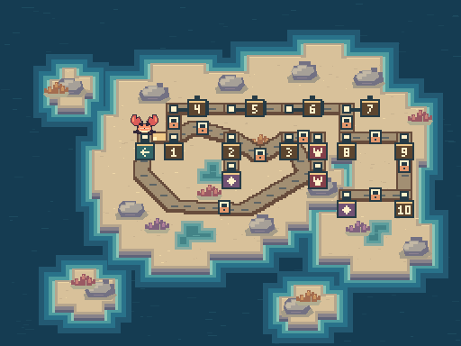
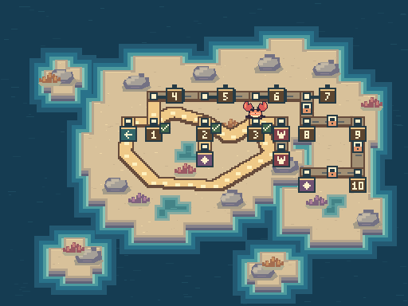
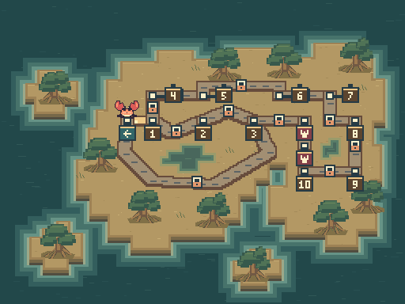
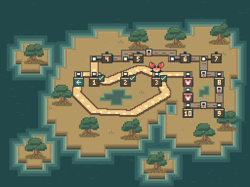

# Seletores de Recifes Expostos e Mangue dos Siris Duplos

**Prévia jogável para revisão.** Os Recifes têm água azul, areia calcária, poças e corais em patamares. O Mangue tem canais de água verde, sedimento ocre e copas diferentes sobre raízes. A luz vem de cima à esquerda. Nenhum fundo contém trilhas, siri, números ou outros dados do jogo.

A interface desenha as trilhas sobre o fundo e diferencia caminhos disponíveis e trancados, com cadeado, sem depender só de cor. As dez fases regulares de cada mundo têm números; os desvios usam um losango, os chefes uma coroa e o cais uma seta. Nenhum vértice, destino ou requisito de passagem mudou. Se a imagem não carregar, o mapa continua funcional com o fundo anterior.

## Quadros do renderizador

| Mundo | Entrada | Rota principal concluída; acesso ao primeiro chefe |
| --- | --- | --- |
| Recifes |  |  |
| Mangue |  |  |

Quadros nativos em 512 × 384, sem cursor, derivados do mesmo renderizador e de estados reais da campanha. Não são capturas do navegador.

## Fontes

[Exportador Python](exportar.py) guarda coordenadas, paletas e matrizes editáveis. Os [estudos V6 de seletores](https://github.com/luigiscofano/mare-miuda-entre-ilhas/tree/af40cdeee4fffe2bd5cb69c638e26016162e1bf7/docs/processo-de-criacao/identidade-visual/20-seletores-v6-travessias-v7/seletores-1-a-4) e a Enseadinha serviram como referência visual, sem reaproveitar imagens com marcos ou rótulos.

Com Python 3 e Pillow, rode `python3 exportar.py` no caderno para regenerar `recifes-512.png` e `mangue-512.png`. Os PNGs de produção ficam em `assets/seletor-recifes-512.png` e `assets/seletor-mangue-512.png`. Os mesmos bytes acompanham a página servida e o HTML autônomo.

© 2026 Luigi Scofano de Araujo. Todos os direitos reservados.
