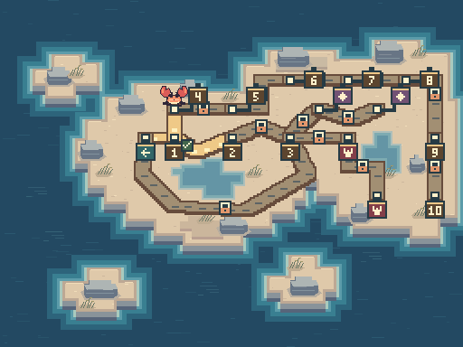
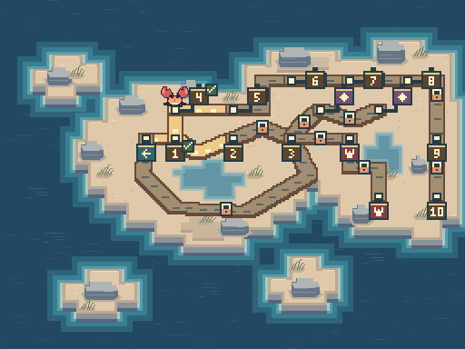
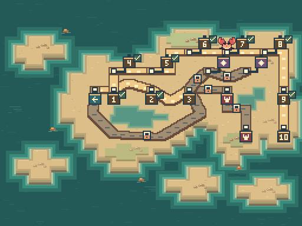
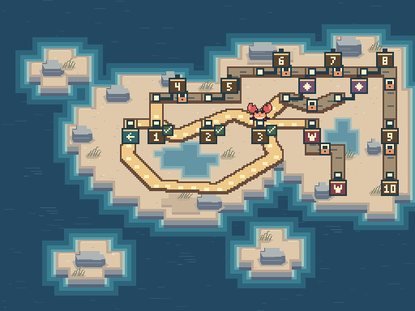
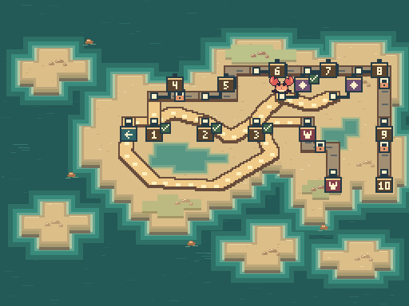

# 36 · Seletores da Enseada da Garça e das Ilhas à Deriva

**Proposta em revisão.** Enseada da Garça: costa de ardósia, canais frios, juncos e terraços de pedra. Ilhas à Deriva: águas de jade, bancos de areia com baixios mais quentes e barrancos baixos. Nos dois mapas, caminhos e marcadores ficam acima da arte e as ilhotas soltas não são lugares visitáveis.

---

<details open>
<summary>Quadros nativos sem cursor</summary>

O renderizador usa o estado da campanha. São quadros de 512 × 384, não capturas de navegador ou de aparelho.

| Estado | Enseada da Garça | Ilhas à Deriva |
| --- | --- | --- |
| Passagem bloqueada |  |  |
| Passagem aberta |  |  |
| Rota opcional |  |  |

</details>

---

<details>
<summary>Leitura das rotas</summary>

Cada seletor continua a usar **15 vértices e 15 ligações**. Números **1–10** marcam as travessias regulares; losangos, desvios; coroas, chefes; e a seta, o cais. Pedra e vegetação foram posicionadas fora das trilhas, sem sobrepor marcadores. Nos ramais norte, as placas ficam ao lado e acima da trilha para não tapar os cadeados horizontais. O caminho liberado está em areia clara; o bloqueado tem areia apagada e cadeado. O texto de direção continua descrevendo o destino e o requisito.

O Siri canônico e suas coordenadas não mudam. Os fundos não contêm caminhos, ícones ou personagens. Se a imagem estiver indisponível, o seletor anterior continua a mostrar as mesmas rotas e destinos.

</details>

---

<details>
<summary>Fonte e reprodução</summary>

[exportar.py](exportar.py) define as máscaras ortogonais de terra e água, faixas de luz e espuma, paletas e pequenos detalhes do cenário. Os pixels são RGB sólidos, desenhados na grade nativa. Aplique escala inteira e nearest-neighbor nas ampliações. A fonte gera o PNG em sua própria pasta; para reproduzir sem alterar o caderno (Python 3 e Pillow):

```sh
tmp="$(mktemp -d)"
cp docs/processo-de-criacao/36-seletores-enseada-deriva/exportar.py "$tmp/"
python3 "$tmp/exportar.py"
cmp "$tmp/enseada-512.png" assets/seletor-enseada-512.png
cmp "$tmp/deriva-512.png" assets/seletor-deriva-512.png
```

A pintura [dos seletores internos](../../../src/render/seletores-praia.ts) combina camadas do fundo, ligações da campanha e símbolos. Não muda as regras de movimento, os IDs e os requisitos do mapa, nem os tabuleiros das fases.

</details>

© 2026 Luigi Scofano de Araujo. Todos os direitos reservados.
