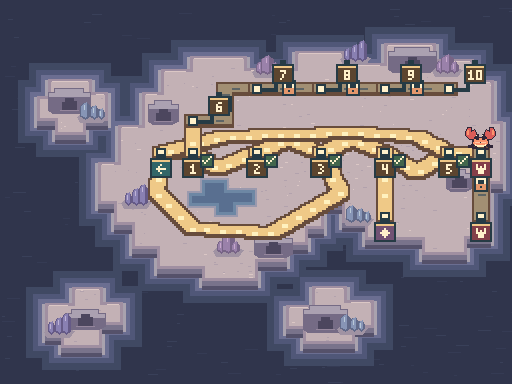
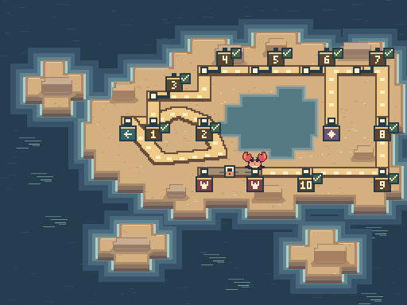
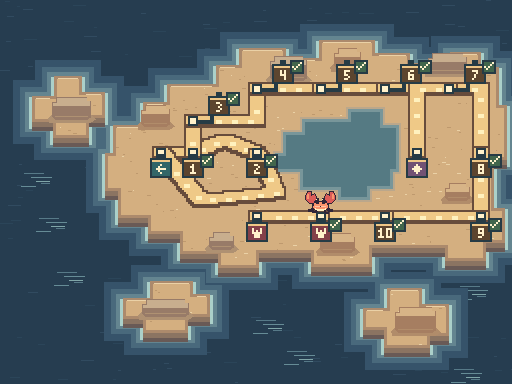
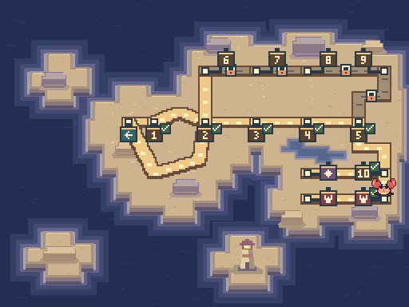

# 37 · Seletores das Grutas, da Baía e do Farol

**Propostas em revisão.** As Grutas da Espuma têm areais violetas, rochas minerais e águas escuras. A Baía da Ressaca tem bancos quentes e mar mais frio, com poucos traços de onda fora das rotas. O Arquipélago do Farol tem mar índigo, falésias discretas e o farol em uma ilhota cenográfica; não é um ponto navegável.

---

<details open>
<summary>Quadros nativos sem cursor</summary>

Os quadros de 512 × 384 são do renderizador com o estado real da campanha. Não são capturas de navegador ou de aparelho.

| Passagem | Antes da primeira arena | Depois da primeira arena |
| --- | --- | --- |
| Grutas: Sentinela → Cofre das Espumas |  |  |
| Baía: Vento Sul → Ressaca Alta |  |  |
| Farol: Guardião → Última Virada |  |  |

</details>

---

<details>
<summary>Como ler os mapas</summary>

- Cada mapa mantém 14 vértices, incluindo cais, 10 travessias regulares, um desvio em trio e duas arenas opcionais. As Grutas e o Farol têm 15 ligações; a Baía tem 14.
- Números indicam fases regulares, losangos indicam desvios, coroas indicam chefes e a seta indica o cais. Os cadeados destacam os bloqueios, com a explicação da condição disponível no controle de direção. Placas setentrionais ficam acima dos caminhos, a placa no extremo leste vira para dentro da moldura e as da parte sul do Farol ficam ao lado da trilha para não encobrir o percurso.
- Os PNGs não têm trilhas ou marcos embutidos. O jogo desenha por cima os vértices e as curvas já existentes e usa o mesmo recorte do Siri. Se o fundo não carregar, o mapa anterior mantém o jogo navegável.
- Navegação, requisitos, desbloqueios, desfecho e opção de rever os créditos seguem como antes. As arenas e os trios não são requisitos novos.

</details>

---

<details>
<summary>Fonte editável e reprodução</summary>

[exportar.py](exportar.py) registra paletas RGB, contornos ortogonais, camadas de margem e iluminação. Sem suavização: cada célula é um pixel opaco, com ampliação inteira nearest-neighbor. Para regenerar em uma pasta temporária com Python 3 e Pillow:

```sh
tmp="$(mktemp -d)"
cp docs/processo-de-criacao/37-seletores-mundos-finais/exportar.py "$tmp/"
python3 "$tmp/exportar.py"
for mundo in grutas ressaca farol; do
  cmp "$tmp/$mundo-512.png" "assets/seletor-$mundo-512.png"
done
```

As marcas usam o [renderizador de seletores internos](../../../src/render/seletores-praia.ts).

</details>

© 2026 Luigi Scofano de Araujo. Todos os direitos reservados.
