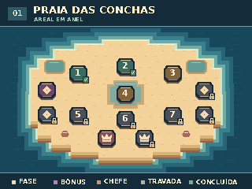
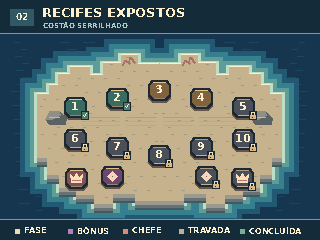
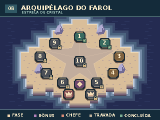

# 38 · Estudos do seletor direto de fases

[Processo de criação](../README.md) · [Campanha](../../campanha/README.md)

Proposta de seleção por clique, toque ou teclado dentro de cada mundo. O Arquipélago continua como seletor de mundos; os mapas internos caminháveis anteriores permanecem no acervo. As pranchas mostram o conceito e estados ilustrativos, não capturas do jogo nem a ordem de desbloqueio definitiva.

| Praia das Conchas | Recifes Expostos | Arquipélago do Farol |
| --- | --- | --- |
|  |  |  |

A proposta usa areia, pedra e água, sem árvores. Números mostram fases, losangos marcam bônus, coroas marcam chefes, e cadeados e sinais de visto distinguem bloqueio de conclusão. O clique direto substitui a caminhada entre fases; a aparência de uma placa não determina o desbloqueio. Nenhum elemento desta pasta entra no build.

[Prancha comparativa em 2×](seletores-diretos.png) · [Fonte editável](desenhar.py)

[V2 · oito seletores, referência oficial provisória](v2/README.md) · segunda rodada preservada sem substituir estes estudos.

[V3 · perspectiva elevada](v3/README.md) · estudo posterior em revisão, sem substituir a referência provisória.

## Reproduzir

Com Python 3 e Pillow, execute `python3 desenhar.py` numa cópia desta pasta. A fonte produz cada quadro nativo em 320 × 240, a ampliação em 3× e a prancha em 2× por vizinho mais próximo. Cada pixel do original é opaco e quadrado; não há filtros de suavização no resultado exportado. As prévias são autorais do projeto e não incorporam recursos do Miudezas.

**© 2026 Luigi Scofano de Araujo. Todos os direitos reservados.**
