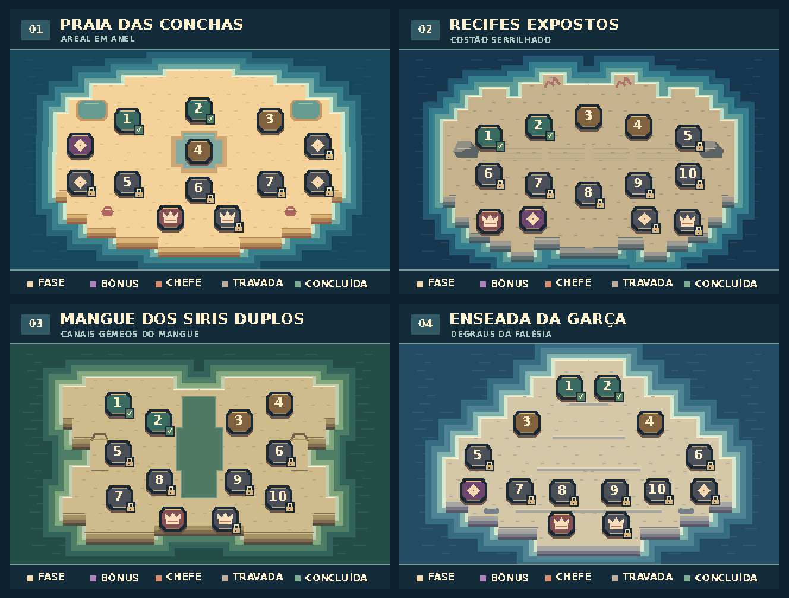
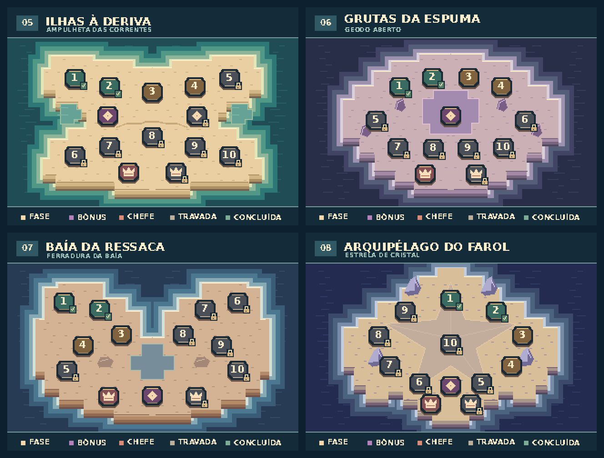

# Seletores diretos | Referência visual V2

Dentro de cada mundo, a seleção é por botões, não por trilhas: estas são pranchas estáticas de aprovação. Os estados ilustrados são exemplos, não progresso de uma partida. Para cada mundo: `-1x.png` na grade RGB nativa de 320 × 240, `-3x.png` com ampliação inteira e `-fundo.png` sem marcadores. `layout.json` contém pontos de ancoragem por categoria; números de exemplo seguem a ordem da campanha. Ao implementar, ligar cada ponto ao ID da fase correspondente e usar o estado real do jogo.

As silhuetas são o areal em anel, o costão serrilhado, os canais gêmeos, os degraus da falésia, a ampulheta das correntes, o geodo, a ferradura da baía e a estrela de cristal. Sem árvores, caminhos ou personagem sobre os botões. 

Para reproduzir: `python3 desenhar.py`, com Pillow e DejaVu Sans Bold disponíveis. A fonte do texto vira máscara de 1 bit; blocos de luz e sombra são cores opacas na grade. As duas folhas de aprovação são compostas de quatro quadros nativos cada e exportadas a 2× com nearest-neighbor.

Luigi aprovou estas pranchas como referência oficial provisória na chamada de 21/11/2026. A aprovação é visual; as imagens não são telas do jogo. O próximo estudo explora vista oblíqua, volumes e silhuetas mais distintas, sem substituir a V2 no histórico.

| Praia a Enseada | Deriva ao Farol |
| --- | --- |
|  |  |

**© 2026 Luigi Scofano de Araujo. Todos os direitos reservados.**
