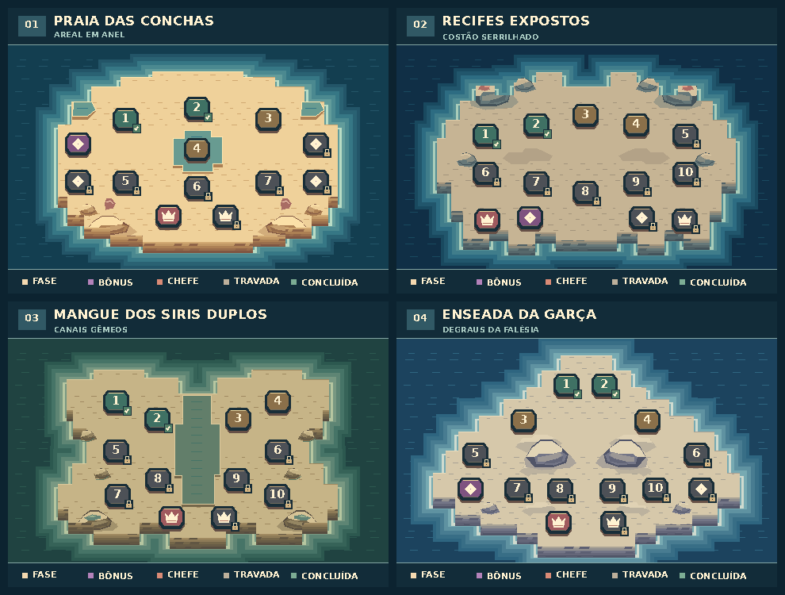
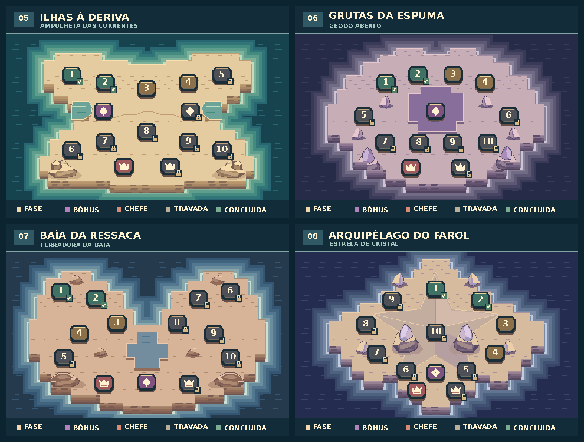

# Seletores diretos | V3

Prévias estáticas, sem integração ao jogo. Grade nativa **480 × 360 pixels**, vista oblíqua leve com predominância do plano superior, recortes costeiros ortogonais, faces de pedra e areia ao sul, espuma em faixas e luz comum de cima à esquerda. A estrela do Farol conserva seu lugar; nenhuma tela usa árvores ou caminhos de navegação.

- `seletores-v3-1.png` e `seletores-v3-2.png`: pranchas de quatro mundos em escala nativa.
- `<mundo>-1x.png` e `<mundo>-2x.png`: telas demonstrativas; os estados de fase são exemplos.
- `<mundo>-fundo.png`: fundo sem botões e sem estado de progresso.
- `layout.json`: centros dos botões na grade V3, agrupados em regular, bônus e chefes. `layout-v2.json` registra as âncoras de origem; a ordem e os totais são preservados.
- `desenhar.py`: fonte primária, incluindo contornos, paletas e detalhes; regenere com Python 3 e Pillow. A fonte tipográfica vira máscara binária antes da aplicação.

As camadas são blocos RGB opacos. A única variação de escala é a exportação inteira 2× com nearest-neighbor.

Estas pranchas foram enviadas para revisão. A V2 permanece a referência oficial provisória. A V3 não foi aplicada ao jogo.

| Praia a Enseada | Deriva ao Farol |
| --- | --- |
|  |  |

**© 2026 Luigi Scofano de Araujo. Todos os direitos reservados.**
