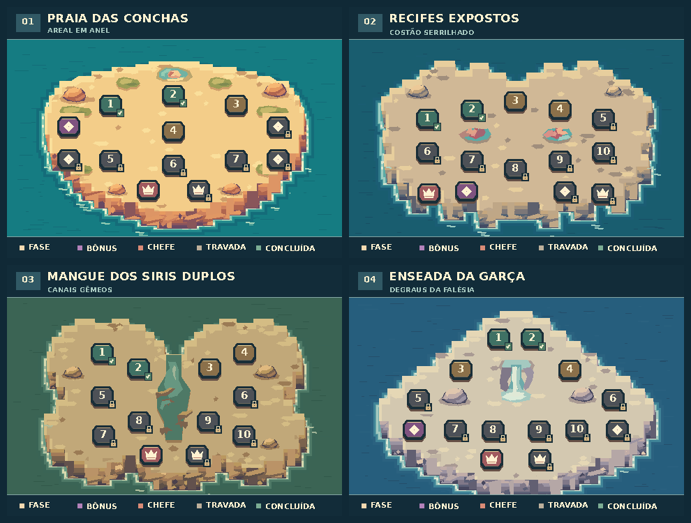
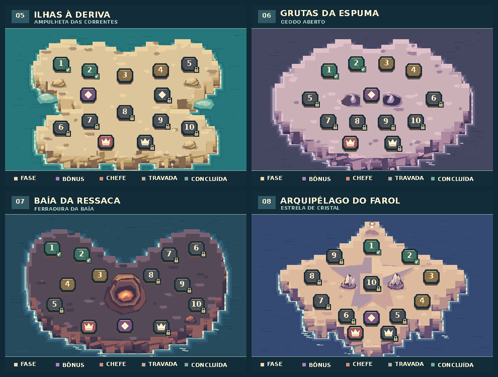

# V5 · Relevo e orla detalhados

Aprofunda a V4, com mais acabamento na costa, na espuma, nos rochedos e nos marcos, sem mover os botões nem descaracterizar as ilhas. É uma prévia em revisão; não foi aplicada ao jogo.

| Praia à Enseada | Deriva ao Farol |
| --- | --- |
|  |  |

## Fontes e reprodução

Este estudo gera os oito quadros RGB de 480 × 360, as versões ampliadas por vizinho mais próximo e os fundos sem botões. Instale Python 3 e Pillow e rode `python3 desenhar.py` numa cópia da pasta. As posições são de apresentação, não estados da campanha. [desenhar.py](./desenhar.py) · [detalhes.py](./detalhes.py) · [interface.py](./interface.py) · [layout-v2.json](./layout-v2.json) · [layout.json](./layout.json).

A arte permanece fora do build. As regras, a Travessia e o seletor de mundos do Arquipélago não fazem parte deste estudo.

**© 2026 Luigi Scofano de Araujo. Todos os direitos reservados.**
