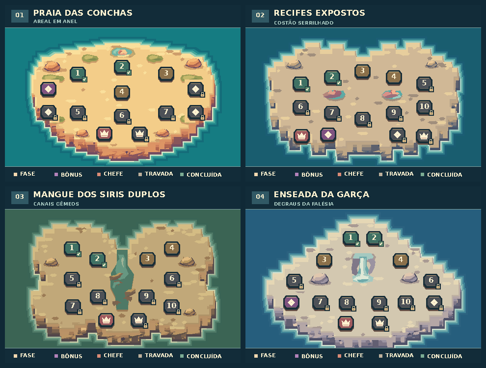
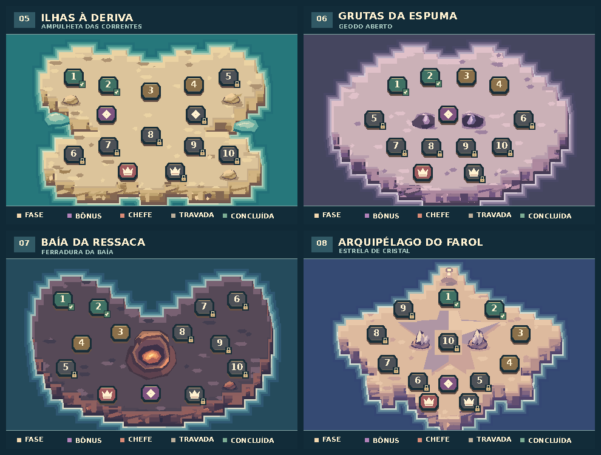

# Seletores diretos | V5

Prévias estáticas de oito mundos. V5 preserva as silhuetas, o diorama, a grade nativa de 480 × 360 e os botões da V4. A diferença está nas camadas: facetas e cortes nos penhascos, espuma em pequenos degraus e novos planos sólidos de sombra e luz nos marcos. Sem árvores, caminhos ou personagem. Estados ilustrados são exemplos, sem alterações no jogo.

- `seletores-v5-1.png` / `seletores-v5-2.png`: pranchas de quatro mundos.
- `<mundo>-1x.png` / `<mundo>-2x.png`: telas em escala inteira, nearest-neighbor.
- `<mundo>-fundo.png`: fundo nativo sem botões.
- `layout.json`: âncoras na grade nativa, preservadas da V4.
- `desenhar.py`, `detalhes.py`, `interface.py` e `layout-v2.json`: fontes. Rode `python3 desenhar.py` com Pillow e DejaVu Sans Bold.

As camadas são máscaras binárias em cores RGB opacas. Rochas cenográficas não atravessam as reservas para os marcadores. Nenhuma suavização é aplicada.

### Acabamento V6
A orla parte do mesmo pé sólido da falésia: as faixas rasas abraçam a
rocha e as cristas quebradas continuam presas à zona de contato. Degraus
de cor definem os planos contra a luz superior esquerda. Cristais e
cratera ganham facetas locais, sem ampliar a área ocupada pelos marcos.
Os oito tabuleiros, a legenda e os estados de exemplo são os da V5;
não existem mudanças nas fases. Execute `python3 desenhar.py` para
gerar as duas pranchas, os fundos e cada versão nativa/ampliada.

| Praia à Enseada | Deriva ao Farol |
| --- | --- |
|  |  |

As pranchas são estudos, separados do jogo e da Travessia.

**© 2026 Luigi Scofano de Araujo. Todos os direitos reservados.**
