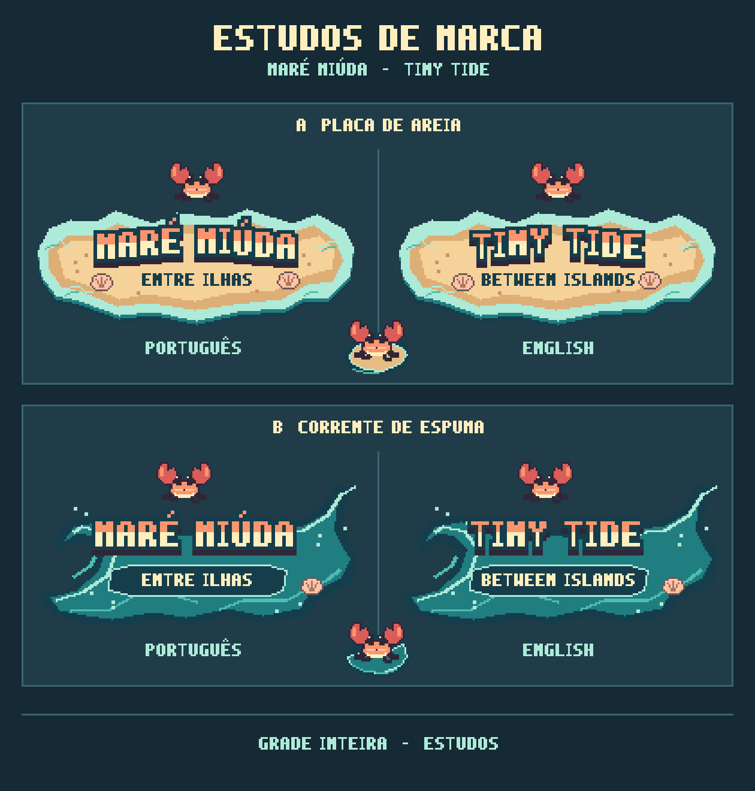

# 01 · Placa de Areia e Corrente de Espuma

Estudos de marca para **Maré Miúda: Entre Ilhas / Tiny Tide: Between Islands**. Nenhuma direção foi aprovada. Os arquivos não são usados no jogo. Esta pasta é registro do processo e deve permanecer mesmo após a escolha final.

---

Direções visuais

- **A · Placa de areia:** o baixio dá suporte à tipografia, com borda de água e duas conchas. O título tem um arco discreto.
- **B · Corrente de espuma:** a crista da onda enquadra o conjunto. O subtítulo repousa numa faixa escura.
- **Compactas:** o siri funciona como emblema sem texto. Areia e água distinguem as respectivas variantes, sem precisar traduzir o ícone.

Os títulos nas duas direções usam blocos coral e creme, com acentos rasterizados na versão em português. Símbolos, máscaras das letras e paleta são autorais deste estudo.

---

Fonte, exports e verificação

- `desenhar.py`: fonte editável com máscaras de letras e desenho em coordenadas inteiras. Os comentários explicam as decisões de grade.
- `renders/`: PNGs de 180 × 94 na escala lógica (1×) e 720 × 376 (4×), emblemas de 40 × 32 e prancha de 1260 × 1320.
- Verificação: nenhuma amostra tem alfa intermediário; a ida e volta à resolução lógica conserva exatamente os PNGs individuais. As imagens não usam suavização, gradientes nem fontes externas.

Com Python e Pillow 13, execute `python desenhar.py`. Todos os PNGs ficam em `renders/` por padrão, ou em outra pasta passável como argumento.

© 2026 Luigi Scofano de Araujo. Todos os direitos reservados.
