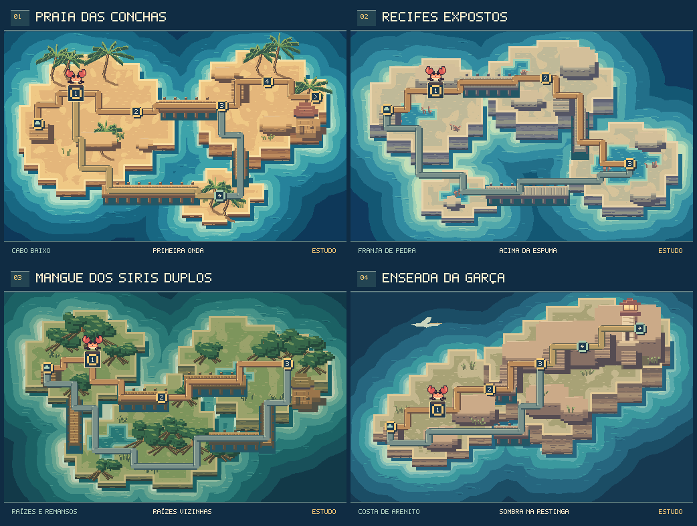
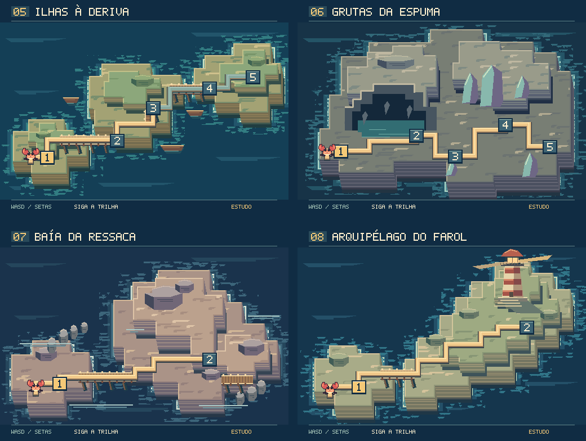
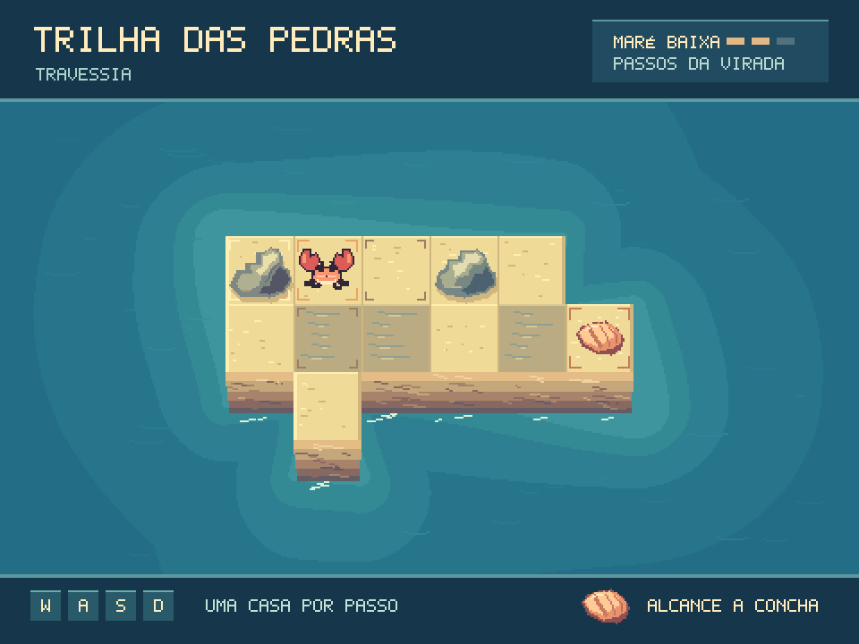
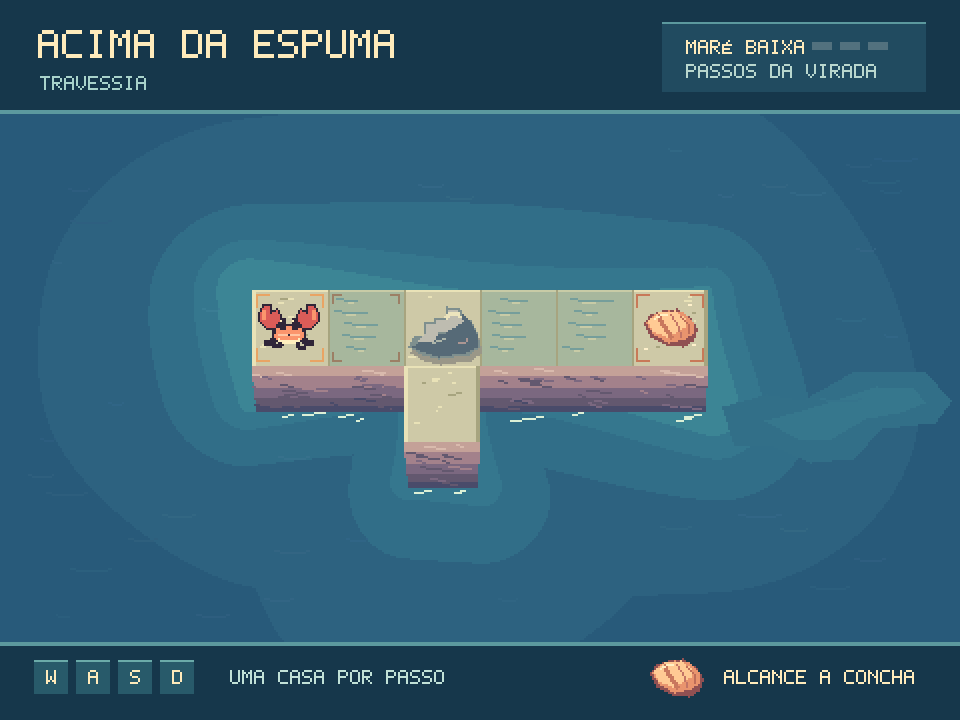

# Seletores V6 e Travessias V7

Estudos estáticos do processo de criação de **Maré Miúda: Entre Ilhas**. Não são capturas jogáveis. Esta rodada não substitui nem apaga os estudos anteriores e não altera a logo, o Arquipélago, o jogo ou o Miudezas.

---

<details>
<summary>Seletores V6 · Oito mundos</summary>

Os seletores usam uma grade de 512 × 384 pixels, conexões ortogonais entre pontos e relevo, materiais e iluminação próprios para cada mundo.





[Fontes e PNGs dos mundos 1 a 4](seletores-1-a-4/) · [Fontes e PNGs dos mundos 5 a 8](seletores-5-a-8/)

</details>

---

<details>
<summary>Travessias V7 · Praia e Recifes</summary>

A praia e os recifes usam uma grade de 480 × 360 pixels. A água tem menos contraste para deixar a rota e o objetivo em primeiro plano.





[Fontes e PNGs das duas Travessias](travessias/)

</details>

---

<details>
<summary>Como reproduzir</summary>

O mesmo siri de 31 × 23 pixels, derivado da logo e já usado na Placa de Areia, aparece nos dez estudos sem recoloração ou redimensionamento. Os PNGs nativos e as prévias em escala inteira são gerados pelas fontes de cada pasta. O pacote inclui a fonte de letras em pixels e a cópia do sprite usada em cada gerador.

```sh
python -m pip install -r requirements.txt
python seletores-1-a-4/desenhar.py
python seletores-5-a-8/desenhar.py
python travessias/desenhar.py
```

</details>

© 2026 Luigi Scofano de Araujo. Todos os direitos reservados.
