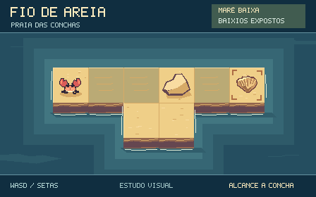
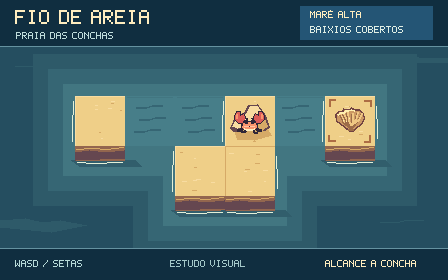
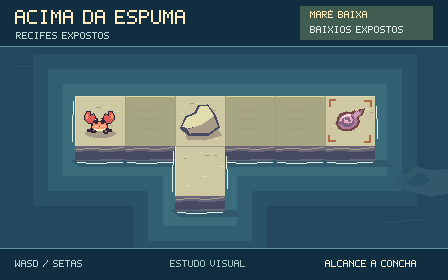
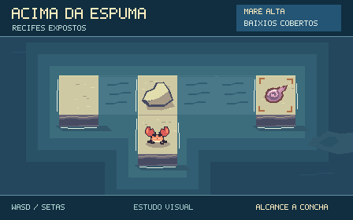
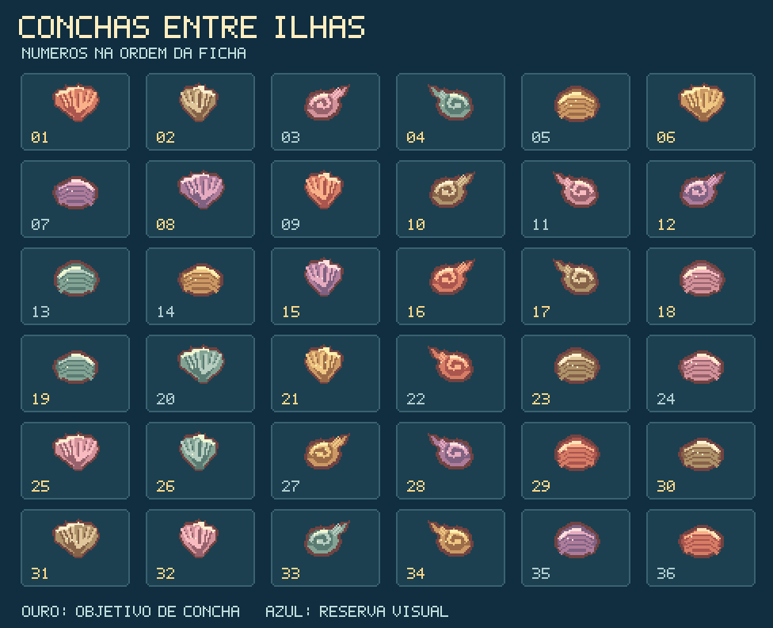

# Travessias V8: maré alta e baixa

Estudos estáticos de **Maré Miúda: Entre Ilhas**, baseados no layout das duas fases. Cada par mantém a mesma projeção e o mesmo terreno para mostrar o que muda quando a água sobe. Não são capturas jogáveis e não alteram código de jogo, regras, fases, logo ou Miudezas. As rodadas anteriores continuam no [README do projeto](../../../../README.md).

## Fio de Areia · Praia das Conchas

| Maré baixa · baixios expostos | Maré alta · baixios cobertos |
| --- | --- |
|  |  |

## Acima da Espuma · Recifes Expostos

| Maré baixa · baixios expostos | Maré alta · baixios cobertos |
| --- | --- |
|  |  |

As quatro imagens estão no tamanho nativo de 448 × 280 pixels. Para ampliar, use escala inteira e vizinho mais próximo. O siri usa o [sprite da logo](siri-da-logo.png) sem recoloração nem redimensionamento.

## Catálogo de conchas



São 36 propostas visuais, uma por fase na [ficha na ordem da numeração do catálogo](conchas-por-fase.json). As 23 marcadas como `concha` correspondem a fases com esse objetivo. As 13 marcadas como `reserva` são alternativas gráficas para fases com outros objetivos; não adicionam conchas a essas fases.

## Reproduzir

Com Python 3, copie este diretório para um local gravável. Nele, execute:

```sh
python -m pip install -r requirements.txt
python desenhar.py
python catalogo.py
```

[desenhar.py](desenhar.py) e [letras.py](letras.py) geram os quatro quadros e duas pranchas pareadas em escala 2×. [catalogo.py](catalogo.py) gera o catálogo, os 36 sprites individuais em `siris-conchas/` e a ficha de variantes a partir de [fases.json](fases.json). As pranchas pareadas e os sprites individuais podem ser regenerados e não são versionados aqui.
