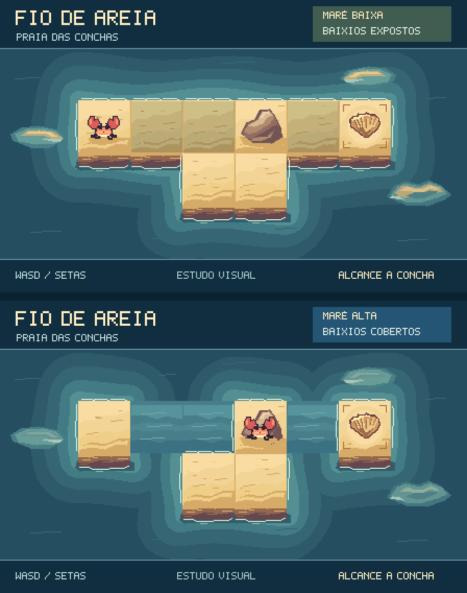
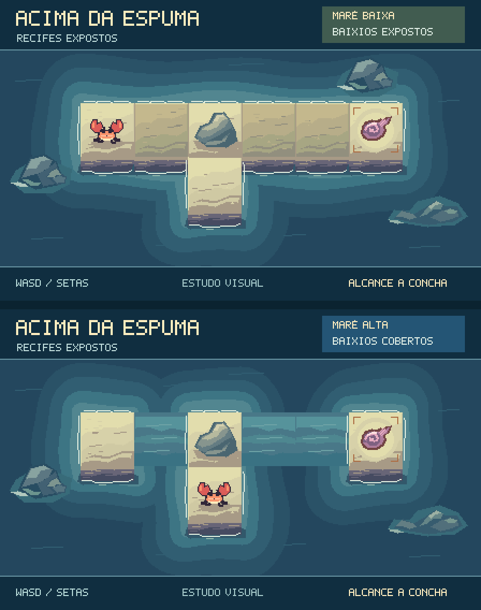

# Travessias V9: água, margens e relevo

Estudo visual estático de **Maré Miúda: Entre Ilhas**. A rodada refina a leitura da água, das margens e do relevo nos dois estados de maré sem alterar o layout das fases. Mantém a malha de 50 × 50 pixels, o [siri original de 31 × 23 pixels](siri-da-logo.png) sem redimensionar ou recolorir e as mesmas conchas da [V8](../21-travessias-v8/README.md).

<details>
<summary>Fio de Areia · Praia das Conchas</summary>



Quadros nativos: [maré baixa](travessia-v9-praia-das-conchas-baixa-1x.png) · [maré alta](travessia-v9-praia-das-conchas-alta-1x.png)

</details>

<details>
<summary>Acima da Espuma · Recifes Expostos</summary>



Quadros nativos: [maré baixa](travessia-v9-recifes-expostos-baixa-1x.png) · [maré alta](travessia-v9-recifes-expostos-alta-1x.png)

</details>

## Fontes e reprodução

Os quadros nativos têm 448 × 280 pixels. Cada prancha reúne os dois estados e amplia o conjunto em 2× com vizinho mais próximo, sem suavizar os pixels.

Em uma cópia gravável deste diretório, execute com Python 3:

```sh
python -m pip install -r requirements.txt
python desenhar.py
```

[desenhar.py](desenhar.py) gera os seis PNGs com a tipografia de [letras.py](letras.py) e o sprite original. As prévias não são jogáveis e não modificam o jogo, suas regras ou o Miudezas.
