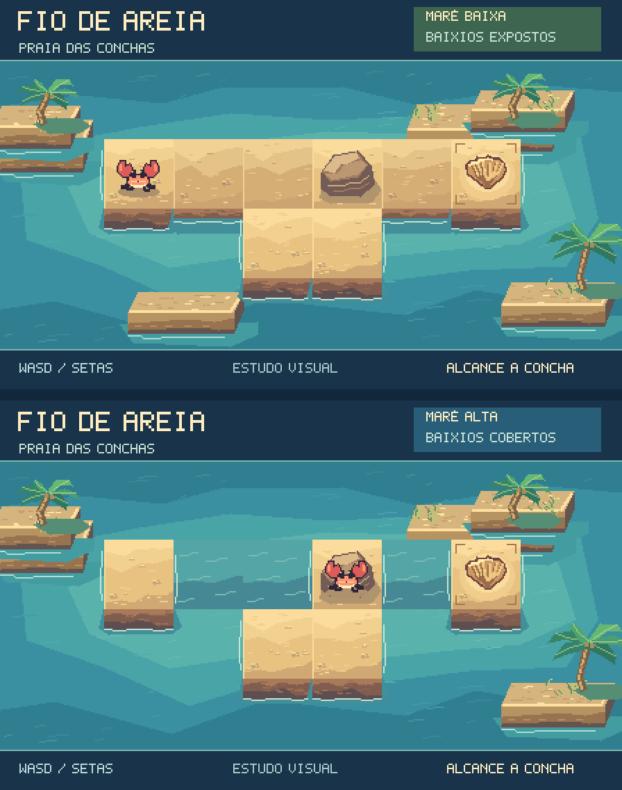
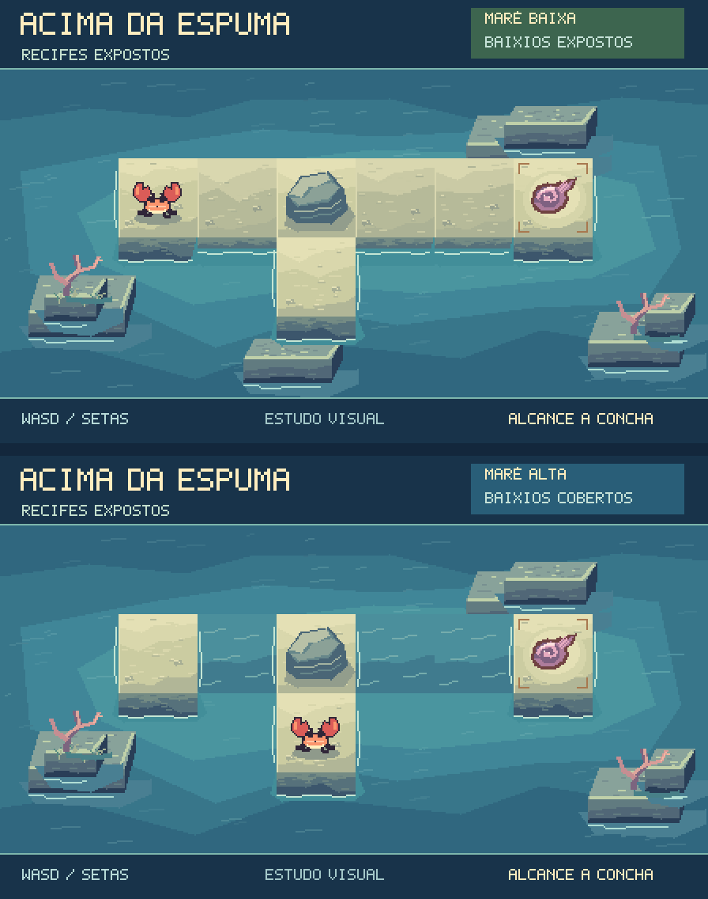

# Travessias V10: novos litorais

A V10 é um estudo visual de **Maré Miúda: Entre Ilhas**. Em Fio de Areia, as margens ganham terraços em degraus e palmeiras. Em Acima da Espuma, o recife exposto e os corais distinguem o litoral rochoso. As faixas do oceano acompanham o contorno do terreno. A [V9](../22-travessias-v9/README.md) permanece no histórico para comparação.

<details>
<summary>Fio de Areia · Praia das Conchas</summary>



Quadros nativos: [maré baixa](travessia-v10-praia-das-conchas-baixa-1x.png) · [maré alta](travessia-v10-praia-das-conchas-alta-1x.png)

</details>

<details>
<summary>Acima da Espuma · Recifes Expostos</summary>



Quadros nativos: [maré baixa](travessia-v10-recifes-expostos-baixa-1x.png) · [maré alta](travessia-v10-recifes-expostos-alta-1x.png)

</details>

## Fontes e reprodução

Cada quadro mede 448 × 280 pixels, com células de 50 × 50. O layout, o [sprite do siri de 31 × 23](siri-da-logo.png) e as conchas são os mesmos da V9. As pranchas ampliam os quadros em 2× com vizinho mais próximo.

Com Python 3, execute em uma cópia gravável desta pasta:

```sh
python -m pip install -r requirements.txt
python desenho.py
```

[desenho.py](desenho.py) gera os seis PNGs com a tipografia de [letras.py](letras.py). São estudos estáticos, sem integração ao jogo e sem alterações nas regras ou no Miudezas.
