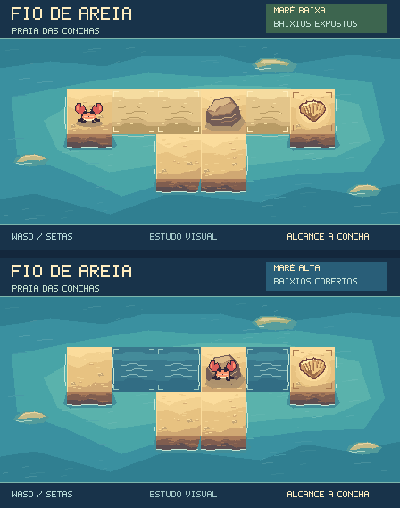
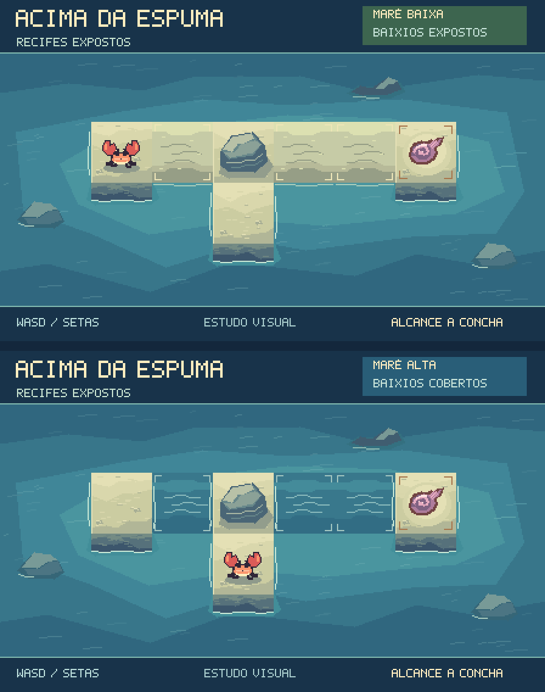

# Travessias V11: células e baixios legíveis

Na V11, as células submersas e expostas têm tratamentos distintos. Marcas discretas nos cantos mostram onde cada célula começa e termina, até sob a água. Bancos de areia e rochas foram simplificados e espaçados para revelar as rotas sem sobrepor elementos. Os estudos da [V10](../23-travessias-v10/README.md) continuam disponíveis.

<details>
<summary>Fio de Areia · Praia das Conchas</summary>



Quadros nativos: [maré baixa](travessia-v11-praia-das-conchas-baixa-1x.png) · [maré alta](travessia-v11-praia-das-conchas-alta-1x.png)

</details>

<details>
<summary>Acima da Espuma · Recifes Expostos</summary>



Quadros nativos: [maré baixa](travessia-v11-recifes-expostos-baixa-1x.png) · [maré alta](travessia-v11-recifes-expostos-alta-1x.png)

</details>

## Fontes e reprodução

Cada quadro mede 448 × 280 pixels e usa células de 50 × 50. A V11 preserva os layouts, as conchas e o [sprite original do siri de 31 × 23 pixels](siri-da-logo.png). As pranchas usam ampliação inteira de 2× com vizinho mais próximo.

Com Python 3, execute em uma cópia gravável desta pasta:

```sh
python -m pip install -r requirements.txt
python desenho.py
```

[desenho.py](desenho.py), [letras.py](letras.py) e o sprite do siri são as fontes dos seis PNGs. A V11 é um estudo estático, sem mudanças no jogo, nas regras ou no Miudezas.
