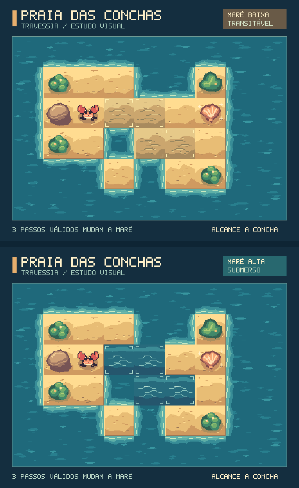
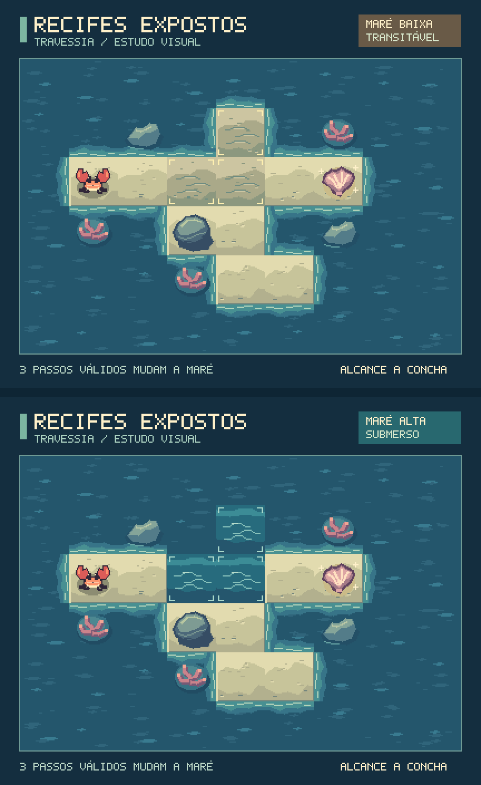
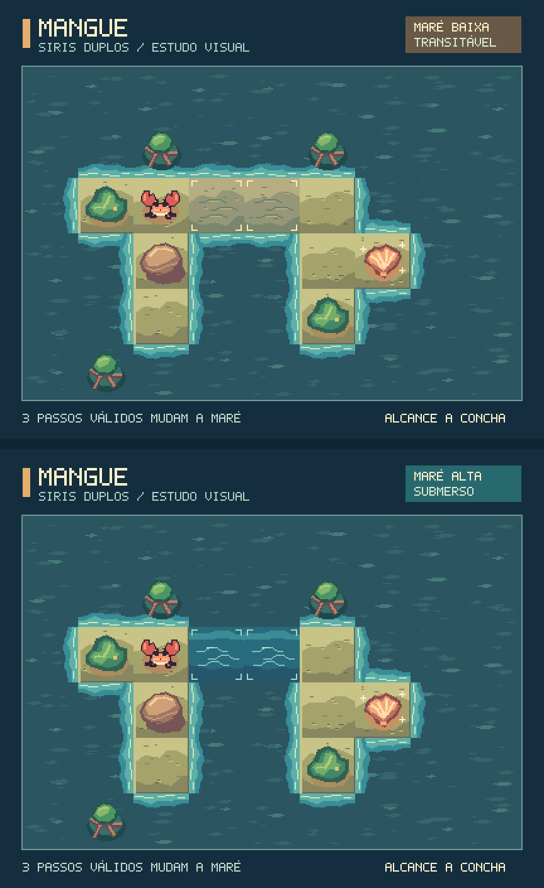
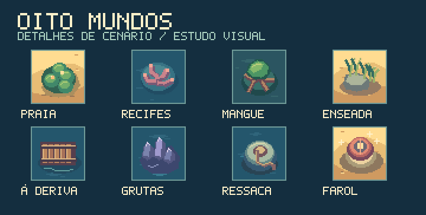

# Travessias V12: proposta zenital

A V12 recomeça a direção visual com tabuleiros vistos de cima, sem usar a V11 como base de desenho. Praia das Conchas, Recifes Expostos e Mangue dos Siris Duplos têm tabuleiros de demonstração distintos. As prévias comparam a maré baixa e a maré alta. É uma proposta conceitual, ainda não aprovada nem integrada ao jogo.

A [V11](../24-travessias-v11/README.md) e as rodadas anteriores permanecem como histórico.

<details>
<summary>Praia das Conchas</summary>



Quadros nativos: [maré baixa](praia-mare-baixa-1x.png) · [maré alta](praia-mare-alta-1x.png)

</details>

<details>
<summary>Recifes Expostos</summary>



Quadros nativos: [maré baixa](recifes-mare-baixa-1x.png) · [maré alta](recifes-mare-alta-1x.png)

</details>

<details>
<summary>Mangue dos Siris Duplos</summary>



Quadros nativos: [maré baixa](mangue-mare-baixa-1x.png) · [maré alta](mangue-mare-alta-1x.png)

</details>

<details>
<summary>Atlas · oito motivos dos mundos</summary>



[Atlas nativo](motivos-dos-mundos-1x.png)

</details>

## Fontes e reprodução

Os seis quadros nativos medem 432 × 348 pixels e usam células de 44 × 44 pixels. Cada prancha pareada mede 864 × 1408 após ampliação de 2× com vizinho mais próximo.

Em uma cópia gravável desta pasta, execute com Python 3:

```sh
python -m pip install -r requirements.txt
python carta.py
python validar.py
```

[carta.py](carta.py) gera os quadros, as pranchas e o atlas em duas escalas, usando [letras.py](letras.py) e o [sprite original do siri](siri-da-logo.png).

A [busca em largura](validar.py) verifica a existência de caminho apenas nos três tabuleiros e no modelo simplificado desta proposta. Não valida o motor, a campanha ou o jogo completo. Este registro não altera regras, fases jogáveis ou o Miudezas.
