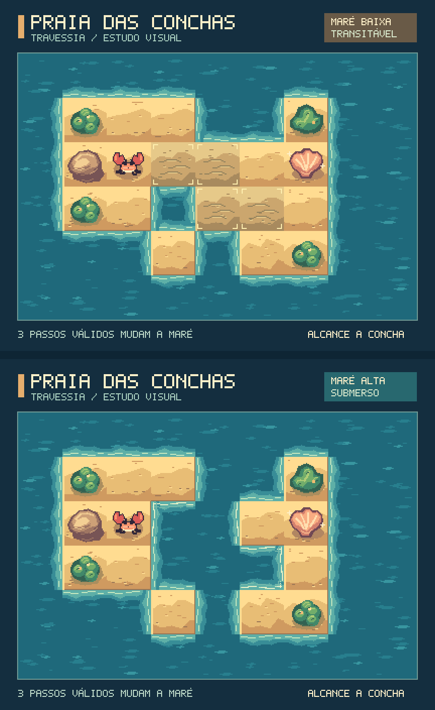
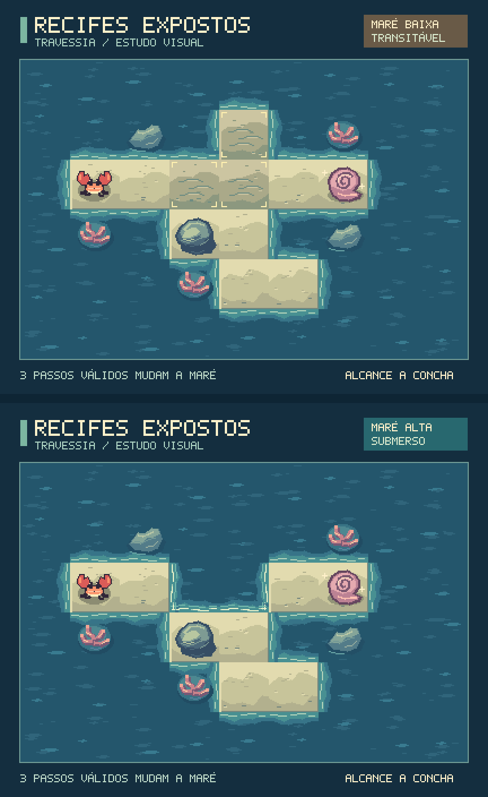
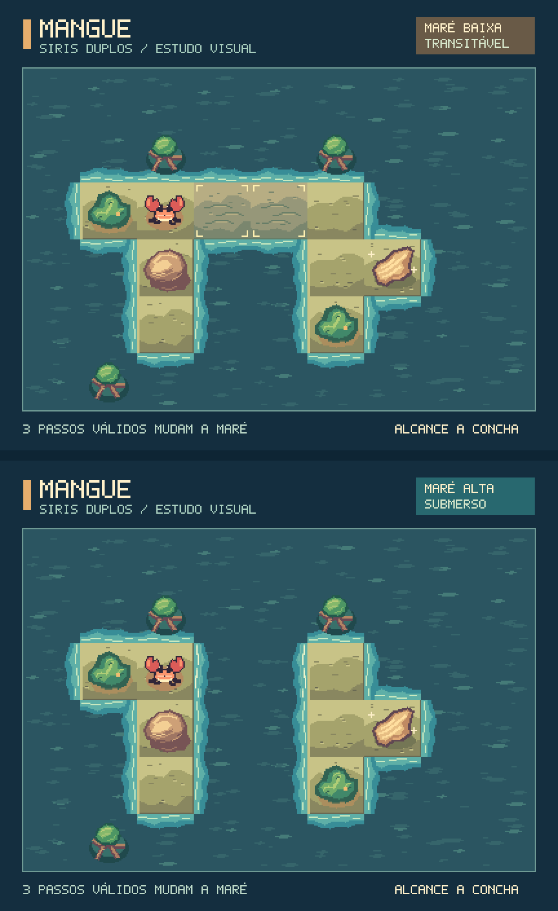
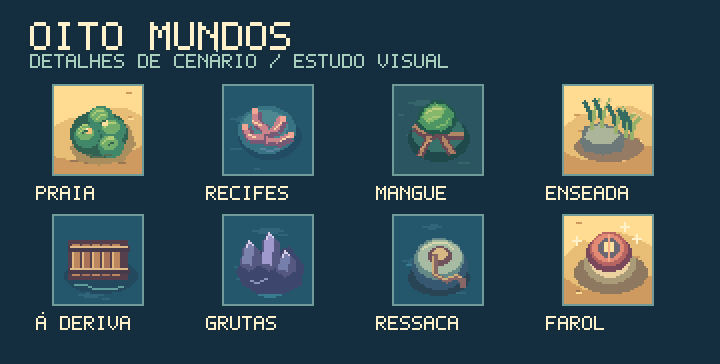

# Travessias V13: oceano preservado, margens mais claras

A água aberta da [V12](../25-travessias-v12-zenital/README.md), aprovada visualmente, foi preservada pixel por pixel nesta rodada. Na maré alta, os interiores alagados usam o mesmo desenho de oceano, com diferença na transição apenas onde a água encontra areia firme. Rochas, vegetação e corais foram retrabalhados. Cada cenário tem uma silhueta própria de concha.

A aprovação se refere à aparência do oceano, não aos outros elementos ou à integração das pranchas ao jogo.

<details>
<summary>Praia das Conchas</summary>



Quadros nativos: [maré baixa](praia-mare-baixa-1x.png) · [maré alta](praia-mare-alta-1x.png)

</details>

<details>
<summary>Recifes Expostos</summary>



Quadros nativos: [maré baixa](recifes-mare-baixa-1x.png) · [maré alta](recifes-mare-alta-1x.png)

</details>

<details>
<summary>Mangue dos Siris Duplos</summary>



Quadros nativos: [maré baixa](mangue-mare-baixa-1x.png) · [maré alta](mangue-mare-alta-1x.png)

</details>

<details>
<summary>Atlas · oito motivos dos mundos</summary>



[Atlas nativo](motivos-dos-mundos-1x.png)

</details>

## Fontes e reprodução

Os seis quadros medem 432 × 348 pixels, com células de 44 × 44. As pranchas têm 864 × 1408, com ampliação inteira por vizinho mais próximo. Os layouts e o [sprite original do siri](siri-da-logo.png) continuam iguais aos da V12.

Em uma cópia gravável desta pasta, execute com Python 3:

```sh
python -m pip install -r requirements.txt
python carta.py
```

[carta.py](carta.py) e [letras.py](letras.py) geram os seis quadros, as três pranchas e o atlas nas duas escalas. A V13 é um estudo visual; não altera o jogo, as regras, as fases jogáveis ou o Miudezas.
