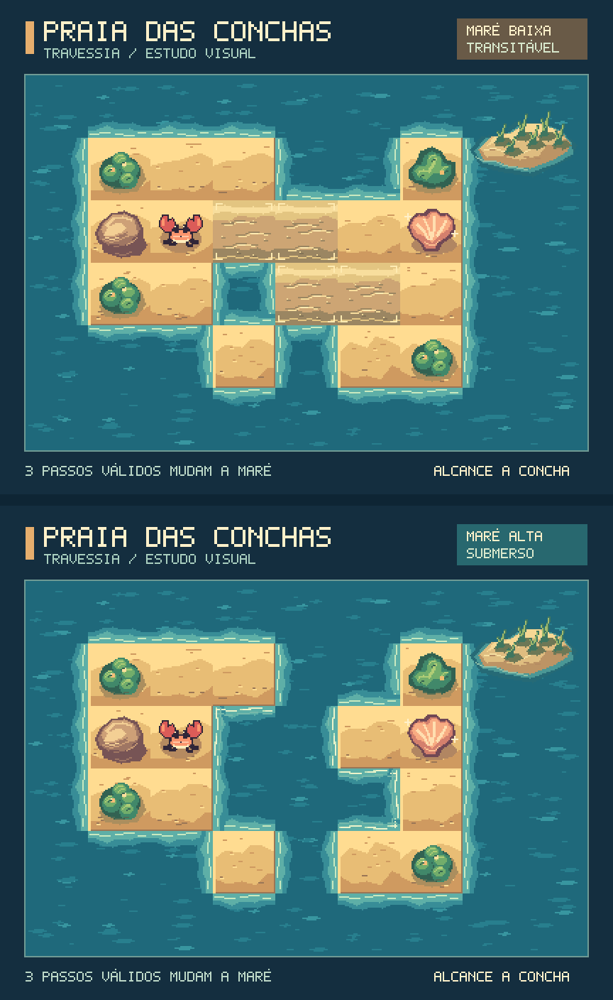
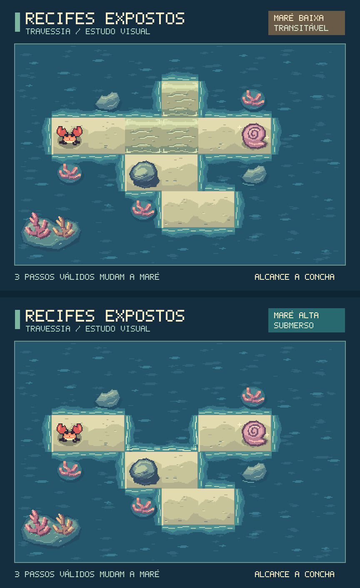
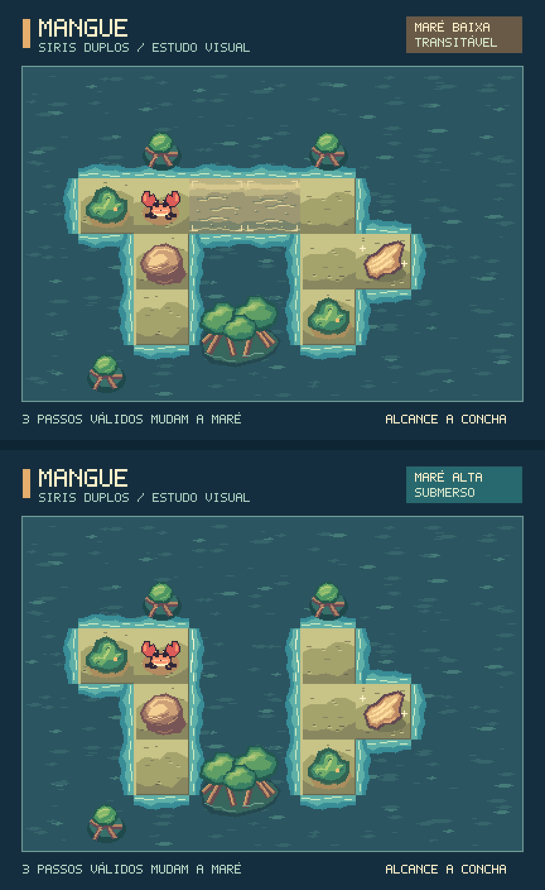

# Travessias V14: estruturas em várias células e areia molhada

A V14 expande os elementos decorativos da [V13](../26-travessias-v13/README.md): dunas costeiras na Praia das Conchas, uma plataforma de coral nos Recifes Expostos e raízes no Mangue dos Siris Duplos. Cada estrutura ocupa um suporte de 2 × 2 células de água aberta decorativa, sem avançar sobre células jogáveis ou a concha. Na maré baixa, só os baixios expostos ganham camadas de areia molhada e reflexos. Na maré alta, a água é a mesma da V13 fora dos novos suportes.

<details>
<summary>Praia das Conchas</summary>



Quadros nativos: [maré baixa](praia-mare-baixa-1x.png) · [maré alta](praia-mare-alta-1x.png)

</details>

<details>
<summary>Recifes Expostos</summary>



Quadros nativos: [maré baixa](recifes-mare-baixa-1x.png) · [maré alta](recifes-mare-alta-1x.png)

</details>

<details>
<summary>Mangue dos Siris Duplos</summary>



Quadros nativos: [maré baixa](mangue-mare-baixa-1x.png) · [maré alta](mangue-mare-alta-1x.png)

</details>

O [atlas de oito motivos](../26-travessias-v13/motivos-dos-mundos.png) não mudou e permanece arquivado na V13, também em [escala nativa](../26-travessias-v13/motivos-dos-mundos-1x.png).

## Fontes e reprodução

Os quadros têm 432 × 348 pixels, com células de 44 × 44. As pranchas pareadas têm 864 × 1408, com ampliação inteira de 2× por vizinho mais próximo. Os layouts, as conchas e o [sprite original do siri](siri-da-logo.png) foram preservados.

Em uma cópia gravável desta pasta, execute com Python 3:

```sh
python -m pip install -r requirements.txt
python carta.py
```

[carta.py](carta.py) gera as pranchas e o atlas com [estruturas.py](estruturas.py), [letras.py](letras.py) e o sprite do siri. A V14 é um estudo visual. Não altera motor, regras, fases jogáveis ou Miudezas.
